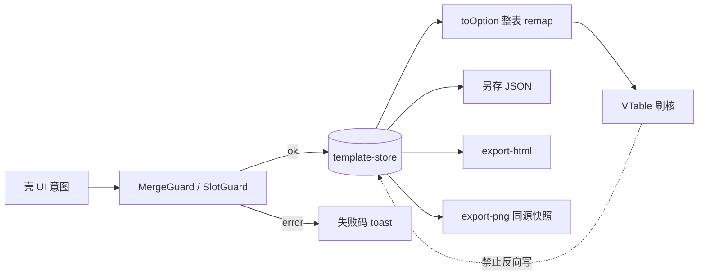

# Fill 难度应对 · 适配存储与设定

> 架构师 · 2026-10-20（Asia/Shanghai）  
> 状态：**用户已认可 · 文档收口 · 仍不开码**  
> **难点化解已锁 A**（用户 2026-10-20）：**Store 单写 + 整表 remap**；路线 B 后置；路线 C 否决  
> 对齐：Fill 已锁 · **不改** [ADR-001](../07-decisions/ADR-001-主核与壳核分层.md) · **不扩** OUT/IN · **不改**已锁 U-\*  
> 对照：[开发约定-壳核与导出.md](开发约定-壳核与导出.md) §1.4 · [设计方案.md](设计方案.md) · [research/VTable能力可行性-编辑合并增删-2026-10-20.md](../research/VTable能力可行性-编辑合并增删-2026-10-20.md) · [research/表格富编辑-能力清单与范围包.md](../research/表格富编辑-能力清单与范围包.md)

---

## 1. 问题与目标

### 1.1 三条主难

| # | 难点 | 风险表现 |
|---|------|----------|
| **D1** | 壳 store ↔ 适配层 ↔ VTable **有限合并/拆分单源** | 双写导致预览 / 另存 / 导出三处不一致；半更新核后无法回滚 |
| **D2** | 导出 HTML/PNG **同源** | Canvas 预览与 HTML rowspan/colspan、空槽、主题 token 观感分叉 |
| **D3** | 槽位 DnD **与合并态并存** | 落点与 merges 冲突时写坏 JSON；误把核原生 DnD 当真相 |

### 1.2 目标（可判定）

1. **三处一致**：编辑台预览、另存本机模板、导出 HTML/PNG 均只读 **同一** `TemplateInstance`（store 快照）。  
2. **越界失败可读**：超 `allowedMerges`、拆 `structuralMerges`、DnD 冲突 → 失败码 + toast；**store 不变、核不半更新**。  
3. **不滑向 Excel/画布**：仍限 Fill；任意合并 / 增删行列 / 自由画布保持 OUT。

### 1.3 已锁化解路线 A（摘要）

| 路线 | 内容 | 处置 |
|------|------|------|
| **A（已锁）** | Store 为唯一可变真相；编辑意图经验证后写 store；`toOption(store)` **整表 remap** 再刷核；导出只读 store | **本期采用** |
| **B（后置）** | 增量 patch option / 局部 cells 更新，减少整表刷 | 性能未成瓶颈前不做；若做须另开契约，不得双写 |
| **C（否决）** | 以 VTable records / 内部 merge 态为真相，反向同步回 JSON | **否决**（与 ADR「核只渲染」冲突，必出双源） |

---

## 2. 系统架构（设定）

### 2.1 壳 / 核分层（复述 ADR-001，不改结论）

| 层 | 持有 | 禁止 |
|----|------|------|
| **壳** | 模板库、属性面板、有限合并/拆分/对齐/强调 UI、slot-dnd、导出编排 | 直接改 VTable option；自由画布 |
| **template-store** | 当前 `TemplateInstance`、脏标记、一步撤销栈 | UI / DOM |
| **适配器** | 纯函数：`toOption(store)`、`applyEditIntent(store, intent) → { store' \| error }` | 持有 VTable 实例；旁路写核 |
| **核（VTable）** | 实例句柄 + **最近一次派生 option 缓存**（只读派生，不持久） | import 壳；DnD 状态机；当 records 真相源 |
| **Exporter** | 无长期状态 | 读 VTable records 当导出源 |

### 2.2 数据流（已锁 A）



硬规则：

1. **UI 意图 → 校验 → 写 store → toOption → 刷核**；不得跳过 store。  
2. **导出只读 store**（HTML 必从 store 生成；PNG 对「与 store 一致的预览根」截取，见 §4.3）。  
3. **禁止** VTable records / 内部 merge 与 `slots`/`layout.merges` **双真相**。

### 2.3 模块清单

| 模块 | 职责 | 本期 |
|------|------|------|
| **Store** | load/校验/快照/撤销；持有 `TemplateInstance` | 做（契约层） |
| **MergeGuard** | 选区 ⊆ `allowedMerges`；禁拆 `structuralMerges`；产出失败码 | 做 |
| **Adapter** | `toOption` / intent 应用；merges→`customMergeCell`；强调/对齐→style | 做 |
| **CoreHost** | mount/destroy；接收 option；`getPreviewEl()` | 做 |
| **Exporter** | HTML 序列化；PNG 截取 | 做 |
| **SlotDnD** | 壳 hit-test；落点与 merges/占用策略；调 `addBlock`/`removeBlock` | 做（壳） |

### 2.4 同槽策略

- **已锁 replace**（`blockSlotPolicy: "replace"`，对齐开发约定 ARCH-T1）。  
- 同槽再拖入：替换原 block，不双写 reject 为默认。

---

## 3. 技术存储（TemplateJSON 骨架）

### 3.1 三类存储角色

| 角色 | 介质 | 内容 | 说明 |
|------|------|------|------|
| **运行时** | 内存 `template-store` | 完整 `TemplateInstance` | 编辑中唯一可变真相 |
| **另存（SAVE-default）** | **IndexedDB**（经 `TemplateRepo`/idb-keyval，脚手架选型 Q7 已锁，2026-10-20 改；键名见开发约定 §6.2） | 与预制 **同构** JSON | 可带 `origin: "user"`、`sourceTemplateId`、`savedAt` |
| **底稿** | 静态 JSON（打包/CDN） | `TemplateDefinition` | 只读装载；用户改动写入实例后再另存 |
| **禁止持久化** | — | VTable `option` / `records` / 内部 merge 态 | **仅派生**；永不写入另存或底稿 |

### 3.2 `schemaVersion`

- 必填建议字段：`schemaVersion: "1.0"`（与开发约定 §2.1 一致）。  
- load 时过旧/未知主版本 → `TEMPLATE_INVALID` 或显式拒绝（实现期二选一须可观测）。  
- **本期不写**迁移脚本；版本 bump 另议。

### 3.3 字段级骨架（示例 · 必填/可选）

> 字段名优先沿用 [开发约定 §2](开发约定-壳核与导出.md)；下方 **\* 待与开发约定细则合一** 的项见文末清单。

```json
{
  "schemaVersion": "1.0",
  "templateId": "compare-alpha-v1",
  "themeId": "T-A",
  "meta": {
    "displayName": "多列对比示例",
    "origin": "preset",
    "sourceTemplateId": null,
    "savedAt": null
  },
  "themeTokens": {
    "primary": "#1a5fb4",
    "zebra": true,
    "emphasis": "#c01c28"
  },
  "slots": {
    "obj.name.a": { "text": "产品A", "align": "left", "emphasize": ["bold"] },
    "row.0.val.a": { "text": "100万", "align": "right" },
    "obj.name.b": ""
  },
  "blocks": [
    {
      "id": "b1",
      "type": "sectionBar",
      "slotId": "row-gap-3",
      "props": { "label": "基础保障", "styleTier": 1 }
    }
  ],
  "layout": {
    "rowCount": 10,
    "colCount": 4,
    "frozenColCount": 1,
    "structuralMerges": [{ "start": [1, 0], "end": [5, 0] }],
    "allowedMerges": [{ "start": [0, 1], "end": [0, 3] }],
    "merges": [{ "start": [0, 1], "end": [0, 3] }],
    "blockSlots": [
      {
        "id": "row-gap-3",
        "accept": ["sectionBar", "groupHeader"],
        "region": "between-rows",
        "occupiedPolicy": "replace"
      }
    ]
  }
}
```

| 字段路径 | 必填 | 说明 |
|----------|------|------|
| `schemaVersion` | 建议 | 契约版本 |
| `templateId` | **是** | 底稿/逻辑 ID |
| `themeId` | **是** | 仅 `T-A` \| `T-B` \| `T-C`；未知回退 `T-A` |
| `meta` | 否 | 显示名；另存时写 `origin`/`savedAt` |
| `themeTokens` | 否 | 覆盖主题包 |
| `slots` | **是** | 文案槽；值可为裸标量或 `{ text, align?, emphasize? }` |
| `blocks[]` | **是** | 可空；U-6=A 四类 |
| `layout.rowCount` / `colCount` | 建议（Fill **锁死**） | 运行时禁止增删行列 |
| `layout.structuralMerges` | 否 | **禁拆** |
| `layout.allowedMerges` | 否 | 有限合并可调范围 |
| `layout.merges` | 否 | **用户有限合并实例**（⊆ allowed；可与 structural 并存但勿冲突） |
| `layout.blockSlots` | 启用 FR-08 时 **是** | DnD 锚点 |
| `slots.*.align` | 否 · Fill IN | `left` \| `center` \| `right` |
| `slots.*.emphasize` | 否 · Fill IN | `"bold"` \| `"red"` \| `"bg"` 或其数组（沿用约定） |
| `blocks[].props.styleTier` | 否 · **\*待合一** | 区块微调 2～3 档提案字段 |

`MergeRange`：`{ start: [row, col], end: [row, col] }`（0-based，闭区间）——与开发约定一致。

### 3.4 另存同构

- 另存产物 = 完整实例 JSON（可落成 `TemplateDefinition` 形态）。  
- **不得**夹带 VTable option、DOM、blob URL。  
- 配额假设见开发约定 ARCH-T5（≤50 份或 ≤2MB，待确认）。

---

## 4. 关键设定（契约）

### 4.1 合并 / 拆分

| 规则 | 失败码 | 成功路径 |
|------|--------|----------|
| 选区 **⊆** 某一 `allowedMerges` 区间（或等于约定允许并集，实现期写死判定函数） | 否则 `MERGE_NOT_ALLOWED` | 写入 `layout.merges` → 整表 `toOption` → `customMergeCell` |
| 拆分目标 ∈ `structuralMerges`（locked） | `MERGE_STRUCTURAL`（与约定「拆 structural」同语义；壳文案走 UX） | — |
| 拆分目标 ∉ 当前 `merges` 或不在允许可拆集 | `MERGE_NOT_ALLOWED` | 从 `merges` 移除对应 range → remap |
| 选区与已有 merge 非法重叠（非完全覆盖替换策略） | `MERGE_NOT_ALLOWED` | 本期建议：**拒绝**半合并，不做自动拆碎 |

对称：合并/拆分失败时 **store 不变、核不刷半态**。

> 注：开发约定 §4.1 表将「超出 allowed / 拆 structural」均映射为 `MERGE_NOT_ALLOWED` 呈现。本文区分 `MERGE_STRUCTURAL` 便于可观测与单测；**壳用户文案仍可统一为禁操作句**。若与 §4 码表冲突，**以开发约定码表为用户可见权威**，实现可将 `MERGE_STRUCTURAL` 归一映射到 `MERGE_NOT_ALLOWED` 再上抛——标 **\*待与开发约定细则合一**。

### 4.2 适配层纪律（已锁 A）

1. **禁止双写**：任何核事件若产生内容变更，必须经 `intent → applyEditIntent → store`；禁止监听 VTable 编辑结果直接改 records 当真相。  
2. **整表 remap**：每次 store 变更后 `option' = toOption(store)`，再 `updateOption`/`setRecords` 整表刷新。不在本期做增量 patch（B 后置）。  
3. **失败原子性**：`applyEditIntent` 返回 `error` 时：store 快照不变；CoreHost **不**调用更新；壳 toast 用失败码。  
4. **派生缓存**：CoreHost 可缓存最近 option 仅用于调试/PNG 就绪判断；**不得**写回 store。

#### 4.2.1 merges / 强调 → option 映射细则（补开发约定缺口）

| store 字段 | VTable option 落点（约定级） | 规则 |
|------------|------------------------------|------|
| `layout.merges` | `customMergeCell`（或文档化的等价 merge API） | 每个 `MergeRange` → 一段自定义合并；text 取合并区主槽/左上槽展示值；**structuralMerges ∪ merges** 一并映射，structural 优先不可被用户 merges 拆掉 |
| `layout.rowCount`/`colCount` | columns 长度 / records 行数 | **锁死**；intent 不得改 |
| `slots[id].text` 或裸值 | 对应单元格 records / 自定义 cell 文本 | 空字符串 → 预览可占位；**导出空串、不泄占位句** |
| `slots[id].align` | cell style `textAlign`（及 HTML `text-align`） | 缺省：数字右 / 文案左（产品建议，实现可表驱动） |
| `slots[id].emphasize` | style：`fontWeight` / color←`themeTokens.emphasis` / `backgroundColor` | token 枚举，**无**用户 hex；多 token 可叠加 |
| `themeId` + `themeTokens` | VTable theme 映射 | 未知 id → T-A + `THEME_MISSING` |
| `blocks[]` | 自定义行/单元格 / customLayout | 按 `type`+`slotId` 插入；`styleTier` 映射深浅/字号档（字段待合一） |

**整表 remap 伪流程（非代码授权）**：

1. 读 store 快照。  
2. 建空 columns/records 骨架（按 rowCount×colCount）。  
3. 填 slots 文本与 align/emphasize。  
4. 应用 blocks（可能占行/自定义单元）。  
5. 注册 `customMergeCell`（structural + merges）。  
6. 应用 theme。  
7. 交给 CoreHost 一次更新。

### 4.3 导出

| 产物 | 设定 |
|------|------|
| **HTML** | **只从 store** 生成表 DOM：`merges`→`rowspan`/`colspan`；文案转义；主题 token **内联**；空槽 → `""` 不泄占位；区块色条/分组行进结构 |
| **PNG** | 对预览根（`getPreviewEl()`）截取；预览必须已由 **同一 store 快照** 刷过核；允许 1～2px 抗锯齿差（开发约定 §5.2 / FR-06） |
| **同源边界** | Canvas 与 HTML **观感近似可接受**（可读一致，非像素级）；验收勿写死像素 diff |
| **禁止** | 导出路径读 VTable records 反推 JSON；外链私有 CSS/字体；Excel API |

就绪门禁：loading / `RENDER_FAIL` → `EXPORT_BLOCKED_RENDERING`（约定已有）。

### 4.4 槽位 DnD

| 项 | 设定 |
|----|------|
| 归属 | **仅壳** `SlotDnD`；核不做通用 DnD |
| 落点校验 | `slotId` ∈ `blockSlots`；`type` ∈ `accept`；占用按 replace |
| 与 merges 冲突 | 若落点区域与当前 `layout.merges` / structural 视觉占位冲突且模板未定义兼容 → 拒绝，提案码 **`SLOT_DROP_BLOCKED`**（\*待与开发约定码表合一；也可暂映射 `BLOCK_TYPE_REJECT`/`SLOT_MISS`） |
| 成功 | `addBlock` 写 store → 整表 remap |
| 同槽 | **replace**（已锁） |
| 真相 | **禁止**核原生 DnD 事件直接改 JSON |

---

## 5. 落地顺序（建议 · **非开码授权**）

| 序 | 项 | 验收取向 |
|----|----|----------|
| 1 | Store schema + MergeGuard **单测契约**（纯函数、无 DOM） | 越界/禁拆用例稳定出码 |
| 2 | Adapter `toOption`（含 merges + emphasize/align） | 固定 fixture → option 快照可对比 |
| 3 | 编辑意图回写（合并/拆分/对齐/强调/setSlot） | 失败原子；成功后预览=store |
| 4 | Exporter HTML/PNG | 空槽/合并/主题内联；PNG 门禁 |
| 5 | SlotDnD（壳） | 落点/冲突码；replace |

**本文是文档加深，不等于授权开码。** 开码须主控派单六件套齐全，且用户另行授权。

---

## 6. 与现有文档关系

| 文档 | 关系 |
|------|------|
| [ADR-001](../07-decisions/ADR-001-主核与壳核分层.md) | **不改**；本文落实其代价「JSON↔option 适配层」的存储与纪律 |
| [设计方案.md](设计方案.md) | 模块清单细化；不改系统形态 |
| [开发约定 §1.4](开发约定-壳核与导出.md) | Fill 边界权威；本文补「存储 + 适配设定 + 映射细则」 |
| [开发约定 §2～§5](开发约定-壳核与导出.md) | schema / 错误码 / 导出契约权威；冲突时 **以 ADR + 开发约定为准** |
| VTable 可行性备忘 / 富编辑范围包 | Fill 范围与核能力依据；Mid/Heavy 仍不做 |

若本文与 §1.4 / ADR 冲突：**以 ADR-001 + 开发约定 §1.4 为准**，并回修本文。

### 6.1 路线 B / C 放弃理由（存档）

| 路线 | 放弃/后置理由 |
|------|----------------|
| **B 增量 remap** | 合并/区块/强调交叉多，增量易漏刷导出源；Fill 表规模 ≤20×12，整表成本可接受 → **后置** |
| **C 核内真相** | 直接违反 ADR「VTable 只渲染」与 Fill「禁止双源」；另存/HTML 无法可靠同源 → **否决** |

---

## 7. 待与开发约定细则合一（字段 / 码）

| ID | 项 | 本文提案 | 权威归属 |
|----|-----|----------|----------|
| **FILL-T1** | 拆 structural 专用码 | `MERGE_STRUCTURAL` vs 统一 `MERGE_NOT_ALLOWED` | 开发约定 §4 |
| **FILL-T2** | DnD×合并冲突码 | `SLOT_DROP_BLOCKED` | 开发约定 §4 |
| **FILL-T3** | 区块微调档字段 | `blocks[].props.styleTier` | 开发约定 §2.4 |
| **FILL-T4** | 槽值对象是否强制 | 裸标量 vs `{ text, align, emphasize }` 并存 | 开发约定 §2.3（已允许并存） |
| **FILL-T5** | merges 与 structural 重叠判定 | 拒绝 vs 自动裁剪 | 实现前补一句到约定 |

---

## 8. 修订

| 日期 | 说明 |
|------|------|
| 2026-10-20 | 首版：对应 D1～D3；锁 A（Store 单写+整表 remap）；存储三类+schemaVersion；merges/强调映射细则；B 后置 C 否决；不改 ADR、Fill 边界不变；仍不开码 |
