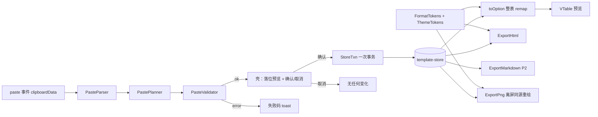

# 增强期 · 设计增量（①出口打磨 + ②入口提速）

> 状态：**定稿** · 用户 2026-10-20 群内「全部按推荐」锁定（依赖清单、K-6、K-7、E-1～E-11；E-9 用户另选 A）· 仍不开码
> 架构师 · 2026-10-20（Asia/Shanghai）· 主控派单「pretty-table ①+② 设计增量」
> 依据：[需求文档.md](../01-requirements/需求文档.md) §3.3 FR-16～27、OUT-5/12/13、§6 E-1～E-7 · [下期增强需求草案](../01-requirements/下期增强-出口打磨与入口提速-需求草案.md)（仅核对口径，以需求文档为准）· [Fill难度应对-适配存储与设定.md](Fill难度应对-适配存储与设定.md)（路线 A）· [开发约定-壳核与导出.md](开发约定-壳核与导出.md) · [设计方案.md](设计方案.md) · [ADR-001](../07-decisions/ADR-001-主核与壳核分层.md) · [research/竞争力改进与竞品-2026-10-20.md](../research/竞争力改进与竞品-2026-10-20.md) · UX 只读对照 [增强期-粘贴填槽与导出选项](../03-ux/增强期-粘贴填槽与导出选项.md)（交互稿，S1～S15 / UX-N1～N4）、[页面流](../03-ux/页面流-模板库编辑台导出.md)、[U-2 主题色板](../03-ux/U-2-主题色板-草案.md)
> 边界：**不改** ADR-001 正文、需求、03-ux；**不扩表**（不触 OUT-1/OUT-10）；**不开放**自定义符号/颜色（OUT-13）；本期 Fill MVP 范围不变；排期按 E-7 假设在 MVP 之后。

---

## 0. 口径说明（两份需求文档核对）

以 `需求文档.md` §3.3 为准。草案已自标「已并入」，但仍有以下差异，**本文不改需求，只列出交 PM/文档管家收口**：

| # | 差异 | 需求文档（权威） | 草案 | 影响 / 建议 |
|---|------|------------------|------|-------------|
| K-1 | **编号不是顺序对应** | FR-16～19 粘贴；**FR-20 价目/矩阵模板**；FR-21～26 符号/格式/推荐/PNG/HTML/窄屏；FR-27 Markdown | N01～04 粘贴；N05～N10 符号…窄屏；**N11 模板**；N12 Markdown | 需求文档只写「N01～N12 对应 FR-16～27」，易被误读为 N05→FR-20。建议在需求文档补对照表（见下表）。本文一律用 FR 编号 |
| K-2 | 草案状态行自相矛盾 | — | 第 4 行「已并入 §3.3」；第 6 行仍写「本期 `需求文档.md` 不改」 | 第 6 行已过时，建议草案改为「已归档·以需求文档为准」 |
| K-3 | OUT-5 拆分写法 | OUT-5 ①②③（② 含图片识别） | OUT-5a/b/c（b 未列图片识别，§3 才列） | 语义一致，命名不同；引用时用需求文档的 OUT-5①②③ |
| K-4 | 「本次不做」范围 | OUT-13 含「搜索/排序/分页交互表」 | §3 无此项；有「账号」（需求由 OUT-3 覆盖） | 无冲突，需求文档更全 |
| K-5 | 验收加严 | FR-16/18 加「行列数不变/未新增行列」；FR-26 加「表格区域内可横滚」；FR-25 指向 E-6 | N01/N03/N10 无这些句；N09 写「[? 待定]」 | 以需求文档为准；本文设计按加严版 |
| K-6 | 与开发约定的旧假设 | FR-24 要 3x | 开发约定 ARCH-T3 假设「上限 2×」 | 增强期以 FR-24 为准，§3.1 给出 3x 方案与像素门槛；ARCH-T3 仅对本期 MVP 有效。**已确认（2026-10-20）** |
| K-7 | PNG 截取方式 | FR-24 要透明底、倍率 | Fill 文 §4.3 / 开发约定 §5.2：截 `getPreviewEl()` | 增强期改为「同 store 离屏重绘」（§3.1），属设计层变更；不涉及 ADR。**已确认（2026-10-20）**；PoC 失败兜底 modern-screenshot 截 ExportHtml |

**编号对照（建议补入需求文档）**

| FR | 草案 | FR | 草案 | FR | 草案 |
|----|------|----|------|----|------|
| FR-16 | N01 | FR-20 | **N11** | FR-24 | N08 |
| FR-17 | N02 | FR-21 | N05 | FR-25 | N09 |
| FR-18 | N03 | FR-22 | N06 | FR-26 | N10 |
| FR-19 | N04 | FR-23 | N07 | FR-27 | N12 |

E-1～E-7 与 N-1～N-7 一一对应，无差异。

---

## 1. 总体：仍是路线 A，只加「批量意图」和「导出参数」



硬规则（继承 Fill 文 §2.2，不新增例外）：

1. 粘贴 = 一个**批量编辑意图**，走「校验 → 一次写 store → 一次 toOption → 刷核」，**不得**逐格写核或逐格写 store。
2. 导出三种产物（HTML / PNG / Markdown）都**只从 store 生成**；符号、数值格式只在 FormatTokens 一处换算，预览、HTML、PNG、Markdown 共用同一函数，保证同源。
3. 结构锁死：`rowCount`/`colCount`/`merges` 不因粘贴改变；粘贴只改 `slots` 的值。

---

## 2. 粘贴整块写入 store（FR-16～19、FR-20 可用性）

### 2.1 流程

| 步 | 模块 | 做什么 | 失败 |
|----|------|--------|------|
| 1 触发 | 壳 PasteEntry | 主入口：选中起点格（描边态、非输入态）后 Ctrl/Cmd+V，监听 `paste` 事件读 `event.clipboardData`（无需权限）。工具条「粘贴表格内容」：先试 `navigator.clipboard.readText()`，被浏览器拒绝时弹「在这里粘贴（Ctrl+V）」小框，仍走 `paste` 事件（交互 S11）。输入态里的粘贴走浏览器原生，只进当前格（交互 §1.1） | 未选起点或起点不可写 → `PASTE_NO_ANCHOR`（交互 S12） |
| 2 读取 | PasteParser | 先取 `text/plain`（Excel/WPS 复制出来是 TSV：制表符分列、换行分行）；仅当 `text/plain` 为空时，才取 `text/html` 里第一个 `<table>`，用浏览器自带 `DOMParser` 只读 `textContent`（**绝不**把 HTML 插进页面或 store） | 无文本 → `PASTE_EMPTY`（静默或轻提示） |
| 3 解析 | PasteParser | PapaParse，`delimiter: "\t"` 固定（不自动猜分隔符，避免逗号被拆列）；支持引号包裹的单元格内换行/制表符；去掉末尾空行空列（Excel 复制时自带）；**不补齐**短行：块宽取最长一行，短行缺的格记为「缺格」（不写），源里明确为空的格记为「空格」（写空串，交互 S7/S8）；单格去首尾空白 | 文本 > 64KB、或解析器报错 → `PASTE_PARSE_FAILED` |
| 4 落位 | PastePlanner | 用起点 `(r0,c0)` 和块大小 `h×w`，在模板 `layout.slotGrid`（§3.2 新增）上算出目标矩形，产出 `PastePlan = { anchor, size, cells: [{row,col,slotId,raw}] }`，附带 `baseVersion`（store 当前版本号） | 模板缺 slotGrid → `PASTE_UNSUPPORTED` |
| 5 校验 | PasteValidator | 按顺序检查（见 §2.3），**全部通过才进入预览**；任何一条不过，整块拒收，带 details 给壳拼文案 | 见 §2.3 |
| 6 换算 | PasteValidator | 按槽类型与 `format` 把 raw 转成语义值（Q-011，需求 §6.2）：text 槽原样；**number 槽**只收纯数字（可带千分位逗号），带 `%`/¥/￥/$/「元」一律按文字；**percent 槽**收数字（可带千分位）与带 `%` 的数字，裸数字按 E-9 当百分数（÷100 存比例），带货币符号按文字；**currency 槽**收 `¥`/`￥`/`$` 前缀、「元」后缀、千分位（`¥1,200`/`1200元`/`1,200`→1200），带 `%` 按文字；mark 槽按识别词表转 `yes/no/partial`（E-2，词表见交互 §1.4）。解析规则集中在 `parseNumeric(raw, format)` 一个纯函数 | **不拒收**：转不过的格按原文字写入，并产出提示 `PASTE_NOTICE_AS_TEXT`（预览条追加「其中 N 格…按文字填入」，交互 §1.4） |
| 7 预览 | 壳 | 高亮目标格（交互定样式），显示「确认 / 取消」；**预览阶段不写 store、不刷核**（高亮是壳的叠加层）；store 置 `pastePending`，期间合并/拆分/对齐/强调/拖区块/导出意图一律拒绝（交互 §1.2）。1×1 按交互 S9 不预览、直接走步 9（UX-N4 待定，两种都不改架构） | — |
| 8 取消 | 壳 | 丢弃 PastePlan | 无变化（FR-17） |
| 9 确认 | StoreTxn | 先比 `baseVersion` 是否等于 store 当前版本；不等说明预览期间有别的改动 → `PASTE_STALE`，提示重新粘贴。相等则在副本上一次写完全部格、整体做 schema 校验、**一次 commit**，压入**一条**撤销快照；随后整表 `toOption` 一次 | 中途任何异常 → 丢弃副本 → `PASTE_COMMIT_FAILED`，store 原样 |
| 10 撤销 | template-store | 复用 FR-11 一步撤销：恢复粘贴前快照 → 整表 remap | — |

### 2.2 落位规则

| 规则 | 设定 |
|------|------|
| 方向 | 从起点向右、向下；源第 i 行第 j 列 → 目标 `(r0+i, c0+j)` |
| 坐标系 | Planner 在**可见网格**上落位（Q-020）：可见网格 = 逻辑网格 `slotGrid` 中按当前已占用的 `between-rows` 区块插入整行「区块行」（整行不可写），与用户看到的行一一对应；源第 i 行对应可见网格第 `r0+i` 行。写入时再映射回逻辑槽 |
| 少于范围（E-3） | 只写被覆盖的格，其余槽保持原值，不清空 |
| 块内空单元格 | 写入空串（清空目标格），预览标「将清空」；与交互 S7 一致，最终以 UX-N1 为准，备选「跳过不写」只改 Planner 一处 |
| 短行缺格 | 不写、不盖层（交互 S8） |
| 区块行 | **E-1 已锁「整块拒收」**：Validator 默认启用 `PASTE_HITS_BLOCK`，目标矩形跨过已占用的区块槽即整块拒收。（逻辑网格 `slotGrid` 不含区块视觉行，若以后改「跳过」只需关这一个开关） |
| 百分比槽裸数字 | **E-9 已锁 A（用户 2026-10-20）**：粘入不带 `%` 的数字**原样当百分数**，解析时除以 100 存比例：`25`→存 0.25 显示 25%，`0.5`→存 0.005 显示 0.5%（不按「<1 视为比例」猜测，规则只有一条）；带 `%` 的按字面（`25%`→存 0.25）。只在百分比槽生效，数字/货币槽不变；不再弹「改写成 25%」的提醒。只改数字解析一处 |
| 单格内容 | 1×1 不预览、直接写（交互 S9，UX-N4 待定）；仍是一次事务、可撤销 |
| 超出计数 | 「多出 N 行/列」按可见网格算，区块行算 1 行（Q-020）：`extraRows = r0+h − 可见行数`，`extraCols = c0+w − colCount` |
| 不扩表 | 块超出网格边界即拒收（`PASTE_OUT_OF_RANGE`），**不截断、不增行列**；对应 FR-18 与开发约定 §1.4「粘贴扩表属 Heavy 不做」 |

### 2.3 校验顺序与失败码

整块原子：只要有一条失败就**整块拒收**（提示类 `PASTE_NOTICE_*` 不拒收），store 与核都不动。序 0～3 任一失败即停（后面无从检查）；序 4～7 **全部检查、一并报告**（Q-020）：Validator 返回 `errors[]`，按表中序号排序，即区块/合并/锁定原因在前、超出在后，壳把各条原因拼成一次提示；主码取 `errors[0].code`。区块/合并/锁定只检查落在可见网格内的部分；每条 details 给全部命中格（便于 UX 高亮红格）。

| 序 | 失败码 | 触发条件 | details | 用户提示方向（文案权威在 UX） | 可重试 |
|----|--------|----------|---------|------------------------------|--------|
| 0 | `PASTE_NO_ANCHOR` | 未选中起点格，或起点不是可写槽 | — | 「先点选一个要开始填的格子」 | 是 |
| 1 | `PASTE_EMPTY` | 剪贴板无 text/plain 也无可用 table | — | 静默或「剪贴板里没有表格内容」 | 是 |
| 2 | `PASTE_PARSE_FAILED` | 文本 > 64KB；解析器报错；解析后 0 行 | `reason` | 「没能识别复制的内容，请从表格软件重新复制」 | 是 |
| 3 | `PASTE_UNSUPPORTED` | 模板缺 `slotGrid`（旧模板且无法迁移，见 §3.4） | `templateId` | 「这张模板暂不支持粘贴填充」 | 否 |
| 4 | `PASTE_HITS_MERGED` | 目标矩形与 `structuralMerges ∪ merges` 任一区间相交（E-1） | 命中区间 | 「范围里有合并格，请先拆分或换起点」 | 是 |
| 5 | `PASTE_HITS_BLOCK` | **默认启用**（E-1 已锁整块拒收）：目标矩形包含可见网格里的区块行 | `blockSlotId` | 交互 S6 | 是 |
| 6 | `PASTE_HITS_LOCKED` | 目标格在 `slotGrid` 里为 `null`（表头常量、非槽位格），或 `slotDefs[id].locked === true` | 命中格 | 「范围里有不可修改的格子」 | 是 |
| 7 | `PASTE_OUT_OF_RANGE` | `r0+h > 可见行数` 或 `c0+w > colCount`（按可见网格，区块行算 1 行） | `extraRows`、`extraCols` | 「多出 1 列」「多出 2 行 1 列」（FR-18）；与 4～6 同时命中时排在其后 | 是（换起点） |
| — | `PASTE_NOTICE_AS_TEXT`（提示，非失败） | 按步 6 规则读不成该格式（number/percent/currency）、mark 槽不在词表 → 按文字原样写入，预览格标「按文字」（Q-011） | 命中格列表 | 预览条追加一句（交互 §1.4） | — |
| 9 | `PASTE_STALE` | 确认时 store 版本已变 | — | 「表格刚被改过，请重新粘贴」 | 是 |
| 10 | `PASTE_COMMIT_FAILED` | 事务内意外异常 | `cause` | 「粘贴失败，表格未改动」 | 是 |

与既有码的关系：`MERGE_NOT_ALLOWED` / `MERGE_STRUCTURAL` / `SLOT_DROP_BLOCKED` 不复用；粘贴码统一 `PASTE_` 前缀，并入开发约定 §4 码表时由文档管家登记（建议随 FILL-T1/T2 一起合一）。

### 2.4 StoreTxn（事务）契约

```ts
// 伪代码，非实现授权
interface StoreTxn {
  /** 在当前快照副本上执行 writes；全部成功才提交 */
  applyBatch(plan: ValidatedPastePlan): { ok: true; version: number } | { ok: false; code: PasteErrorCode; details?: unknown }
}
// 内部顺序：checkVersion → clone(slots) → 逐格写副本 → validateInstance(副本) → pushUndo(旧快照) → commit(副本) → version++ → 通知 Adapter 整表 remap（一次）
```

- 撤销栈仍是「一步」：粘贴占一步，与改字、合并等同级（FR-19 并入 FR-11）。
- 粘贴不触碰 `layout`、`blocks`、`themeId`；`validateInstance` 发现这些字段变化即视为实现错误，回滚。

### 2.5 与交互稿状态对照（码 → 交互 S 编号）

| 交互状态 | 架构落点 |
|----------|----------|
| S1/S2 正常、少粘 | 通过校验 → 预览 → StoreTxn |
| S3 多粘 | `PASTE_OUT_OF_RANGE`（extraRows/extraCols 供「多出 2 行 1 列」与幽灵格） |
| S4 合并格 | `PASTE_HITS_MERGED` |
| S5 锁定/模板固定格 | `PASTE_HITS_LOCKED` |
| S6 区块行 | 整块拒收 `PASTE_HITS_BLOCK`（E-1 已锁） |
| S7 空单元格 / S8 行不齐 | Parser 区分「空格」与「缺格」 |
| S9 1×1 | 不预览直写，仍一次事务 |
| S10 非表格内容 | `PASTE_EMPTY` / `PASTE_PARSE_FAILED`（剪贴板含 Files 时附 `hasFiles` 供「暂不支持直接导入文件」） |
| S11 读剪贴板被拒 | 壳弹手动粘贴框，不产生码 |
| S12 起点不可写 | `PASTE_NO_ANCHOR` |
| S13 写入失败 | `PASTE_COMMIT_FAILED` / `PASTE_STALE`，整体回滚 |
| S14/S15 撤销 | FR-11 一步撤销栈 |

---

## 3. 模板底稿 JSON 增量与 schemaVersion

### 3.1 新增字段

| 字段路径 | 类型 | 归属 | 必填 | 说明 |
|----------|------|------|------|------|
| `meta.templateType` | `"compare" \| "detail" \| "pricing" \| "matrix"` | 底稿 | 建议 | FR-01 类型字段落地；FR-20 新增 `pricing`、`matrix` |
| `layout.slotGrid` | `(string \| null)[][]` | 底稿 | 粘贴需要时 **是** | rowCount×colCount 的逻辑网格：格内为 slotId，`null` = 不可写（表头常量、角标格等）。合并区只在左上格写 slotId，其余格写同一 slotId 或 `null`（实现期二选一并写进校验） |
| `slotDefs` | `Record<slotId, SlotDef>` | 底稿 | 否（缺省 = 全部 text 可写） | 声明槽类型与格式，FR-22「由模板声明」 |
| `SlotDef.kind` | `"text" \| "number" \| "mark"` | 底稿 | 否，默认 `text` | 决定粘贴换算与渲染 |
| `SlotDef.format` | `"number" \| "percent" \| "currency"` | 底稿 | `kind=number` 时建议 | 缺省 `number` |
| `SlotDef.currency` | `"CNY" \| "USD"` | 底稿 | `format=currency` 时 | 缺省 `CNY`；**用户不可改** |
| `SlotDef.fractionDigits` | `0..4` | 底稿 | 否 | 缺省：number 0、currency 2；percent **按输入最多 2 位、末尾 0 不显示**（`Intl` 的 `minimumFractionDigits:0, maximumFractionDigits:2`，需求 Q-009）；底稿声明了固定位数时以底稿为准 |
| `SlotDef.unit` | `string` | 底稿 | 否 | number 槽后缀单位（如「元/月」），窄空格分隔；用户不可改（交互 §4.3） |
| `SlotDef.locked` | `boolean` | 底稿 | 否 | 粘贴与改字都不可写 |
| `layout.recommendableCols` | `number[]` | 底稿 | 否 | 允许被标「推荐」的列（数据列）；空 = 不支持推荐 |
| `layout.captionSlot` | `slotId` | 底稿 | 否 | 表标题槽，HTML 导出成 `<caption>`（FR-25） |
| `highlight.recommendCol` | `number \| null` | **实例** | 否，默认 `null` | FR-23：最多一列；设置新列即替换旧值（天然「自动取消前一列」） |
| 槽值 `{ mark }` | `{ mark: "yes" \| "no" \| "partial" \| null, align?, emphasize? }` | 实例 | — | 只存语义，不存符号；mark/number 槽也允许存普通文字（如「仅限会员」「面议」），按文字显示、不套格式（交互 §4.1/§4.3） |
| 槽值 `{ num }` | `{ num: number \| null, align?, emphasize? }` | 实例 | — | 只存数字；显示格式来自 SlotDef |

示例（对比模板片段）：

```json
{
  "schemaVersion": "1.1",
  "templateId": "compare-alpha-v2",
  "themeId": "T-A",
  "meta": { "displayName": "多列对比", "templateType": "compare", "origin": "preset" },
  "slotDefs": {
    "row.1.val.a": { "kind": "mark" },
    "row.2.val.a": { "kind": "number", "format": "percent" },
    "row.3.val.a": { "kind": "number", "format": "currency", "currency": "CNY", "fractionDigits": 0 }
  },
  "slots": {
    "row.1.val.a": { "mark": "yes" },
    "row.2.val.a": { "num": 0.25 },
    "row.3.val.a": { "num": 1200, "align": "right" }
  },
  "highlight": { "recommendCol": 2 },
  "layout": {
    "rowCount": 6, "colCount": 4, "frozenColCount": 1,
    "captionSlot": "title",
    "recommendableCols": [1, 2, 3],
    "slotGrid": [
      [null, "obj.name.a", "obj.name.b", "obj.name.c"],
      ["row.1.label", "row.1.val.a", "row.1.val.b", "row.1.val.c"]
    ]
  }
}
```

价目模板（`pricing`）：行 = 套餐/档位，列 = 价格（currency）、权益（mark/text）；矩阵模板（`matrix`）：行列两向标签 + 交叉格（mark 或 number）。两类都用同一套 `slotGrid` + `slotDefs`，**不新增渲染机制**，只是底稿 JSON。

### 3.2 schemaVersion 结论：**升到 "1.1"（小版本，向后兼容）**

| 理由 | 说明 |
|------|------|
| 只加字段 | 以上全是**可选新增**，不删、不改名、不改既有语义 → 小版本 |
| 需要区分 | 粘贴依赖 `slotGrid`；读到 1.0 时要走迁移判断，必须能识别版本 |
| 不升主版本 | 主版本 2.x 留给破坏性变更；读到未知主版本仍 `TEMPLATE_INVALID`（与 Fill 文 §3.2 一致） |

### 3.3 读写规则

| 场景 | 规则 |
|------|------|
| 读 1.0 | 可读。缺 `slotDefs` → 全部按 text；缺 `highlight` → `recommendCol=null`；缺 `templateType` → 按 templateId 映射表推断，推断不到为 `compare`；缺 `slotGrid` → 走 §3.4 |
| 读 1.1 | 正常 |
| 读 1.x（x>1） | 可读；未知可选字段忽略并 warn（为后续小版本留余地） |
| 读 2.x 及以上 | `TEMPLATE_INVALID` |
| 写（另存） | 一律写 `"1.1"`，补齐默认值后再存（IndexedDB，经 `TemplateRepo`/idb-keyval，Q7 已锁；键名见开发约定 §6.2；SAVE-default 规则不变） |
| 未知值 | `mark` 不在三值内 → 当 `null` + warn `MARK_UNKNOWN`；`format` 未知 → 回退 `number` + warn `FORMAT_UNKNOWN`；`recommendCol` 不在 `recommendableCols` → 置 `null` + warn |
| 旧文字值放进新类型槽 | 例如 1.0 里 number 槽存的是 `"100万"`：照原文字显示，不报错、不强转；只有用户再次编辑或粘贴时才按 number 校验 |

### 3.4 迁移策略（只在读取时做，纯函数，不写回原件）

1. `migrate_1_0_to_1_1(json)`：补默认值（见上表），版本号改为 1.1。
2. `slotGrid` 缺失时：用户另存的模板有 `meta.sourceTemplateId`（或同 `templateId`）→ 找到对应系统底稿，且 `rowCount/colCount` 一致（Fill 不允许改行列，正常都一致）→ 借用底稿的 `slotGrid` 与 `slotDefs`。
3. 借不到 → 模板照常可编辑、可导出，只是粘贴入口置灰，触发时报 `PASTE_UNSUPPORTED`。
4. 迁移结果只存在内存；用户下次另存时自然落成 1.1，**不批量改写**本机已存模板（避免一次性写坏 localStorage）。
5. 建议（不扩 MVP 范围）：MVP 实现 schema 校验时对**未知可选字段宽容**（warn 不拒），增强期即可零成本过渡。

---

## 4. 语义单元格走主题 token（FR-21～23）

### 4.1 数据模型

单元格**只存语义**，样式全部由主题决定：

| 语义 | 实例里存 | 主题负责 | 用户能改的 |
|------|----------|----------|------------|
| 三态符号 | `mark: "yes" \| "no" \| "partial"` | 颜色（及是否加圆底） | 只能选三态之一 |
| 数值 | `num: number` + 模板 `SlotDef.format` | 数字字体、对齐（默认右）、负数色 | 只能改数字，不能改格式 |
| 推荐列 | `highlight.recommendCol` | 强调色、角标底色/字色、列描边 | 只能选哪一列（或取消） |

### 4.2 FormatTokens（全局常量，产品统一，不随主题变）

```ts
// 伪代码
const MARK_GLYPH = { yes: "✓", no: "✗", partial: "◐" } as const       // FR-21 固定
const MARK_LABEL = { yes: "支持", no: "不支持", partial: "部分支持" }   // HTML aria-label / Markdown 备注
const MARK_WORDS = { /* E-2：识别词表，由交互在 03-ux 定；此处只留结构 */ yes: [], no: [], partial: [] }
const RECOMMEND_BADGE_TEXT = "推荐"
function formatNumber(v: number, def: SlotDef): string   // 唯一实现，预览/HTML/PNG/Markdown 共用
```

`formatNumber` 用浏览器原生 `Intl.NumberFormat("zh-CN", …)`：`number` → `style:"decimal"`；`percent` → `style:"percent"`（`0.25` → `25%`，满足 FR-22 验收）；`currency` → `style:"currency", currency:"CNY"`（显示 `¥1,200`）。locale **写死 `zh-CN`**，不跟随浏览器语言，保证三处一致。

### 4.3 主题映射（复用 U-2 已有 token，不新增色值）

按交互稿 §4.1/§4.2，**不新增主题 token**，只在主题包里加一张「语义 → 既有 token」映射：

| 语义 | 映射到 U-2 既有 token | 说明 |
|------|------------------------|------|
| ✓ 支持 / ◐ 部分 | `primary` | 靠形状区分三态，颜色只是加强 |
| ✗ 不支持 | `emphasis` | — |
| 推荐角标 | 底 `emphasis`、字 `headerText` | 角标文字固定「推荐」 |
| 推荐列浅底 | `emphasis` 同档浅底（T-A 为 U-2 已列值） | 与斑马纹叠加时推荐列优先 |
| 数值 | 正文色；负数不变色（条件着色属 OUT-13） | — |

- 具体色值以 [U-2](../03-ux/U-2-主题色板-草案.md) 为准，U-2 改则跟改；本文不定色。
- 实例 `themeTokens` 即使写了这些映射也**一律忽略**（load 时 warn），确保 OUT-13「不开放自定义符号/颜色」在数据层也成立；界面也不提供入口。

### 4.4 落点映射（整表 remap 内）

| store | 预览（VTable option） | HTML | PNG | Markdown |
|-------|----------------------|------|-----|----------|
| `{mark}` | 单元格文本 = 符号，`color` = 主题 token，居中 | `<td style="color:…;text-align:center" aria-label="支持">✓</td>` | 同预览（离屏重绘） | 符号字符 |
| `{num}` | 文本 = `formatNumber`，右对齐 | 同字符串，`text-align:right` | 同预览 | 同字符串 |
| `recommendCol` | 该列表头加角标（自定义渲染/图标），整列描边或浅底 | 表头 `<th>` 内 `<span style="…">推荐</span>`，该列单元格内联描边 | 同预览 | 表头文字后加「（推荐）」 |

风险：`◐`（U+25D0）在部分系统字体里缺字形。实现期 PoC 验证 Windows/macOS 默认字体；缺字时改为 VTable 内置图标/SVG 画法，HTML 用内联 SVG——**[待 PoC]**。

---

## 5. 导出层（FR-24～27）

### 5.1 PNG：倍率 1x/2x/3x + 透明底（FR-24）

**推荐方案：同 store 离屏重绘，用 VTable 自带出图。**

| 步 | 做法 |
|----|------|
| 1 | 用**同一个** `toOption(store)` 生成 option（同源） |
| 2 | 在页面外（`position:fixed; left:-99999px`）挂一个临时容器，新建一个 VTable 实例：`canvasWidth:"auto"`、`canvasHeight:"auto"`（按内容撑满，不受预览视口裁切），关闭动画 |
| 3 | `setPixelRatio(scale)`，scale ∈ {1,2,3}，默认 2 |
| 4 | 透明底：主题里 `underlayBackgroundColor` 设为 `transparent`，表格容器背景透明；单元格自己的底色保留。「表格以外」= 四周 16 CSS px 留白区 + 表格外框圆角以外的角落，这些像素 alpha=0（Q-008） |
| 5 | **等画布定稿**：轮询画布尺寸，非 0 且连续两帧不变才读尺寸、才 `exportImg()`（auto 模式尺寸是异步定的，PoC 实测第一帧为 0）。`exportImg()` 得到 base64 → 画到一张新的 2D 画布上，四周各留 16×倍率 像素（透明底时留白区不填色，否则填主题 `paper` token 色）→ `toBlob` 下载 |
| 6 | **延后销毁**：`release()` 前再等一帧，否则 VTable 已排队的回调会访问已释放实例（PoC 实测报错）。离屏容器一并移除，不得残留画布 |

为什么不继续截 `getPreviewEl()`：预览是 Canvas，按屏幕像素比绘制，DOM 截图库放大到 3x 只是拉伸，会糊；预览有横滚和钉列视口，宽表会被裁；透明底也需要重绘。VTable 的 `exportImg()` 官方说明只导出「当前可见区域」（[外](https://github.com/VisActor/VTable/issues/463)、[外](https://github.com/VisActor/VTable/issues/1761)，均未关闭），所以必须用 `canvasWidth/Height:"auto"` 让离屏实例的可见区 = 全表（本项目表规模 ≤20×12，可承受）。

| 项 | 设定 |
|----|------|
| 尺寸口径 | 「预览宽度」= **表格内容宽** = 离屏实例在 auto 模式下的画布 CSS 宽，即全部列宽之和 **+ 表格外框线**（默认主题左右各 1px，共 2px；PoC 实测 480+2=482），含钉列与横滚隐藏部分，不含编辑台留白和滚动条；高同理。外框属于表格本身，计入（2026-10-20 定）。离屏实例四周固定留白 16 CSS px，所以输出宽 = (内容宽 + 32) × 倍率、输出高 = (内容高 + 32) × 倍率，±2px；内容宽/高可在调试面板读到（开发约定 §6.2）。MVP 也走这条路径、固定 2×（开发约定 §5.2）。需求 FR-24「图片宽度 = 预览宽度×2」的措辞请 PM 按此公式同步（Q-008） |
| 尺寸预估 | `ExportPng.measure(store, scale)` 返回输出像素，供抽屉实时显示「约 1840 × 960 像素」（交互 §3.1），只算不画 |
| 像素门槛 | 输出像素 `宽×高` 超过 16,777,216（约 4096×4096，按 Safari 画布面积保守值）（「宽×高」指含四周 16px 留白的最终输出，即 (内容宽+32)×(内容高+32)×倍率²，D-3）→ `EXPORT_PNG_TOO_LARGE`，壳给「改用 2x 重试」（交互 §3.5）；**不自动降倍**（FR-24 要倍率精确）。门槛值 **[? 未核实]**：PoC 已验证超限拦截逻辑，但浏览器画布上限尚未在 Chromium/Firefox/Safari 实测，实施计划校准后回写。**测法**（Q-008）：测试构建里 URL 加 `?pt-png-max=<像素数>` 临时改门槛，取值放在抽屉显示的「2x 预估像素」与「3x 预估像素」之间，则选 3x 必触发、选 2x 必通过；或用 `?pt-fault=EXPORT_PNG_TOO_LARGE` 直接注入 |
| 默认与记忆 | 默认 2x；上次选择存本机（localStorage，仅偏好，不进模板 JSON） |
| 就绪 | 预览 `RENDER_FAIL`/loading 时仍按 `EXPORT_BLOCKED_RENDERING` 禁用（不变） |
| 防连点 | 不变（FR-12） |
| 兜底（仅 PoC 失败时启用） | 把 ExportHtml 的结果挂到离屏 DOM，用 modern-screenshot 截图（`scale` + `backgroundColor:null`），也是 store 同源；代价是观感与 Canvas 预览只「近似」，需门禁同意 |
| 待 PoC | ① 离屏容器下 `canvasWidth:"auto"` + `exportImg()` 输出完整；② `underlayBackgroundColor: transparent` 后四周像素 alpha=0；③ 3x 下文字清晰 |

### 5.2 HTML：语义化 + 内联样式（FR-25）

| 项 | 设定 |
|----|------|
| 结构 | `<div 外层滚动容器>` → `<table>` → `<caption>`（有 `captionSlot` 时）→ `<thead>`（`headerLevels` 行）→ `<tbody>` → `<tfoot>`（`emphFooter` 区块） |
| 表头 | 列头 `<th scope="col">`；跨列的上级表头 `<th scope="colgroup" colspan=…>`；首列标签格 `<th scope="row">`（跨行用 `scope="rowgroup"`） |
| 合并 | `structuralMerges ∪ merges` → `rowspan`/`colspan`（沿用 Fill 文 §4.3） |
| 区块 | `sectionBar`/`groupHeader` → 整行 `<tr><th colspan=全宽 scope="colgroup">`；`leftTag` → 首列内 `<span>` |
| 样式 | **全部内联** `style=""`，不输出 `<style>` 和 class（富文本编辑器、邮件常剥掉样式表）；只用 color、background-color、border、border-collapse、font-weight、font-size、text-align、padding、white-space、min-width、position:sticky、overflow-x |
| 符号 | 文本字符 + `aria-label`；颜色来自主题 token |
| 安全 | 所有文案文本转义（需求 §9）；不输出 script、事件属性、外链资源；粘贴来的内容在 store 里本来就是纯文本 |
| 空槽 | 空串，不泄占位（不变） |
| 剪贴板 | 同时写 `text/html`（上述片段）和 `text/plain`（TSV，便于再贴回表格软件）；浏览器拒绝写剪贴板时 `exportHtml` 仍返回字符串，壳展开手动复制框（交互 §3.5） |

### 5.3 窄屏（FR-26 / E-4）：**推荐「横向滚动容器 + min-width」，否决卡片化**

```html
<div style="max-width:100%;overflow-x:auto;-webkit-overflow-scrolling:touch">
  <table style="border-collapse:collapse;min-width:640px"> … 首列格加 position:sticky;left:0;background:… </table>
</div>
```

| 方案 | 结论 | 理由 |
|------|------|------|
| **横滚容器 + `min-width`（+ 首列 sticky）** | **推荐** | 结构不变，合并/多级头/推荐列都保留；整页不溢出、表格区内横滚，直接满足 FR-26；与 FR-04「横滚+首列钉」一致；只靠内联样式即可 |
| 卡片化（窄屏改成一行一卡） | 否决 | 要靠 `@media` 样式表，粘到富文本编辑器会被剥掉；rowspan/colspan 与多级表头无法可靠映射成卡片；同一份 HTML 两种结构，等于再做一套导出 |

降级：部分编辑器会剥 `position:sticky` 或 `overflow`。剥 sticky → 退化为纯横滚，仍满足 FR-26；剥 overflow → 有溢出风险，属 E-6 选编辑器时要测的项。`min-width` 取值 = 列数 × 每列最小宽（建议 120px，首列 96px），由 ExportHtml 按 store 计算。

### 5.4 Markdown（FR-27，P2，是否纳入见 E-5）

- ExportMarkdown 从 store 生成 GFM 表格；只取最底一层表头作为表头行；合并格展开：值放左上格，其余格留空，并返回 `lossy: true` → 壳提示「Markdown 不支持合并，已拆开展示」。
- `|` 转义为 `\|`，换行转 `<br>`；符号输出字符，数值用 `formatNumber`。
- 成本：一个纯函数，与 ExportHtml 共用 ExportModel（§7），约等于半个模块。

---

## 6. 开源依赖清单（已确认）

> 状态：**已确认**（用户 2026-10-20「全部按推荐」）。依赖已锁，但仍不装包、不开码；@dnd-kit 与 PNG 出图需先 PoC。
> 检索时间 2026-10-20（Asia/Shanghai）。星标、许可、最近推送来自 GitHub REST API / GitHub 工具（`stargazers_count`、`license.spdx_id`、`pushed_at`）；最新版本与发布时间来自 npm registry；能力项来自各仓 README / 类型声明 / 官方文档。时间均已换算为 UTC+8。
> 许可红线（OUT-7）：只允许 MIT / Apache-2.0，不符合的直接**淘汰**。

### 6.0 筛选维度

通用维度：星标、许可、维护活跃度（最近推送 / 最近发版）、文档、与 VTable / 路线 A 的契合度、安全。另加三条**业务筛选维度**（来自交互稿 [增强期-粘贴填槽与导出选项](../03-ux/增强期-粘贴填槽与导出选项.md) 与 [页面流](../03-ux/页面流-模板库编辑台导出.md)）：

| 维度 | 含义 | 判定方式 |
|------|------|----------|
| **F1 粘贴：先预览、越界整块拒收不截断** | 解析结果必须是**完整**二维数组，不截断、不自动写入、能区分「空格」与「缺格」、行列数可准确计数，才能让 Planner 先预览、再整块拒收 | 看解析器输出是否完整、引号/换行是否正确 |
| **F2 PNG：默认 2x，透明底只去表格外底色，导出 = 所见** | 倍率必须是**真重绘**而非拉伸；透明只作用于表格外围（格内纸色保留）；画面与预览同一渲染器 | 看是否能按倍率重绘、能否只让外围透明、是否与 Canvas 预览同源 |
| **F3 拖拽：支持键盘操作和撤销** | 能用键盘把区块放进槽位（需求 §9「点击添加」等价入口）；落下必须走 `addBlock` 写 store，从而进 FR-11 一步撤销 | 看是否内置键盘传感器；看能否只发「意图」不直接改 DOM/数据 |

撤销说明：撤销是 store 层能力（路线 A），任何拖拽库只要「落下 → 调 `addBlock`」就自动可撤销；会自己改 DOM 顺序或数组的库（如 SortableJS 的排序模式）必须关掉这部分行为，否则绕过 store。

### 6.1 环节一：壳层前端框架 + 状态管理

| 候选 | 星标 | 许可 | 最近推送 / 最新发布 | 与 VTable 契合 | 与团队约定 | 结论 |
|------|------|------|---------------------|----------------|------------|------|
| **Vue 3 + Pinia** [外](https://github.com/vuejs/core) · [外](https://github.com/vuejs/pinia) | vue 54694；pinia 14743 | MIT / MIT | vue 推送 2026-10-20，npm 3.5.44 于 2026-10-13；pinia 推送 2026-10-18，npm 4.1.0 于 2026-10-14 | 官方有 `@visactor/vue-vtable` 封装，但**不用**：核须脱离 Vue（开发约定 §1.5 C-2），核直接用 `@visactor/vtable` 命令式 API，壳经 `CoreHandle` 挂载 | 交互设计师的 Uiverse 取用约定已写「改写成 Vue SFC」 | **推荐** |
| React 19 + Zustand [外](https://github.com/facebook/react) · [外](https://github.com/pmndrs/zustand) | react 251455（API 返回仓名已为 react/react）；zustand 58837 | MIT / MIT | react 推送 2026-10-20，npm 19.3.1 于 2026-10-15；zustand 推送 2026-10-14，npm 5.0.15 于 2026-08-13 | 官方封装 `@visactor/react-vtable` 1.26.8（MIT，peer react ^18.2 \|\| ^19） | 与 Vue SFC 约定冲突，要改交互侧取用约定 | 备选：生态最大，若团队以 React 为主可换；放弃理由是与现有 Vue SFC 约定不一致 |
| Svelte 5（自带 store） [外](https://github.com/sveltejs/svelte) | 88410 | MIT | 推送 2026-10-20，npm 5.57.2 于 2026-10-06 | npm 上**无** `@visactor/svelte-vtable`（查询返回 Not found），需自己包一层原生 VTable | 同上冲突 | 放弃：无官方封装，适配层要多写；团队约定不符 |

状态管理说明：Pinia 只是 template-store 的「外壳」，路线 A 的纯函数（applyEditIntent、StoreTxn、toOption）不依赖 Pinia，换框架时可整体搬走。三项 F1～F3 与框架无直接关系，不作淘汰依据。

### 6.2 环节二：PNG 导出

| 候选 | 星标 | 许可 | 最近推送 / 最新发布 | F2 倍率真重绘 | F2 只透明外围 | F2 导出 = 所见 | 结论 |
|------|------|------|---------------------|---------------|---------------|----------------|------|
| **VTable 自带出图**（`exportImg()` + `setPixelRatio()` + `canvasWidth/Height:"auto"`，主题 `underlayBackgroundColor`）[外](https://github.com/VisActor/VTable) | 3680 | MIT | 推送 2026-10-19；`@visactor/vtable` 1.26.8 于 2026-09-11 | ✅ 按像素比重绘 | ✅ `underlayBackgroundColor` 只管表格外画布区，格内底色不变 | ✅ 与预览同一渲染器、同一 `toOption(store)` | **推荐**（零新增依赖；待 §5.1 PoC 三项） |
| `@visactor/vtable-export` [外](https://www.npmjs.com/package/@visactor/vtable-export) | 同主仓 | MIT | 1.26.8 于 2026-09-11 | — | — | — | **淘汰（本环节）**：依赖 `exceljs`、`file-saver`，定位 Excel/CSV 导出，不提供本环节需要的出图能力；Excel 导出又是 OUT-5③ |
| modern-screenshot [外](https://github.com/qq15725/modern-screenshot) | 2088 | MIT | 推送 2026-04-16；npm 4.7.0 于 2026-04-16 | ⚠️ 对 DOM 是真重绘（`scale`）；对 Canvas 预览只能拉伸，会糊 | ⚠️ `backgroundColor:null` 让整个节点底透明，需给表格本身显式铺纸色才能做到「只透明外围」 | ⚠️ 截 Canvas 预览可同源但受视口裁切；截 ExportHtml 的 DOM 则与 Canvas 预览只「近似」 | **兜底**：仅在 VTable PoC 失败时，用来截 ExportHtml 的离屏 DOM |
| html-to-image [外](https://github.com/bubkoo/html-to-image) | 7256 | MIT | 推送 2026-05-28；**npm 1.11.13 于 2025-02-14** | 同上（`pixelRatio`） | 同上（`backgroundColor`） | 同上 | 放弃：modern-screenshot 是它的分支（README 写明 Fork from html-to-image），发版更勤 |
| dom-to-image-more [外](https://github.com/IDisposable/dom-to-image-more) | 681 | GitHub 元数据 NOASSERTION；LICENSE 文件与 npm 均为 MIT | 推送 2026-09-25；npm 3.11.0 于 2026-09-25 | 同上（`scale`） | 同上（`bgcolor`） | 同上 | 放弃：社区小，许可元数据不规范需额外审；能力与兜底候选重复 |

（html2canvas 31922★、MIT，但 npm 最后发版 2022-01-23、自行重绘 CSS 还原度差，不列入候选。）

### 6.3 环节三：粘贴解析

| 候选 | 星标 | 许可 | 最近推送 / 最新发布 | F1 完整不截断 | F1 引号/换行正确、行列可计数 | F1 区分空格/缺格 | 结论 |
|------|------|------|---------------------|---------------|------------------------------|------------------|------|
| **PapaParse** [外](https://github.com/mholt/PapaParse) | 13590 | MIT | 推送 2026-10-09；npm 5.7.0 于 2026-08-24 | ✅ 返回全部行，只解析不写入 | ✅ 处理引号包裹的换行/制表符；固定 `delimiter:"\t"` | ✅ 短行保持原长度（不补齐），空格为 `""` | **推荐** |
| d3-dsv [外](https://github.com/d3/d3-dsv) | 445 | **ISC** | 推送 2024-01-06；npm 3.0.1 于 2021-06-06 | ✅ | ✅ `tsvParseRows` | ✅ | **淘汰**：ISC 不在 OUT-7 白名单；且多年未发版 |
| 自写 split | — | — | — | ✅ | ❌ Excel 对含换行/制表符的格加引号，简单 split 会多算行列 → 误判「多出 N 行」，直接违反 F1 | ⚠️ | 放弃：补齐引号处理等于重写解析器 |

HTML 兜底：仅当 `text/plain` 为空时，用浏览器自带 `DOMParser` 读第一张 `<table>` 的 `textContent`，零依赖；SheetJS（36343★、Apache-2.0，GitHub 镜像最近推送 2024-04-18，官方分发渠道最新版本 [? 未核实]）面向 xlsx 文件导入（OUT-5②），不采用。

### 6.4 环节四：数值格式化

| 候选 | 星标 | 许可 | 最近推送 / 最新发布 | 覆盖 FR-22 | 与预览/导出同源 | 结论 |
|------|------|------|---------------------|-----------|-----------------|------|
| **Intl.NumberFormat**（浏览器原生）[外](https://developer.mozilla.org/zh-CN/docs/Web/JavaScript/Reference/Global_Objects/Intl/NumberFormat) | — | — | 随浏览器 | ✅ `decimal/percent/currency` 正好三种 | ✅ 一个 `formatNumber` 四处共用；locale 写死 `zh-CN` | **推荐** |
| numfmt [外](https://github.com/borgar/numfmt) | 67 | MIT | 推送 2026-10-17；npm 4.0.1 于 2026-10-17 | ✅ 支持 Excel 格式码，也能把文字解析成数字 | ✅ | 备选：我们不接受用户格式码，原生足够；若自写「文字→数字」不够用（如「1.2万」）再引入其解析能力；社区小 |
| numeral.js [外](https://github.com/adamwdraper/Numeral-js) | 9698 | MIT | 推送 2026-02-15；**npm 2.0.6 于 2017-03-27** | ✅ | ✅ | 放弃：npm 九年未发版，能力被原生覆盖 |

粘贴时「文字 → 数字」：自写窄解析（去空白、去千分位逗号、去 `¥`/`$`/`￥` 前缀与「元」后缀、尾 `%` 除以 100、全角数字转半角）；读不成的按文字写入并提示（交互 §1.4），不猜测。「万/亿」等中文单位**本期不识别**（交 PM）。

### 6.5 环节五：拖拽（槽位 DnD，ADR-001：在壳、禁通用画布）

本项目的拖拽只是「左侧组件库 → 表内少量固定槽位」，不排序、不自由摆放。

| 候选 | 星标 | 许可 | 最近推送 / 最新发布 | F3 键盘操作 | F3 撤销（只发意图、走 store） | 与 ADR-001 / VTable 契合 | 结论 |
|------|------|------|---------------------|-------------|------------------------------|--------------------------|------|
| **@dnd-kit（`@dnd-kit/vue` / `@dnd-kit/dom`）** [外](https://github.com/clauderic/dnd-kit) | 17730 | MIT | 推送 2026-10-15；`@dnd-kit/dom`、`@dnd-kit/vue` 0.5.1 于 2026-10-15（`@dnd-kit/vue` peer vue ^3.5）；旧版 React 专用 `@dnd-kit/core` 6.3.1 于 2024-12-06 | ✅ README 写明内置 Pointer/Mouse/Touch/**Keyboard** 传感器与读屏播报；`@dnd-kit/dom` 类型声明含 `KeyboardSensor` | ✅ 只给 drop 事件，由壳调 `addBlock` | ✅ 不依赖 HTML5 DnD；droppable 可只注册槽位元素，不碰 Canvas 内部；不是画布引擎 | **推荐**；风险：新架构仍是 0.x 版本，需锁定小版本并做 PoC |
| 自写指针事件 | — | — | — | ⚠️ 需自写「选中区块 → 方向键选槽 → Enter 放下」与点击添加 | ✅ | ✅ 完全可控 | 备选：@dnd-kit PoC 不过时启用；槽位少，自写成本可控，但键盘与读屏要自己补 |
| SortableJS / vuedraggable [外](https://github.com/SortableJS/Sortable) · [外](https://github.com/SortableJS/vue.draggable.next) | Sortable 31197；vue.draggable.next 4500 | MIT / MIT | Sortable 推送 2026-03-25，npm 1.15.7 于 2026-02-12；vue.draggable.next 推送 **2023-09-27**，Vue 3 版 `vuedraggable@next` 4.1.0 于 **2021-08-23** | ❌ 基于 HTML5 DnD，无内置键盘拖拽（dnd-kit README 也指出 HTML5 DnD 不支持键盘） | ❌ 默认直接改列表/DOM 顺序，需关掉才不绕过 store | ⚠️ 定位是列表排序，不是「放进槽位」 | **淘汰**：不满足 F3，且 Vue 3 封装多年未发版 |
| pragmatic-drag-and-drop [外](https://github.com/atlassian/pragmatic-drag-and-drop) | 12786 | GitHub 元数据 NOASSERTION；LICENSE 文件与 npm 均为 Apache-2.0 | 推送 2026-10-20；`@atlaskit/pragmatic-drag-and-drop` 4.0.0 于 2026-09-24 | ❌ 核心基于原生 DnD，README 说明「不规定无障碍方案」，键盘需自建替代控件 | ✅ 只给事件 | ✅ 框架无关、体积小 | 放弃：键盘要自己补，等于失去选它的意义 |

### 6.6 推荐汇总（已确认）

| 环节 | 推荐 | 一句理由 | 备选 / 兜底 |
|------|------|----------|-------------|
| 壳框架 + 状态 | **Vue 3 + Pinia** | VTable 有官方 Vue 封装，且与现有「Vue SFC」取用约定一致 | React 19 + Zustand |
| PNG 导出 | **VTable 自带出图（离屏同源重绘）** | 唯一同时做到 2x/3x 真重绘、只透明外围、导出 = 所见，且零新增依赖 | modern-screenshot 截 ExportHtml DOM |
| 粘贴解析 | **PapaParse** | MIT、活跃，正确处理 Excel 引号与换行，保证整块拒收的行列计数准确 | 无（d3-dsv 许可淘汰） |
| 数值格式化 | **Intl.NumberFormat（原生）** | 零依赖，三种格式正好覆盖，四处共用一个函数 | numfmt（仅在需要更强的文字解析时） |
| 拖拽 | **@dnd-kit（Vue/DOM 版）** | 内置键盘传感器，只发意图由 store 写入，天然可撤销 | 自写指针事件 + 键盘路径 |

新增运行时依赖合计：Vue、Pinia、PapaParse、@dnd-kit/vue（及其依赖的 `@dnd-kit/dom`），全部 MIT。

> 脚手架 / 无样式组件库 / 样式方案 / 路由的对比与待确认项见 [`research/脚手架选型-2026-10-20.md`](../research/脚手架选型-2026-10-20.md)（create-vue + Reka UI 等 Q1～Q9 已确认）。

---

## 7. 模块清单（新增 / 改动）

| 模块 | 新/改 | 层 | 职责 | 依赖 | 对应 FR |
|------|------|----|------|------|---------|
| **PasteEntry** | 新 | 壳 | 监听 `paste`；判断起点与编辑态；取 clipboardData；驱动预览/确认/取消 UI | PasteParser、PastePlanner、PasteValidator、StoreTxn | 16、17 |
| **PasteParser** | 新 | 纯函数 | text/plain TSV → 二维字符串；text/html 兜底；大小上限 | PapaParse、DOMParser | 16 |
| **PastePlanner** | 新 | 纯函数 | 起点 + 块大小 + `slotGrid` → PastePlan（带 baseVersion） | store 只读快照 | 16、18 |
| **PasteValidator** | 新 | 纯函数 | §2.3 顺序校验；类型换算（number/mark）；产出失败码 | FormatTokens（识别词表、数字解析） | 18、19、21、22 |
| **StoreTxn** | 新（store 内） | store | 版本检查 → 副本批量写 → 校验 → 一次提交 → 一条撤销 | template-store | 19 |
| **template-store** | 改 | store | 增 `version` 计数；`highlight.recommendCol` 读写（最多一列）；1.0→1.1 读时迁移 | SchemaMigrator | 19、23 |
| **SchemaMigrator** | 新 | 纯函数 | 版本识别、补默认、借底稿 slotGrid | 系统底稿索引 | 20、全体 |
| **FormatTokens** | 新 | 纯函数/常量 | 符号字形与标签、识别词表结构、`formatNumber`（Intl） | Intl.NumberFormat | 21、22、23 |
| **主题语义映射** | 改 | 数据 | 三套主题加「语义 → 既有 token」映射（✓◐→primary、✗→emphasis、推荐→emphasis/headerText）；拒绝实例覆盖 | U-2 既有 token | 21、23 |
| **Adapter（toOption）** | 改 | 纯函数 | 映射 `{mark}`/`{num}`/推荐列到 option；仍整表 remap | FormatTokens、ThemeTokens | 21～23 |
| **ExportModel** | 新 | 纯函数 | 从 store 生成中间表模型（行列、表头层级、合并、区块、已格式化文本、样式 token），供 HTML/Markdown 共用 | FormatTokens | 25～27 |
| **ExportHtml** | 改 | 纯函数 | 语义结构 + 全内联样式 + 横滚容器/min-width/首列 sticky；双格式写剪贴板 | ExportModel | 25、26 |
| **ExportMarkdown** | 新（P2） | 纯函数 | GFM 表格 + 合并降级标记 | ExportModel | 27 |
| **ExportPng** | 改 | 壳编排 + 核 | 离屏 VTable 实例：同 toOption、auto 尺寸、setPixelRatio、透明 underlay、exportImg；像素门槛 | Adapter、`@visactor/vtable` | 24 |
| **底稿 JSON（pricing/matrix）** | 新 | 数据 | 各 ≥1 张，带 slotGrid/slotDefs/templateType | schema 1.1 | 20 |

依赖方向仍是「壳 → store → 核」；新增的纯函数模块都不依赖 DOM（PasteParser 的 DOMParser 兜底除外，放在壳侧调用）。

---

## 8. FR-16～27 追溯表

| FR | 优先级 | 模块 / 说明 | 关键设计点 | 本文章节 |
|----|--------|-------------|------------|----------|
| FR-16 粘贴按位置填 | P0 | PasteEntry、PasteParser、PastePlanner、StoreTxn | TSV 解析；逻辑网格 slotGrid 落位；行列数不变 | §2.1～2.2 |
| FR-17 预览落位 + 确认/取消 | P0 | PasteEntry（壳叠加高亮）、PastePlan | 预览阶段不写 store；取消=丢弃计划 | §2.1 步 7～8 |
| FR-18 超出整块拒收、不截断不扩表 | P0 | PastePlanner、PasteValidator | `PASTE_OUT_OF_RANGE` 带 extraRows/extraCols | §2.2、§2.3 |
| FR-19 一次写入、整体回滚、撤销一步 | P0 | StoreTxn、template-store | 副本写 + 一次提交 + 一条撤销；`PASTE_STALE`/`PASTE_COMMIT_FAILED` | §2.4 |
| FR-20 价目/矩阵模板 | P1 | 底稿 JSON、SchemaMigrator、`meta.templateType` | 复用 slotGrid/slotDefs，不加渲染机制；可走粘贴与导出 | §3.1 |
| FR-21 ✓✗◐ 跟主题 | P0 | FormatTokens、ThemeTokens、Adapter、ExportHtml/Png | 只存 `mark`；颜色来自主题；实例覆盖被忽略 | §4 |
| FR-22 数字/百分比/货币 | P1 | SlotDef.format、FormatTokens.formatNumber | Intl `zh-CN`；`0.25`→`25%`；四处共用一个函数 | §3.1、§4.2 |
| FR-23 推荐列最多一列 | P1 | template-store（`highlight.recommendCol`）、Adapter、ExportHtml | 单值字段天然互斥；限 `recommendableCols` | §3.1、§4.4 |
| FR-24 PNG 1/2/3x + 透明 | P0 | ExportPng | 离屏同源重绘 + setPixelRatio + 透明 underlay；像素门槛 | §5.1 |
| FR-25 语义 HTML + 内联样式 | P0 | ExportModel、ExportHtml | caption/thead/tbody/tfoot/th scope；无 `<style>` | §5.2 |
| FR-26 ≤375px 不撑破 | P1 | ExportHtml | 横滚容器 + min-width + 首列 sticky；卡片化否决 | §5.3 |
| FR-27 Markdown（P2·待确认） | P2 | ExportModel、ExportMarkdown | 合并降级 + 提示；是否纳入看 E-5 | §5.4 |

---

## 9. 失败处理总表

| 失败码 | 模块 | 触发 | store / 核 | 可重试 | 新/旧 |
|--------|------|------|-----------|--------|-------|
| `PASTE_NO_ANCHOR` | PasteEntry | 无起点或起点不可写 | 不动 | 是 | 新 |
| `PASTE_EMPTY` | PasteParser | 剪贴板无可用内容 | 不动 | 是 | 新 |
| `PASTE_PARSE_FAILED` | PasteParser | 超 64KB / 解析错 / 0 行 | 不动 | 是 | 新 |
| `PASTE_UNSUPPORTED` | PastePlanner | 模板无 slotGrid 且迁移不了 | 不动 | 否 | 新 |
| `PASTE_OUT_OF_RANGE` | PasteValidator | 超出网格（多 N 行/列） | 不动 | 是 | 新 |
| `PASTE_HITS_MERGED` | PasteValidator | 碰到合并格（E-1） | 不动 | 是 | 新 |
| `PASTE_HITS_LOCKED` | PasteValidator | 碰到锁定/非槽位格 | 不动 | 是 | 新 |
| `PASTE_HITS_BLOCK` | PasteValidator | 碰到区块行（E-1 已锁，默认启用） | 不动 | 是 | 新 |
| `PASTE_NOTICE_AS_TEXT`（提示） | PasteValidator | 数字/符号槽读不成 → 按文字写 | 确认后正常写 | — | 新 |
| `PASTE_STALE` | StoreTxn | 预览后 store 被改 | 不动 | 是 | 新 |
| `PASTE_COMMIT_FAILED` | StoreTxn | 事务内异常 | **回滚**到原样 | 是 | 新 |
| `EXPORT_PNG_TOO_LARGE` | ExportPng | 倍率后像素超门槛 | 不涉及 | 是（降倍率） | 新 |
| `EXPORT_PNG_FAIL` | ExportPng | 离屏实例创建/出图失败；临时实例必须销毁 | 不涉及 | 是 | 旧 |
| `EXPORT_HTML_FAIL` | ExportHtml | 序列化或剪贴板写入失败 | 不涉及 | 是 | 旧 |
| `EXPORT_BLOCKED_RENDERING` | 壳 | 预览未就绪 | 不涉及 | 待就绪 | 旧 |
| `MARK_UNKNOWN`（warn） | SchemaMigrator | mark 值不在三值内 | 当 null 显示 | — | 新 |
| `FORMAT_UNKNOWN`（warn） | SchemaMigrator | format 未知 | 回退 number | — | 新 |
| `TEMPLATE_INVALID` | template-store | schemaVersion 主版本 ≥2 或缺必填 | 不加载 | 是（重选） | 旧 |
| Markdown `lossy`（提示，非错误） | ExportMarkdown | 含合并格 | 不涉及 | — | 新 |

原则不变：用户只看白话，不暴露 code；任何失败**不清空 store**；预览阶段的失败连高亮都不留。

---

## 10. E-1～E-7 架构意见

> **结论（2026-10-20）**：E-1～E-11 已由用户「全部按推荐」锁定，口径以 [需求文档](../01-requirements/需求文档.md) §6.1 为准。E-1 = 合并格、锁定格、区块行一律**整块拒收**；E-2 符号识别仍建议只在 `kind=mark` 槽生效（FR-21 判据以 PM 为准）。下表保留为当时的架构意见。

| # | 项 | 架构意见 |
|---|----|----------|
| E-1 | 粘贴遇合并/锁定/区块槽 | 合并格、锁定格**同意整块拒收**（`PASTE_HITS_MERGED` / `PASTE_HITS_LOCKED`）；备选「合并格按左上落位」不建议（源行列与目标格错位）。区块行：**支持交互 §1.5 的「跳过」**——逻辑网格本来就不含区块行，零成本；若 PM 维持拒收也可开 `PASTE_HITS_BLOCK`。交 PM 拍板 |
| E-2 | 是/否/Y/N/✓/✗ 自动识别 | **技术可行**，建议**只在 `kind=mark` 的槽识别**，text 槽原样保留（避免把正文里的「是」误转符号）；mark 槽遇到词表外文字按交互稿**按文字写入 + 提示**，不拒收。词表放 FormatTokens 常量，内容按交互 §1.4 |
| E-3 | 粘贴少于范围 | **同意保持原值**，实现零成本（只写被覆盖格）。块内空单元格写空串（交互 S7 / UX-N1），短行缺格不写（S8）；UX-N1 若改「跳过」只改一处 |
| E-4 | 窄屏处置 | **推荐横滚 + 首列钉**（§5.3）：内联 `overflow-x:auto` 容器 + `min-width` + 首列 `position:sticky`；卡片化否决（要靠媒体查询样式表，富文本编辑器会剥掉；合并与多级头无法映射）。sticky 被剥时退化为纯横滚，仍满足 FR-26 |
| E-5 | Markdown 是否纳入 | 纯排期/产品取舍，**交 PM/用户**。技术侧：成本低（一个纯函数，复用 ExportModel），不影响其他模块，纳入或砍掉都不改架构 |
| E-6 | FR-25 验收选哪款富文本编辑器 | **交主控/测试定**。架构建议候选至少覆盖两类：保留内联 style 的、会剥离 `position`/`overflow` 的各一款，用来验证 §5.3 的降级路径 |
| E-7 | 增强期排期 | 纯排期，**交 PM/用户**。技术侧提示：schema 1.1 是向后兼容的小版本，MVP 实现 schema 校验时对未知可选字段只 warn 不拒，后续切换几乎无迁移成本（不扩 MVP 范围） |

---

## 11. ADR-001 是否需要修改：**不改**

| 检查项 | 结论 |
|--------|------|
| 主核 | 仍是 VTable（MIT）；PNG 反而更多用 VTable 自带能力 |
| 壳/核分层 | 粘贴在壳 + store；核只吃 option；剪贴板权限 UX 本就归壳（ADR §3） |
| 数据真相 | 仍是 store 单写 + 整表 remap（路线 A）；无新增真相源 |
| 系统形态 | 仍是纯前端、本地、免登录；无后端、无外部模型（AI 起稿 OUT-12 未进） |
| 依赖许可 | 推荐依赖（Vue/Pinia/PapaParse/@dnd-kit）均 MIT；兜底 modern-screenshot（MIT）；满足 OUT-7。框架选型本身也不进 ADR-001（ADR 未锁框架），确认后记入开发约定 |
| 接口骨架 | CoreHandle 语义不变；`exportPng` 增加可选参数 `{ scale?, transparent? }`、`exportHtml` 增加可选参数属开发约定层细化，不触 ADR 决策 |

需要在**开发约定**层回写的（交门禁后另派，本次只加指针）：§2 增字段与 1.1、§4 增 `PASTE_*` 与 `EXPORT_PNG_TOO_LARGE`、§5.2 PNG 改为离屏重绘与 3x、ARCH-T3 标注增强期覆盖。

---

## 12. 未核实 / 待 PoC 清单

| # | 项 | 状态 |
|---|----|------|
| P-1 | 离屏 VTable `canvasWidth/Height:"auto"` 下 `exportImg()` 输出全表 | 待 PoC |
| P-2 | `underlayBackgroundColor: transparent` 后表外像素 alpha=0 | 待 PoC |
| P-3 | 3x 输出清晰度与耗时（≤20×12） | 待 PoC |
| P-4 | 画布像素门槛 16,777,216 | [? 未核实]，实现期实测 |
| P-5 | `◐` 字形在默认字体的覆盖 | 待 PoC |
| P-7 | 各富文本编辑器对 inline style / sticky / overflow 的保留情况 | 随 E-6 测 |
| P-8 | `@dnd-kit/vue` 0.5.x 键盘放入槽位 + 与 VTable 预览共存（只注册槽位叠加层） | 待 PoC |
| P-9 | SheetJS 当前官方版本 | [? 未核实]（已淘汰，不影响结论） |

---

## 13. 自检

- [x] FR-16～27 每条都有模块对应（§8）
- [x] 有失败处理总表（§9），粘贴整块原子、失败不留半成品
- [x] 开源依赖清单五环节（框架/PNG/粘贴/格式化/拖拽），含 F1～F3 业务筛选维度，数据来自 GitHub API / npm registry，未查到的标注了；全节已确认（2026-10-20）
- [x] 不改 ADR-001、需求、03-ux；不扩表；不开放自定义符号/颜色
- [x] 未写业务代码；伪代码仅说明契约
- [x] 仍不开码

## 14. 修订

| 日期 | 说明 |
|------|------|
| 2026-10-20 | 按实施计划回流：percent 默认小数位改按 Q-009；去掉 `@visactor/vue-vtable`（核不依赖 Vue）；槽位 id 示例按 U-1 改 `obj.name.*`；PNG 留白底色定为 `paper` token |
| 2026-10-20 | 测试复跑 D-1/D-3：§5.1 口径不变（含外框），开发约定 §5.2 已对齐；像素门槛按含留白的最终输出计 |
| 2026-10-20 | 按 PoC 结果：§5.1 尺寸口径定为含表格外框（列宽和 + 2px）；步 5/6 补「等画布连续两帧不变再读」「release 前再等一帧」、留白由二次合成画布实现；刷新恢复存储与失败码见开发约定 §6.3 |
| 2026-10-20 | 按需求 Q-011/Q-020 对齐：§2.1 步 6 按 number/percent/currency 分别解析、不认的按文字；§2.2 改为可见网格落位、区块行算 1 行计数；§2.3 序 4～7 全检一并报告、区块/合并/锁定在前、超出在后 |
| 2026-10-20 | 回应陌生人测试 Q-007/008：§5.1 定「预览宽度」= 表格内容宽、留白 16px 与尺寸公式、「表格以外」范围、像素门槛测法（`pt-png-max`）；§3.3 另存存储改 IndexedDB |
| 2026-10-20 | E-9 用户选 A：百分比槽裸数字原样当百分数（`25`→25%，`0.5`→0.5%），存比例；文头去掉 E-9 待定 |
| 2026-10-20 | 用户「全部按推荐」：文头改定稿；依赖清单、K-6、K-7 标已确认；E-1 改为区块行也整块拒收（`PASTE_HITS_BLOCK` 默认启用）；E-9 按 FR-22 口径写明 |
| 2026-10-20 | §6.6 末加指针：脚手架选型对比见 research/脚手架选型-2026-10-20.md |
| 2026-10-20 | 对齐交互稿 `03-ux/增强期-粘贴填槽与导出选项.md`：类型不符改「按文字写入+提示」、区块行默认跳过、空格/缺格区分、1×1 直写、主题映射复用 U-2 token、PNG 尺寸预估；§6 改为「开源依赖清单（待用户确认）」五环节 + F1～F3 筛选维度 |
| 2026-10-20 | 首版草案：粘贴批量事务与 `PASTE_*` 码；schema 1.1（slotGrid/slotDefs/highlight/templateType）与读时迁移；语义单元格走主题 token；PNG 离屏同源重绘（1/2/3x、透明底）；HTML 语义化 + 内联 + 横滚窄屏；三组选型；E-1～E-7 意见；ADR-001 不改 |
