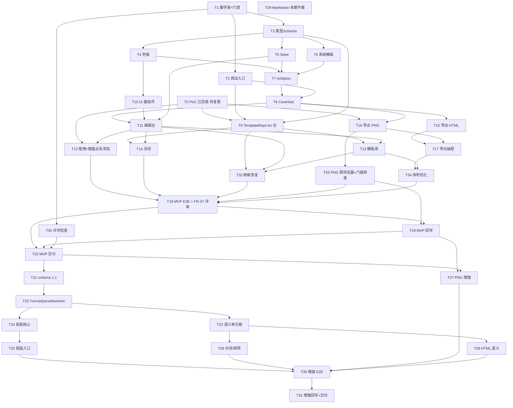

# pretty-table 实施计划（Fill MVP + 增强期①②）

> **For agentic workers：** 执行本计划请用 `superpowers:subagent-driven-development`（推荐：每个任务派一个新的执行体，任务之间做评审）或 `superpowers:executing-plans`（分批执行，设检查点）。步骤用复选框（`- [ ]`）跟踪。
> 作者：架构师 · 2026-10-20（Asia/Shanghai）· 主控派单「写实施计划」· 状态：**草案，待主控门禁**
> 依据版本：需求文档（14:4x 版，含 §6 P-1/P-2、§6.2 Q-001～Q-020 回流）、02-design 全部（开发约定含 §1.5 C-1～C-7、§5.2 MVP 离屏重绘、§6.2 可测性；设计增量含 Q-011/Q-020 改动）、ADR-001、research/脚手架选型、03-ux（uiverse-选型 v2 14:28 版）、05-verify/验收步骤（TC-PT-001～090）；**v2 追加**：research/PoC-结果-2026-10-20.md（四项通）、开发约定 §6.3 刷新恢复与 `DRAFT_*` 码、research/许可证-传递依赖方案-2026-10-20.md（用户已选 A）、03-ux/页面流「区块增删与点击添加」（键盘放区块 2026-10-20 补）；用户拍板 P-1 自动恢复、P-2 不做 Markdown、FR-24 含外框。
> 本文只写文档，不写业务实现代码；不改 01～03、07 目录和其他任何文件；不 git commit/push（推仓归文档管家）。

**Goal：** 按定稿需求（FR-01～FR-27）与设计，交付一个纯静态网页工具：从模板库（系统预设 + 我的模板）选底稿 → 编辑台填槽、换主题、在允许区内合并/拆分/对齐/强调、往表内槽位拖区块 → 另存为模板 → 复制 HTML / 导出 PNG。分两期：先 **Fill MVP**（FR-01～15），MVP 发布后再立项做 **增强期①②**（FR-16～27，E-7）。

**Architecture：** 单工程，分 `src/core`（核：类型、schema、主题色板、纯函数 store、`toOption` 适配、VTable 挂载、导出）与 `src/shell`（壳：Vue 页面、Pinia 外壳、槽位拖拽、属性面板、导出抽屉、本机存储、调试与故障注入）。调用方向只能是 **壳 → store → 核**；store 是唯一可变真相，每次编辑走「意图 → 校验 → 写 store → `toOption` 整表重映射 → 刷新 VTable」（路线 A）；HTML / PNG / Markdown 都只从 store 生成；PNG 从 MVP 起就用离屏同源重绘。存储、剪贴板、URL 参数、调试开关只在壳（开发约定 §1.5 C-3）。

**Tech Stack：** Vue 3 + Pinia + TypeScript（create-vue 生成）· Vitest · Playwright · ESLint（create-vue 选 ESLint 时一并带 oxlint）+ Prettier · pnpm · `@visactor/vtable` · Reka UI · 原生 CSS 变量 · idb-keyval · PapaParse（增强期）· @dnd-kit（`@dnd-kit/vue` / `@dnd-kit/dom` / `@dnd-kit/abstract` 0.5.1 精确锁版本，PoC-3 已通过；只管鼠标 / 触摸）· 浏览器原生 `Intl.NumberFormat`（增强期）· modern-screenshot（PoC-1 已通过，未引入；仅 B 路径切换时引入，T33 做演练）。

---

## Global Constraints（全局约束，摘自定稿文档原文）

| # | 约束 | 出处 |
|---|------|------|
| GC-1 | 脚手架用 **create-vue**，勾选：TypeScript ✅、Pinia ✅、Vitest ✅、Playwright ✅、ESLint ✅、Prettier ✅；**JSX ❌**；**Router 不装**（编辑台 / 模板库 / 导出用组件内状态切换） | 脚手架选型 §4.1、§7.2 第 2a 行、Q3 |
| GC-2 | **单工程**，目录分 `src/core`（TemplateJSON store、toOption、导出、格式化；不依赖 Vue 组件）与 `src/shell`（页面、组件、交互） | 脚手架选型 §4.2 |
| GC-3 | 包管理 **pnpm**，单工程；锁文件入库；Node 版本写进 `.nvmrc` / `engines`（具体版本开码时按 create-vue 当期要求定） | 脚手架选型 §4.3 |
| GC-4 | 无样式组件库 **Reka UI**：管交互行为与无障碍；Uiverse 片段只作视觉参考；颜色只取 U-2 | 脚手架选型 Q5；uiverse-选型 §0 |
| GC-5 | 样式用 **原生 CSS 变量 + SFC scoped**，**不引入 Tailwind**；Uiverse 里 Tailwind 写法改写为变量 | 脚手架选型 Q2、§7.2 第 3 行 |
| GC-6 | 模板本机存储 **IndexedDB + idb-keyval**，外包 **`TemplateRepo`** 接口；库名 `pretty-table`、对象仓 `kv`（`createStore('pretty-table','kv')`）、键 `tpl:<templateId>`；`draft:current` 存最近一次编辑草稿（P-1 已拍板自动恢复，开发约定 §6.3）；TemplateRepo 与 DraftRepo 共用同一个 `createStore('pretty-table','kv')`；localStorage 只放 `pt.pref.pngScale`（增强期倍率偏好） | 脚手架选型 Q7；开发约定 §6、§6.1、§6.2、§6.3 |
| GC-7 | 交付形态：**普通静态网页**（`vite build` 输出），本期唯一验收形态；无后端、无登录 | 脚手架选型 Q8；需求 OUT-3 |
| GC-8 | 中文字体用 **系统字体栈**（PingFang SC / Microsoft YaHei / Noto Sans CJK SC），同一个字体常量供画布、PNG、HTML 三处；出图前先 `await document.fonts.ready` | 脚手架选型 Q6、§7.2 第 8 行、§7.4 |
| GC-9 | 依赖只许 **MIT / Apache-2.0**（OUT-7）；例外已拍板：create-vue 生成的模板文件为 CC0，视为合规。**传递依赖按用户拍板方案 A（2026-10-20）**：间接依赖放行 BSD-2/3、ISC、0BSD、Unlicense；MPL-2.0 仅放行 `@resvg/resvg-js` 且不得进浏览器产物；GPL 类阻断；由 T35 落地自动检查 | 需求 OUT-7；许可证-传递依赖方案 |
| GC-10 | **门禁 G-1 核不得引用壳**：ESLint 内置 `no-restricted-imports` 对 `src/core/**` 禁止 `@/shell/**`、`vue`、`pinia`、`reka-ui`；`pnpm lint` 0 报错；CI / pre-commit 不过就拒收（开发约定 §1.5 **C-1**） | 脚手架选型 §7.2 门禁规则；开发约定 §1.5 |
| GC-11 | **门禁 G-2 色板单一来源**：T-A/B/C 只在 `src/core/theme/` 存一份 TS 色板数据，由它生成壳 CSS 变量、VTable 主题、导出 HTML 内联样式；**禁止**别处硬编码色值，**禁止**运行时从 DOM 反读 CSS 变量；评审搜到别处色值字面量即拒收（C-6） | 脚手架选型 §7.2；开发约定 §1.5 |
| GC-12 | FR-07 分层**按评审项验收**：主控在代码评审时按开发约定 §1.5 **C-1～C-7** 逐条跑命令、记录「通过 / 不通过 + 证据」，任一条不通过即阻断合入；不做界面测试、不交陌生人测试 | 需求 FR-07（Q-016）；开发约定 §1.5 |
| GC-13 | **不改 node_modules / 库文件**；不把 Galaxy 整包装进依赖 | 脚手架选型 C4；uiverse-选型 §3.7 |
| GC-14 | **ADR-001 不改**：VTable 主核 + 壳/核分层 + 表内槽位拖拽；VTable 只渲染，不当通用画布 | ADR-001；开发约定 §1.4 |
| GC-15 | 路线 A：Store 单写 + 整表重映射；**禁止** VTable records 与 `slots`/`merges` 双源真相；导出只读 store | Fill难度应对 §1.3、§2.2、§4.2 |
| GC-16 | **E-9 = A**：百分比槽粘不带 `%` 的数字**原样当百分数**：`25` → 25%（存 0.25），`0.5` → 0.5%（存 0.005）；**存比例**；带 `%` 按字面（`25%` 存 0.25）；只在百分比槽生效；**不出现任何改写提醒**（Q-010）；百分比默认最多 2 位小数、末尾 0 不显示（Q-009） | 需求 FR-22、§6.1 E-9、§6.2；设计增量 §2.2 |
| GC-17 | **E-1**：粘贴范围碰到合并格、locked 格、区块行一律**整块拒收**；`PASTE_HITS_BLOCK` **默认启用**；计数按可见网格（区块行算 1 行），同时命中时一次提示全部原因、区块/合并/锁定在前、超出在后（Q-020） | 需求 FR-18、E-1；设计增量 §2.2～2.3 |
| GC-18 | PNG：**MVP 起即离屏同源重绘**（同一 `toOption(store)` 新建页面外 VTable，`canvasWidth/Height:"auto"`，关动画，`exportImg()` 后销毁），导出**全表**；四周留白 **16 CSS px**（二次合成 2D 画布实现）；表格内容宽 = 列宽和 + 表格外框 2px（用户已拍板含外框）；等画布尺寸非 0 且连续两帧不变再读 / 再 `exportImg`，`release()` 前再等一帧；输出宽 =（表格内容宽 + 32）× 倍率、高 =（内容高 + 32）× 倍率，±2px。**MVP 固定 2×、无倍率选项、留白填 `paper` token**；**增强期**加 1/2/3×（默认 2×）与**透明底**（留白区与圆角外角落 alpha=0，格内纸色保留），像素超门槛报 `EXPORT_PNG_TOO_LARGE`，**不自动降倍** | 开发约定 §5.2、ARCH-T3；设计增量 §5.1；需求 FR-24 |
| GC-19 | **可测性**（开发约定 §6.2）：测试构建 `pnpm build --mode e2e`（`.env.e2e` 设 `VITE_PT_DEBUG=1`，`pnpm dev` 默认打开），正式 `pnpm build` 摇树去掉；`?pt-debug=1` 只读调试面板；`?pt-fault=<码>[,<码>]` 下一次调用按该码失败（`!` 后缀一直失败）；`?pt-png-max=<像素数>` 覆盖 PNG 门槛；注入点 = 壳 `src/shell/debug/fault.ts` 的 `faultGate(code)`，**核不读 URL** | 开发约定 §6.2 |
| GC-20 | Fill 范围锁：无增删行列、无列宽拖拽、无筛选/排序/冻结开关/填充柄/公式入口；无 Excel 拖角合并；无自由画布；无 Excel 导出入口 | 需求 IN-10、OUT-1/9/10/11、FR-15 |
| GC-21 | 表规模 ≤ 20 行 × 12 列；钉列 ≤ 2；单实例 blocks ≤ 20；主题切换淡入 ≤ 300ms，不整页 loading | 开发约定 §6；需求 §9 |
| GC-22 | 安全：槽位与区块文案一律当文本，导出 HTML 必须转义；不输出 `<script>`、事件属性、外链资源 | 需求 §9；开发约定 §5.1 |
| GC-23 | 空槽：预览显示占位，**导出输出空串，不输出占位句** | 开发约定 §1.3、ARCH-T4 |
| GC-24 | 同槽再拖入默认 **replace** | 开发约定 ARCH-T1 |
| GC-25 | 用户看不到错误码，只看白话文案（以 03-ux 为准）；任何失败**不清空 store** | 开发约定 §4.2；设计增量 §9 |
| GC-26 | 前端 UI 装饰件**只实现 `03-ux/uiverse-选型.md` v2 §5 点名条目**（U-01～U-05 主选或备选；U-06 不启用，空态只用文字 + 操作按钮）；改写成 Vue SFC + scoped CSS，颜色只用 U-2 变量，丢掉片段自带 JS 与 Tailwind 类名，保留来源注释；动效单次 ≤300ms（按钮按下 ≤120ms，开关/单选/提示 ≤150ms，复选 ≤200ms）；`prefers-reduced-motion: reduce` 时即时切换；导出产物不含任何 Uiverse 片段；缺条目回流交互，**禁止自己去 Galaxy 另挑**；交互行为交给 Reka UI | uiverse-选型 v2 §1、§3、§5 |
| GC-27 | 强调只有**红字 / 加粗 / 底色**三项，不做角标；表头行、左栏项名、非槽只读格、区块内不能强调（按钮置灰 +「此处由模板固定，不能强调」）；合并后**保留左上格文案，其余格清除**，可撤销一步；撤销**只一步、无重做** | 需求 FR-03⑥、FR-11、§6.2 Q-002/Q-004/Q-005、§8 |
| GC-28 | commit 说明用中文；写验分离（L 档）：实现者与验证者不能是同一个 bot；白名单外改动拒收 | 主控派单与角色约定 |

---

## 与 writing-plans 的差异（本项目约束改造）

1. **架构师不写业务实现代码。** 标准 writing-plans 要求每步给完整实现代码；本计划改为每个任务给：**接口签名**（TS 类型 / 函数名，取自设计文档，跨任务一致）、**测试用例清单**（用例名 + 输入 → 期望 / 断言要点，可附只含 `describe/it` 与断言意图的骨架）、**确切命令与期望结果**。实现函数体由实现者按签名与测试写。
2. **步骤仍是 TDD**：先写失败测试 → 跑一遍确认失败 → 实现 → 跑通 → 提交。
3. **每个任务多出字段**：负责角色、实现者 / 验证者、允许改（路径白名单）、禁止改、回报格式，以及对应的 05-verify 用例号（TC-PT-xxx）。实现者不得改 `tests/e2e/**`、`tests/acceptance/**`（归测试工程师）。
4. **测试位置**：核的单测与源码同目录（`src/core/**/*.spec.ts`），以满足 C-7「`pnpm vitest run src/core` 可脱离壳单测」；壳单测放 `src/shell/**/*.spec.ts`；E2E 放 `tests/e2e/`，按 05-verify 验收步骤写的用例放 `tests/acceptance/`。
5. **PoC 分支**：PoC 四项已通，受影响任务（T9、T12、T16、T27）定走 A 路径；B 路径的允许改文件与验收保留为切换预案，只在 T0 复跑或 T33 跨浏览器实测失败时启用。需求 P-1 / P-2 已拍板，不再分支；OUT-7 已拍板选 A，T35 为必做任务。
6. **失败态验收统一用故障注入**：凡能用 `?pt-fault=<码>` 触发的失败态，验收一律在测试构建里注入（T2 提供），不靠改代码或断网模拟；注入不了的（如真实配额满）用单测（fake-indexeddb）验收（开发约定 §6.2 验收归属）。
7. **文档没写的不编**：标「依据缺失」，写「当前假设 + 依据」，汇总在 §6 交主控 / PM 裁定。

---

## 0. 分阶段实施路线（先易后难，用户 2026-10-20 要求）

规则：按阶段顺序推进；高风险点已在 T0 PoC 前置验证；每个阶段结束时必须**能跑、能看、测试全绿**，主控验收出口后才进下一阶段。阶段内的任务按依赖顺序做，没有依赖的可以并行。难点（拖拽、整块粘贴）有意排在同期最后：前面阶段的东西都稳定了再做。

| 阶段 | 难度 | 目标 | 任务 | 进入条件 | 验收方式 | 可演示产物 |
|------|------|------|------|----------|----------|------------|
| S0 地基 | 易 | 脚手架和门禁跑通 | T0 补验（与全程并行）、T1、T2、T35 | 本计划放行、用户说「开工」 | `pnpm lint`、`pnpm test:unit`、`pnpm check:licenses` 退出码 0 | `pnpm dev` 打开空白页，`?pt-debug=1` 出现调试面板 |
| S1 只读渲染 | 易 | 静态骨架页：模板数据渲染成表 | T3、T4、T5、T6、T7、T8 | S0 验收通过 | `pnpm vitest run src/core` 全绿；FR-07 C-1～C-3 通过 | 页面显示一张系统模板渲染的表（只读） |
| S2 可编辑 | 中 | 主流程第一段：改表 | T10、T11 | S1 验收通过 | T10/T11 验收命令全过；撤销单测全绿 | 直接改格子文字、合并、对齐、强调、换主题，撤销一步 |
| S3 本机存储 | 中 | 主流程第二段：存取 | T9、T13、T14、T32 | S2 验收通过 | 存储单测（fake-indexeddb）全绿；故障注入 `TEMPLATE_*`/`DRAFT_*` 提示正确 | 从模板库选模板、另存我的模板；刷新后内容还在 |
| S4 导出 | 中 | 主流程打通：导出 | T15、T16、T17 | S3 验收通过 | PNG 尺寸按开发约定 §5.2 公式 ±2px；§5.2 四步比对通过 | 复制 HTML、下载 2× PNG，全流程从选模板到导出走通 |
| S5 难交互 | 难 | 次要功能：拖拽区块 | T12 | S4 验收通过 | T12 验收命令全过；键盘「点击添加」端到端用例通过 | 鼠标拖入区块、键盘点击添加，读屏有播报 |
| S6 加固与发布 | 中 | 边界、性能、兼容，MVP 上线 | T33、T34、T18、T19、T20 | S5 验收通过 | 三浏览器实测完成并回写门槛；`pnpm check:bundle` 退出码 0；MVP 验收用例全部执行；FR-07 评审通过 | 线上 MVP 地址 |
| S7 增强·格式 | 易 | schema 1.1 与数值格式 | T21、T22、T23 | MVP 交付、增强期立项 | 迁移与格式化单测全绿 | 旧草稿可读；数字/百分比/金额按格式显示；✓✗◐ |
| S8 增强·模板与导出 | 中 | 新模板与导出增强 | T26、T27、T28 | S7 验收通过 | T26～T28 验收命令全过；透明底四边与圆角外 alpha=0 | 价目/矩阵模板；PNG 1/2/3× 与透明底；HTML 粘进公众号不走样 |
| S9 增强·整块粘贴 | 难 | 最难点：粘贴填槽 | T24、T25 | S8 验收通过 | 粘贴核心单测全绿；错误按设计增量 §2.3 一并报告 | 从 Excel 整块粘贴进表格 |
| S10 增强·收尾 | 中 | 增强期上线 | T30、T31 | S9 验收通过 | 增强期验收用例全部执行 | 线上增强版 |

说明：任务编号保持不变，实际先后以本表为准，依赖关系仍以各任务「依赖」字段与 §7 为准。T35 原来只要求「在 T20 前完成」，因为它简单且只依赖 T1，提到 S0 做。

## 1. 文件结构

> **当前假设：** 工程根目录 `pretty-table-app/`，独立 git 仓，不进 grok 文档仓，与 `pretty-table-poc/` 同级（依据：主控派单 PoC 不进 grok 仓的同一原则）；名称与位置由主控派单最终定。下文路径相对工程根。

```
pretty-table-app/
├─ package.json / pnpm-lock.yaml / .nvmrc            # GC-3
├─ .env.e2e                                          # VITE_PT_DEBUG=1（GC-19）
├─ eslint.config.ts                                  # C-1：src/core/** 禁 @/shell/**、vue、pinia、reka-ui；src/shell/** 禁 @/core/* 深路径（C-4）
├─ vite.config.ts / vitest.config.ts / playwright.config.ts
├─ scripts/
│  ├─ check-color-literals.mjs                       # G-2 / C-6
│  ├─ check-licenses.mjs                             # OUT-7 方案 A（T35）
│  ├─ report-bundle.mjs                              # 体积门禁（T34）
│  └─ review-fr07.sh                                 # 一次跑完 §1.5 C-1～C-7 的命令，输出给主控评审记录
├─ src/
│  ├─ main.ts / App.vue                              # 壳入口；无 router
│  ├─ core/                                          # 核：不引用壳、不碰存储/剪贴板/URL/调试开关（C-1～C-3）
│  │  ├─ index.ts                                    # 核唯一出口（C-4）
│  │  ├─ types.ts / errors.ts
│  │  ├─ schema/validate.ts (+ .spec.ts)
│  │  ├─ schema/migrate.ts                           # 【增强期】1.0→1.1 读时迁移
│  │  ├─ theme/palettes.ts font.ts cssVars.ts vtableTheme.ts inlineStyle.ts (+ specs)
│  │  ├─ theme/semantic.ts                           # 【增强期】✓✗◐ / 推荐列 → 既有 token
│  │  ├─ store/intent.ts mergeGuard.ts editorState.ts (+ specs)
│  │  ├─ store/txn.ts                                # 【增强期】StoreTxn
│  │  ├─ adapter/toOption.ts (+ spec)
│  │  ├─ render/coreHost.ts (+ spec)                 # mount / CoreHandle
│  │  ├─ export/html.ts                              # MVP：全内联；增强期：语义化 + 窄屏
│  │  ├─ export/png.ts                               # MVP 起：离屏重绘、留白 16、measureContent / measurePng
│  │  ├─ export/model.ts                             # 【增强期】ExportModel
│  │  ├─ export/markdown.ts                          # 【增强期·P2】
│  │  ├─ format/formatTokens.ts parseNumeric.ts      # 【增强期】
│  │  ├─ paste/parser.ts planner.ts validator.ts     # 【增强期】
│  │  └─ templates/index.ts compare-alpha-v1.json detail-alpha-v1.json (+ 增强期 pricing-v1.json matrix-v1.json)
│  └─ shell/
│     ├─ debug/fault.ts                              # faultGate(code)、?pt-fault 解析
│     ├─ debug/flags.ts                              # isDebugBuild、?pt-debug、?pt-png-max 读取
│     ├─ debug/DebugPanel.vue                        # 只读面板
│     ├─ debug/sources.ts                            # registerDebugSource
│     ├─ stores/editor.ts / stores/library.ts        # Pinia 外壳
│     ├─ repo/kvStore.ts（createStore('pretty-table','kv')，唯一）templateRepo.ts idbTemplateRepo.ts draftRepo.ts localStorageTemplateRepo.ts（仅 B 路径）prefs.ts（增强期）
│     ├─ theme/applyCssVars.ts
│     ├─ ui/PtButton.vue PtSwitch.vue PtCheckbox.vue PtSegmented.vue PtLoader.vue PtTooltip.vue
│     │     PtDialog.vue PtDrawer.vue PtToast.vue PtToggleGroup.vue
│     ├─ pages/LibraryPage.vue EditorPage.vue
│     ├─ library/**                                  # 卡片、Chip、空态
│     ├─ editor/PreviewHost.vue PropertyPanel.vue EditorToolbar.vue BlockLibrary.vue SaveTemplateDialog.vue LeaveGuard.ts errorCopy.ts draftSync.ts
│     ├─ dnd/slotDnd.ts placeMode.ts（键盘 / 点击添加）SlotOverlay.vue dndKitAdapter.ts（仅鼠标 / 触摸；B 路径换 pointerDnd.ts）
│     ├─ export/ExportDrawer.vue clipboard.ts
│     └─ paste/PasteEntry.vue pasteCopy.ts           # 【增强期】
├─ reports/png-threshold.md png-fallback-drill.md   # T33 产出
└─ tests/
   ├─ component/**                                   # 需真实 Canvas 的组件页（Playwright），实现者写
   ├─ e2e/**                                         # 测试工程师写；实现者不得改
   └─ acceptance/**                                  # 测试工程师按 05-verify/验收步骤 TC-PT-001～090 写
```

| 设计模块 | 落点 | 出处 |
|---|---|---|
| shell-app | `main.ts`、`App.vue`、`pages/*`、`editor/LeaveGuard.ts` | 设计方案 §2；开发约定 §1.2 |
| template-store | 纯函数 `src/core/store/*` + Pinia 外壳 `src/shell/stores/editor.ts` | 开发约定 §1.2；脚手架 §4.2；设计增量 §6.1 状态管理说明 |
| slot-dnd | `src/shell/dnd/*`、`editor/BlockLibrary.vue` | 开发约定 §1.2 |
| property-panel | `editor/PropertyPanel.vue` | 开发约定 §1.2 |
| render-core | `core/adapter/toOption.ts`、`core/render/coreHost.ts` | 开发约定 §1.2；Fill难度应对 §2.3 |
| export-html / export-png | `core/export/*` + 壳 `export/*` | 开发约定 §5 |
| embed-api | `core/render/coreHost.ts` 的 `mount`（只预留，不发 SDK） | 开发约定 §3；U-4 |
| 调试与故障注入 | `src/shell/debug/*` | 开发约定 §6.2 |
| 增强期新增 | 见设计增量 §7，上表「【增强期】」 | 设计增量 §7 |

---

## 2. 跨任务统一接口（Interfaces 总表）

> 各任务 Consumes / Produces 只用下面的名字。语义取自开发约定 §2～§4、§6.2，Fill难度应对 §3～§4，设计增量 §2～§5；「当前假设」见 §6。

```ts
// ===== src/core/types.ts =====
export type ThemeId = 'T-A' | 'T-B' | 'T-C'
export type BlockType = 'sectionBar' | 'groupHeader' | 'emphFooter' | 'leftTag'
export type Align = 'left' | 'center' | 'right'
export type Emphasis = 'bold' | 'red' | 'bg'
export type CellCoord = [row: number, col: number]
export interface MergeRange { start: CellCoord; end: CellCoord }
export type SlotObject = { text: string | number; align?: Align; emphasize?: Emphasis | Emphasis[] }
export type SlotValue = string | number | SlotObject
  // 增强期 1.1 追加：| { mark: 'yes'|'no'|'partial'|null; align?; emphasize? } | { num: number|null; align?; emphasize? }
export interface ThemeTokens { primary: string; zebra?: boolean | string; emphasis?: string; border?: string; background?: string; tag?: string }
export interface BlockDesc { id: string; type: BlockType; slotId: string; props?: { label?: string; text?: string; styleTier?: 1 | 2 | 3; [k: string]: unknown } }
export interface BlockSlotDef { id: string; accept: BlockType[]; rowHint?: string; region?: string; mutexGroup?: string; occupiedPolicy?: 'replace' | 'reject' }
export interface LayoutSpec {
  rowCount: number; colCount: number; frozenColCount?: number
  merges?: MergeRange[]; allowedMerges?: MergeRange[]; structuralMerges?: MergeRange[]
  blockSlots: BlockSlotDef[]; headerLevels?: 1 | 2 | 3
  slotGrid?: (string | null)[][]          // 当前假设：MVP 底稿就带（§6 D-1）；1.1 正式化
  // 增强期 1.1：recommendableCols?: number[]; captionSlot?: string
}
export type TemplateType = 'compare' | 'detail' | 'pricing' | 'matrix'
export interface TemplateMeta { displayName?: string; description?: string; templateType?: TemplateType; origin?: 'preset' | 'user'; sourceTemplateId?: string | null; savedAt?: string | null }
export interface TemplateInstance {
  schemaVersion: string; templateId: string; themeId: ThemeId | string; themeTokens?: ThemeTokens
  slots: Record<string, SlotValue>; blocks: BlockDesc[]; layout: LayoutSpec; meta?: TemplateMeta
  // 增强期 1.1：slotDefs?: Record<string, SlotDef>; highlight?: { recommendCol: number | null }
}
export type TemplateDefinition = TemplateInstance
export type TemplateJSON = TemplateInstance

// ===== src/core/errors.ts（开发约定 §4.1 + 设计增量 §9）=====
export type ErrorCode =
  | 'TEMPLATE_INVALID' | 'THEME_MISSING' | 'SLOT_UNKNOWN' | 'SLOT_MISS' | 'BLOCK_TYPE_REJECT'
  | 'BLOCK_SLOT_OCCUPIED' | 'BLOCK_NOT_FOUND' | 'MERGE_NOT_ALLOWED' | 'MERGE_STRUCTURAL' | 'SLOT_DROP_BLOCKED'
  | 'RENDER_FAIL' | 'EXPORT_HTML_FAIL' | 'EXPORT_PNG_FAIL' | 'EXPORT_BLOCKED_RENDERING'
  | 'TEMPLATE_LIST_FAIL' | 'TEMPLATE_SAVE_FAIL'     // SAVE_FAIL details.reason: 'quota' | 'io'
  | 'DRAFT_RESTORE_FAIL' | 'DRAFT_SAVE_FAIL'        // 开发约定 §6.3
  | 'EXPORT_PNG_TOO_LARGE'                  // 增强期
  | PasteErrorCode                          // 增强期
export type PasteErrorCode = 'PASTE_NO_ANCHOR' | 'PASTE_EMPTY' | 'PASTE_PARSE_FAILED' | 'PASTE_UNSUPPORTED'
  | 'PASTE_HITS_MERGED' | 'PASTE_HITS_BLOCK' | 'PASTE_HITS_LOCKED' | 'PASTE_OUT_OF_RANGE' | 'PASTE_STALE' | 'PASTE_COMMIT_FAILED'
export type WarnCode = 'SLOT_UNKNOWN' | 'BLOCK_TYPE_REJECT' | 'THEME_MISSING' | 'UNKNOWN_FIELD' | 'MARK_UNKNOWN' | 'FORMAT_UNKNOWN' | 'PASTE_NOTICE_AS_TEXT'
export interface CoreError { code: ErrorCode; message: string; details?: unknown }
export interface CoreWarning { code: WarnCode; message: string; details?: unknown }
export type Result<T> = { ok: true; value: T; warnings?: CoreWarning[] } | { ok: false; error: CoreError }

// ===== schema / theme =====
export function validateInstance(json: unknown): Result<TemplateInstance>
export interface Palette { paper: string; primary: string; headerText: string; zebra: string; emphasis: string; emphasisSoft: string; border: string; tag: string; tagText: string }
export const PALETTES: Readonly<Record<ThemeId, Palette>>
export const THEME_NAMES: Readonly<Record<ThemeId, string>>
export const DEFAULT_THEME_ID: ThemeId                     // 'T-A'
export function resolveTheme(themeId: string, tokens?: ThemeTokens): { themeId: ThemeId; palette: Palette; zebraOn: boolean; warning?: CoreWarning }
export const FONT_STACK: string
export function toCssVars(palette: Palette): Record<`--pt-${string}`, string>
export function toVTableTheme(palette: Palette, opts: { zebraOn: boolean; transparentUnderlay?: boolean }): unknown
export function cellInlineStyle(palette: Palette, cell: { role: 'header' | 'body' | 'label' | 'block'; zebraRow?: boolean; align?: Align; emphasize?: Emphasis[] }): string

// ===== store =====
export type EditIntent =
  | { kind: 'setSlot'; slotId: string; value: SlotValue }
  | { kind: 'setTheme'; themeId: ThemeId }
  | { kind: 'setZebra'; on: boolean }
  | { kind: 'merge'; range: MergeRange }
  | { kind: 'split'; range: MergeRange }
  | { kind: 'setAlign'; slotId: string; align: Align }
  | { kind: 'setEmphasis'; slotId: string; emphasize: Emphasis[] }
  | { kind: 'addBlock'; block: BlockDesc }
  | { kind: 'removeBlock'; blockId: string }
  | { kind: 'updateBlock'; blockId: string; props: Partial<NonNullable<BlockDesc['props']>> }
  // 增强期：| { kind: 'setRecommendCol'; col: number | null }
export function applyEditIntent(inst: TemplateInstance, intent: EditIntent, opts?: { blockSlotPolicy?: 'replace' | 'reject' }): Result<TemplateInstance>
export function canMerge(layout: LayoutSpec, range: MergeRange): Result<void>
export function canSplit(layout: LayoutSpec, range: MergeRange): Result<void>
export function isEmphasizable(inst: TemplateInstance, slotId: string): boolean    // GC-27 禁止强调区
export interface EditorState { current: TemplateInstance; undoSnapshot: TemplateInstance | null; dirty: boolean; version: number }
export function createEditorState(inst: TemplateInstance): EditorState
export function dispatch(state: EditorState, intent: EditIntent): Result<EditorState>
export function undoOnce(state: EditorState): EditorState
export function markClean(state: EditorState): EditorState

// ===== adapter / render =====
export interface RenderContext { mode: 'preview' | 'export'; transparentUnderlay?: boolean }
export function toOption(inst: TemplateInstance, ctx: RenderContext): unknown
export type RenderState = 'loading' | 'ready' | 'error'
export interface PngExportOptions { scale?: 1 | 2 | 3; transparent?: boolean; maxPixels?: number }
export interface CoreOptions { initial?: TemplateJSON; blockSlotPolicy?: 'replace' | 'reject'; onError?: (err: CoreError) => void; onRenderState?: (s: RenderState) => void }
export interface CoreHandle {
  loadTemplate(json: TemplateJSON): void         // 壳每次 store 变更后传快照（整表重映射）
  applyTheme(themeId: string | ThemeTokens): void
  setSlot(slotId: string, value: SlotValue): void
  addBlock(block: BlockDesc): void
  removeBlock(blockId: string): void
  setMerge?(range: MergeRange): void
  exportHtml(): Promise<string>
  exportPng(opts?: PngExportOptions): Promise<Blob>
  getPreviewEl(): HTMLElement | null
  getRenderState(): RenderState
  destroy(): void
}
export function mount(el: HTMLElement, options?: CoreOptions): CoreHandle

// ===== export =====
export const PNG_MARGIN_CSS_PX = 16
export const PNG_MAX_PIXELS_DEFAULT: number      // 暂定 16_777_216；T0 PoC 实测后回写设计增量 §5.1
export function measureContent(inst: TemplateInstance): Promise<{ width: number; height: number }>   // 表格内容宽/高 = 列宽和 + 2px 外框 / 行高和 + 2px（CSS px，全列/全行，离屏 1× 定稿后读）
export function measurePng(inst: TemplateInstance, scale: 1 | 2 | 3): Promise<{ width: number; height: number }>  // (内容 + 32) × scale
export function exportPng(inst: TemplateInstance, opts: Required<Pick<PngExportOptions, 'scale' | 'transparent'>> & { maxPixels?: number }): Promise<Result<Blob>>
export function exportHtml(inst: TemplateInstance): Result<string>
// T34：渲染相关模块经动态导入出口暴露，壳仍只从 @/core 导入
export function loadRenderCore(): Promise<{ mount: typeof mount; exportPng: typeof exportPng; measurePng: typeof measurePng; measureContent: typeof measureContent }>

// ===== src/shell/debug =====
export function isDebugBuild(): boolean                         // import.meta.env.VITE_PT_DEBUG
export type FaultCode = 'DRAFT_RESTORE_FAIL' | 'DRAFT_SAVE_FAIL' | 'TEMPLATE_LIST_FAIL' | 'RENDER_FAIL' | 'EXPORT_HTML_FAIL' | 'EXPORT_PNG_FAIL' | 'TEMPLATE_SAVE_FAIL' | 'PASTE_COMMIT_FAILED' | 'EXPORT_PNG_TOO_LARGE'
export function faultGate(code: FaultCode): CoreError | null    // 命中注入则返回错误（一次性，'!' 一直）
export function pngMaxOverride(): number | null                 // ?pt-png-max
export function registerDebugSource(key: 'instance' | 'savedTemplates' | 'draft' | 'contentSize' | 'pngEstimate' | 'meta', getter: () => unknown): void

// ===== src/shell/repo =====
export interface UserTemplateRecord { templateId: string; name: string; description?: string; templateType: TemplateType; sourceTemplateId: string | null; savedAt: string; sizeBytes: number }
export interface TemplateRepo {
  list(): Promise<Result<UserTemplateRecord[]>>                // 失败 TEMPLATE_LIST_FAIL
  get(templateId: string): Promise<TemplateDefinition | null>
  add(def: TemplateDefinition, info: { name: string; description?: string }): Promise<Result<UserTemplateRecord>>   // 只新增；失败 TEMPLATE_SAVE_FAIL（details.reason 'quota' | 'io'）
  remove(templateId: string): Promise<void>
}
export const REPO_LIMITS: { maxCount: 50; maxBytes: 2_097_152 }  // ARCH-T5 假设
export function createTemplateRepo(): TemplateRepo
export const kvStore: UseStore                                   // createStore('pretty-table','kv')；键前缀 tpl: / draft:
export interface DraftRecord { schemaVersion: string; templateId: string; instance: TemplateInstance; savedAt: string }
export interface DraftRepo { load(): Promise<Result<DraftRecord | null>>; save(rec: DraftRecord): Promise<Result<void>>; clear(): Promise<void> }   // 键 draft:current（T32）
export function createDraftRepo(): DraftRepo
```

增强期接口（FormatTokens、parseNumeric、Paste、StoreTxn、ExportModel、Markdown）在 T21～T29 给出，名字取自设计增量 §2、§4、§5、§7。

## 3. 通用约定（各任务共用）

**回报格式（R-标准）**：每个任务完成后，实现者与验证者各回报一次，固定字段：
```
任务：Tx 任务名 ｜ 角色：实现者/验证者 ｜ bot：<名>
结果：通过 / 不通过 / 阻塞
提交：<commit hash 列表>（中文说明）｜ 改动文件：<列表>（须全在白名单内）
命令与结果：<每条验收命令 + 末尾摘要行（通过数/失败数/退出码）>
测试：新增 <n> 条，全部 <通过/失败条目>
分支：走了哪条路径（A/B，如有）及依据
偏差与当前假设：<无 / 列表>
阻塞与回流：<无 / 需谁裁定什么>
```
验证者另加：「独立复跑命令结果」「抽查 TC-PT 编号与结论」「白名单核对：通过/越界文件」。

**通用禁止改（所有任务默认）**：`node_modules/**`、grok 文档仓 `docs/01-requirements/**`、`docs/02-design/**`、`docs/03-ux/**`、`docs/07-decisions/**`（回写只走 T19/T31 由文档管家执行）；`tests/e2e/**`、`tests/acceptance/**`（除测试工程师任务）；其他任务白名单内、本任务白名单外的任何文件。

**通用门禁命令（每个实现任务提交前都要过）**：`pnpm lint`（0 error）、`pnpm type-check`（0 error）、`pnpm check:colors`（0 命中）、`pnpm vitest run`（全绿）。

**失败态注入（T2 之后可用）**：测试构建 `pnpm build --mode e2e && pnpm preview`，或 `pnpm dev`；URL 加 `?pt-fault=<码>`。

---

## 4. 任务清单

### T0 · PoC 技术验证 —— **已完成（前端开发 2026-10-20，四项通），待测试工程师独立复跑**

- **状态**：已完成（实现者自测通过）；**待验证者独立复跑**。结论与证据见 `docs/research/PoC-结果-2026-10-20.md`（工程 `C:\Users\Administrator\Documents\pretty-table-poc\`，未进 grok 仓）
- **对应 FR**：FR-06、FR-08、FR-13、FR-14、FR-24（为其落地方案定路径）
- **负责角色**：前端开发 ｜ **实现者**：前端开发（已完成）｜ **验证者**：测试工程师（独立复跑，未执行）
- **依赖**：无
- **允许改**：独立目录 `pretty-table-poc/**`（不进 grok 仓）；复跑只新增 `pretty-table-poc/artifacts/rerun-*` 输出，不改实现
- **禁止改**：grok 文档仓任何文件；`pretty-table-app/**`
- **PoC 实测结论（2026-10-20，Chrome 155 无头，12/12 通过）**：

| 子项 | 结论 | 兜底 | 关键实测 | 留给开码的硬性要求 → 落到 |
|---|---|---|---|---|
| PoC-1 VTable exportImg 3× + 像素上限拦截 | **通** | 未启用（modern-screenshot 未用） | 内容 CSS 482×362（列宽和 480 + 外框 2px）；1×/2×/3× 输出与 CSS×倍率误差 0px；3× 独立颜色数 408 vs 1× 41（真重绘）；大表 3× 估算 53,676,756 > 16,777,216 → `EXPORT_PNG_TOO_LARGE`，不建倍率实例、无残留 | ①轮询画布尺寸非 0 且连续两帧不变再读 / 再 `exportImg`；②`release()` 前再等一帧；③尺寸口径含外框（列宽和 + 2px）→ **T16** |
| PoC-2 透明底只透外围 | **通** | 未启用 | 透明组外围 59,496 像素 alpha 全 0、角点 0、格内 255；对照组角点 255 | 外围留白由二次合成画布提供（auto 画布没有「表格以外」区域）→ **T16 / T27** |
| PoC-3 dnd-kit 键盘拖拽 | **通**（`@dnd-kit/vue` 0.5.1 锁版本） | 未启用 | 排序与放入槽位都通；drop 只发意图，由 store 写入，可一步撤销 | 槽位场景键盘是**步长平移**（30 次右移才到槽），须做槽位键盘跳转 + 「点击添加」等价入口；可拖元素加 `tabindex="0"`；与 VTable 叠加层共存未测 → **T12** |
| PoC-4 idb-keyval 存取 + 刷新后仍在 | **通** | — | save/list/get/remove，reload 后仍在 | PoC 用的是 `createStore('pretty-table','templates')`，**以设计为准**改为 `createStore('pretty-table','kv')`，键前缀 `tpl:` / `draft:` → **T9 / T32** |

- **PoC 未覆盖、已转入后续任务**：Firefox / Safari 实测、像素门槛浏览器实测校准与 `?pt-png-max` 覆盖验证（原 PoC-1c/1d）、modern-screenshot 兜底演练 → **T33**；构建体积（产物 JS 2.16MB / gzip 555KB，主要是 VTable / vrender）→ **T34**；dnd 与 VTable 预览叠加层共存、读屏播报 → **T12**；IndexedDB 配额满 / 隐私模式 → **T9 / T32** 单测；传递依赖许可（MPL-2.0 / BSD / ISC 等）→ **T35（OUT-7 已选 A）**；Reka UI 抽屉焦点与 Toast 读屏（原 PoC-5）→ **T10**
- **复跑用的通过标准 / 失败判定 / 兜底（保留，验证者复跑与后续切换都按此）**：

| 子项 | 通过标准 | 失败判定 | 兜底方案（切 B 路径） | 切换条件 |
|---|---|---|---|---|
| **PoC-1a** 离屏 3× 出图 | PoC 级：表格本体图宽高 = 内容（列宽和 + 外框 2px）× 3 ±2px（PoC 未做留白合成；正式输出 =（内容 + 32）× 倍率，见 T16 / T0-V01）；全表含横滚隐藏列与钉列；文字锐利（独立颜色数 3× 明显多于 1×） | 尺寸不符 / 缺列 / 文字糊 / 抛错 | **modern-screenshot**（MIT）截离屏 `ExportHtml` DOM（同源 store），`scale` 控倍率；须主控门禁同意 | 复跑失败，或 T33 在任一目标浏览器（Chromium / Firefox / WebKit）失败且修不好 |
| **PoC-1b** 像素上限拦截 | 超门槛 100% 拦下、不建倍率实例、无残留；未超照常出图（PoC 估算未含留白；正式实现按含 16px 留白的输出像素估算，见 T16 / T0-V07） | 拦截前已开始渲染或崩溃 | 同 1a，拦截逻辑不变 | 同上 |
| **PoC-1c** 像素门槛校准（转 T33） | Chromium、Firefox、WebKit/Safari 各给出实测最大成功像素与测法 | 无稳定值 | 维持 16,777,216 并记录不稳定区间 | — |
| **PoC-1d** `?pt-png-max` 覆盖（转 T33） | 取 2× 与 3× 预估之间：3× 必触发 `EXPORT_PNG_TOO_LARGE`，2× 必通过 | 任一不符 | 修正读参优先级后重测 | — |
| **PoC-2** 透明底 | 外围 alpha=0（**四边**都要测，PoC 原用例只测了右 / 下，见 T0-V00）、格内 alpha=255；对照组外围 alpha=255 | 格内也透 / 外围不透 | modern-screenshot `backgroundColor:null` + 外层透明 | 复跑或 T33 跨浏览器失败 |
| **PoC-3** dnd-kit 键盘 | 鼠标与纯键盘（Space 拿起 → 方向键 → Space 放下 / Esc 取消）都能落入槽位，drop 只发意图、可撤销 | 键盘任一步不可用 / 落点不准 | **自写指针事件拖拽 + 独立键盘路径**（点击添加 → 选槽 → Enter / Esc），不引 dnd-kit | 复跑失败，或 T12 叠加层共存无法解决 |
| **PoC-4** idb-keyval | 刷新、重启后都在；JSON 往返无损 | 读不回 / Safari 普通窗口不可用 | `localStorage` 实现同一接口（键 `pt.repo.tpl:<id>`、`pt.repo.draft:current`） | 复跑失败，或 T33 Safari 实测不可用 |

- **T0 补验子任务（测试复跑回流 + 05-verify/测试总表 §2.6「PoC 未覆盖」U-1～U-15，共 16 条）**：PoC 结论只覆盖四项主干，下列各条逐条补验。PoC 级可验的（T0-V00）在 `pretty-table-poc/` 内补；其余依赖正式代码，在「承接任务」完成后由**测试工程师**执行（实现者不得自验），结果回填测试总表对应 U 条目与 TC。尺寸口径统一：**内容宽 = 列宽和 + 外框 2px**（高同理），**输出 =（内容 + 32）× 倍率**，**像素预估含 16px 留白**（即按输出尺寸算）

| 子任务 | 对应总表条目 | 补验内容 | 判据（通过标准） | 承接任务 | 执行者 |
|---|---|---|---|---|---|
| **T0-V00** | 测试复跑回流 D-2（与 U-2 相关） | PoC-2 只验了**右 / 下**外围透明；补验**上 / 左**外围与四角 | 在 PoC 固定画布用例中把外围放到四边（内容四周各 +20px）：四条边带全部像素 alpha=0；四角 alpha=0；格内 alpha=255；对照组四边 alpha=255 | T0（PoC 工程内补） | 测试工程师 |
| **T0-V01** | U-1 | 四周 16px 留白二次合成与尺寸公式 | 2× 输出 =（内容 + 32）× 2 ±2px；四边留白宽 = 16×倍率 ±1px；MVP 留白像素 = `paper` 色、alpha=255 | T16 | 测试工程师 |
| **T0-V02** | U-2 | 透明模式**四周留白**与**圆角外角落** alpha=0 | 1×/2×/3× 各一张：四条留白带全部 alpha=0；主题 `frameStyle.cornerRadius>0` 时外框圆角以外像素 alpha=0（允许抗锯齿过渡 ≤2px 宽半透明）；格内 alpha=255 | T27 | 测试工程师 |
| **T0-V03** | U-3 | 横滚隐藏列 / 钉列宽表导出全表 | 20 列 × 12 行、钉 1 列、预览处于横滚中段时导出：PNG 宽 =（列宽和 + 2 + 32）× 倍率 ±2px；最左钉列与最右隐藏列文字均可在 PNG 中读到（像素抽样非底色） | T16 | 测试工程师 |
| **T0-V04** | U-4 | 导出 PNG 与预览叠图一致 | 预览截图与 1× 导出（裁去留白）`toHaveScreenshot` 比对差异像素 ≤1%；或按测试总表 4 步比对法（主题色、合并、强调、对齐）全部一致 | T16 | 测试工程师 |
| **T0-V05** | U-5 | 3× 边长 >6000「图片较大」提示；「改用 2x 重试」可成功；生成中禁用 | 输出任一边 >6000 时出现提示文案（以 03-ux 为准）；超门槛时点「改用 2x 重试」得到 2× PNG；生成中下载按钮 `disabled` 且连点只出一张 | T27（含 T17 防连点） | 测试工程师 |
| **T0-V06** | U-6 | 倍率默认 2× 与本机记忆、像素预估显示 | 首次打开抽屉选中 2×；改选 3× 后刷新仍为 3×（`localStorage['pt.pref.pngScale']==='3'`）；抽屉「约 W × H 像素」=（内容 + 32）× 倍率，与实际输出一致 ±2px | T27 | 测试工程师 |
| **T0-V07** | U-7 | 像素门槛三浏览器实测校准；`?pt-png-max` / `?pt-fault` 测法 | Chromium / Firefox / WebKit（及真机 Safari）各有实测最大成功输出像素（含留白）记录；`?pt-png-max` 取 2× 与 3× 预估（含留白）之间：3× 必报 `EXPORT_PNG_TOO_LARGE`、2× 必通过；`?pt-fault=EXPORT_PNG_TOO_LARGE` 直接出提示；实测值经 T19 回写设计增量 §5.1 | T33、T19 | 测试工程师 |
| **T0-V08** | U-8 | 指针拖拽：悬停高亮、幽灵块、未命中回弹、Esc 取消、同槽替换 | 鼠标拖动中仅命中槽位时高亮；拖动时有幽灵块跟随；表外松手回弹 +「请放到表内虚线槽位」；拖动中按 Esc 取消且无写入；同槽再放 = 替换 +「已替换原区块」 | T12 | 测试工程师 |
| **T0-V09** | U-9 | 「点击添加」等价入口与键盘放区块（PoC 步长平移方案已废弃） | 单击库项 → 单击高亮槽 = 落成；键盘：库项上 Enter → 焦点到第一个可放槽 → ↑↓ / Tab 只在高亮槽间移动 → Enter 放下 / Esc 取消；全程不按住任何键；`DragDropProvider` 未注册 KeyboardSensor | T12 | 测试工程师 + 陌生人测试专员 |
| **T0-V10** | U-10 | dnd 叠加层与 VTable 预览 Canvas 共存、读屏播报 | 非拖拽态预览可正常点选 / 多选 / 横滚；横滚、主题切换、缩放后槽框与行间位置重合 ±2px；读屏（NVDA 或 VoiceOver）在键盘放区块时播报「第 i 个槽位，共 n 个，按回车放入」 | T12 | 测试工程师 |
| **T0-V11** | U-11 | IndexedDB 配额满 / 隐私模式 / 重启浏览器 / 无痕隔离 / `file://` | 配额满（fake-indexeddb 注入或真实填满）→ `TEMPLATE_SAVE_FAIL reason=quota` 文案正确；隐私 / 无痕模式下我的模板列表为空态提示、另存失败 reason=io，不崩；重启浏览器后我的模板仍在；无痕窗口看不到普通窗口的模板；`file://` 打开时行为记录在案（GC-7 交付形态为静态站，`file://` 只记录不作通过条件） | T9、T14 | 测试工程师 |
| **T0-V12** | U-12 | 草稿 `draft:current` 刷新恢复 | 按 T32 用例 1～13：刷新后内容恢复、撤销按钮灰；防抖 800ms；`pagehide` / `visibilitychange` 补写；`pastePending` 不写；`?pt-fault=DRAFT_RESTORE_FAIL` / `DRAFT_SAVE_FAIL` 降级路径正确 | T32 | 测试工程师 |
| **T0-V13** | U-13 | Firefox / Safari 覆盖（PoC 仅系统 Chrome） | PNG（T16 / T27）、拖拽（T12）、存储（T9 / T32）的组件测在 Playwright chromium（自带内核）/ firefox / webkit 三项目全绿；真机 Safari 近两版抽查 PNG 尺寸、透明、拖拽、刷新恢复各 1 次 | T33（PNG）、T12、T9、T32 | 测试工程师 |
| **T0-V14** | U-14 | 传递依赖许可是否满足 OUT-7 | OUT-7 已选 A：T35 `pnpm check:licenses` 退出码 0、`dist/THIRD-PARTY-LICENSES.txt` 存在、dist 无 resvg 原生代码 | T35 | 测试工程师 |
| **T0-V15** | U-15 | PoC 四项以外的功能（HTML 导出、粘贴填槽、格式化、主题、合并拆分等） | 不在 PoC 补验范围；按 05-verify 对应 TC 由各功能任务的验证者与 T18 / T30 验收；本条只核对「每条 FR 在 §8 覆盖表都有承接任务」即通过 | T3～T31（见 §8） | 测试工程师 |

- **验证者复跑步骤**：
  - [ ] 在干净目录拷贝 PoC 工程，`npm ci`（或 `pnpm install --frozen-lockfile`）
  - [ ] `npx playwright test --repeat-each=2`，期望 12/12 通过（Chrome）
  - [ ] `npx vue-tsc --build` 退出码 0
  - [ ] 对照 `artifacts\poc1-*.png`、`poc2-*.png` 人工复核（尺寸、文字锐利、透明外围）
  - [ ] 在 PoC 工程补验 T0-V00（上 / 左外围透明）
  - [ ] 回报：与 PoC 结果是否一致；不一致项按上表「切换条件」报主控
  - [ ] T0-V01～V15 随承接任务完成逐条执行并回填测试总表 §2.6
- **验收命令**：`cd pretty-table-poc && npx playwright test --repeat-each=2`（12 passed）；`npx vue-tsc --build`（exit 0）
- **回报格式**：R-标准 + 「复跑 12/12：是/否」+ 每项「与 PoC 结论一致 / 不一致（证据）」+ 补验子任务表（T0-V00～V15：通过 / 不通过 / 阻塞 + 证据）
- **对后续任务的影响**：四项全通 → **T9、T12、T16、T27 定走 A 路径**；B 路径保留为切换预案，只在本任务复跑或 T33 跨浏览器实测失败时启用

---

### T1 · 脚手架初始化与门禁（含 FR-07 C-1 规则落地）

- **对应 FR**：FR-07（C-1、C-6 的工具链部分）；全局
- **负责角色**：运维交付 ｜ **实现者**：运维交付 ｜ **验证者**：测试工程师
- **依赖**：无（可与 T0 并行）
- **允许改**：工程根新建全部脚手架文件；`eslint.config.ts`、`package.json`（scripts）、`.nvmrc`、`.env.e2e`、`.gitignore`、`vite.config.ts`、`vitest.config.ts`、`playwright.config.ts`、`scripts/check-color-literals.mjs`、`scripts/review-fr07.sh`（许可检查脚本不在本任务，归 T35）、`src/core/index.ts`（空出口）、`src/shell/.gitkeep`、`.github/workflows/ci.yml`（若主控指定 CI 平台则以其为准）
- **禁止改**：通用禁止改；删除 create-vue 生成的 Playwright/Vitest 配置
- **Interfaces**：Produces：脚本 `pnpm dev` / `build` / `build --mode e2e` / `preview` / `lint` / `type-check` / `format` / `test:unit`（= `vitest run`）/ `test:e2e`（= `playwright test`）/ `check:colors` / `review:fr07`（`check:licenses` 由 T35 加入）
- **ESLint 规则（C-1，必须落地）**：
  ```ts
  // eslint.config.ts 中针对 files: ['src/core/**'] 的条目
  rules: { 'no-restricted-imports': ['error', { patterns: [
    { group: ['@/shell/*', '@/shell/**', '**/shell/**'], message: 'G-1：核不得引用壳' },
    { group: ['vue', 'pinia', 'reka-ui', '@visactor/vue-vtable'], message: 'C-1/C-2：核不依赖界面框架' },
    { group: ['idb-keyval'], message: 'C-3：存储只在壳' } ] }] }
  // 针对 files: ['src/shell/**']：
  rules: { 'no-restricted-imports': ['error', { patterns: [
    { group: ['@/core/*', '!@/core/index'], message: 'C-4：壳只从 @/core 导入' } ] }] }
  ```
- **测试用例清单**（`scripts/__fixtures__/` 下放违规样例，由脚本测试驱动，不进 src）：
  1. `core 引 @/shell 报错`：在 fixture `src/core/__lint_probe__.ts` 写 `import x from '@/shell/x'` → `pnpm lint` 退出码 ≠ 0、提示含「G-1」
  2. `core 引 vue/pinia/reka-ui 报错`：同上三条 → 各报错
  3. `shell 深路径引核报错`：`import { x } from '@/core/store/intent'` → 报错含「C-4」
  4. `色值字面量被拦`：`src/shell/x.css` 含 `#1F6FEB` → `pnpm check:colors` 退出码 1 并列出文件；`src/core/theme/palettes.ts` 中的色值不报
  5. `直接依赖许可人工核对`：装包前 `pnpm view <pkg> license` 确认直接依赖均为 MIT / Apache-2.0（自动检查归 T35）
  6. `测试构建开关`：`pnpm build --mode e2e` 产物含 `VITE_PT_DEBUG`=1 的分支；`pnpm build` 产物搜不到 `pt-debug` 字符串
- **步骤**：
  - [ ] `pnpm create vue@latest pretty-table-app`，按 GC-1 勾选；装 `@visactor/vtable`（精确 1.26.8，与 PoC 一致）、`reka-ui`、`idb-keyval`（精确 6.3.0）；**不装** `@visactor/vue-vtable`；`@dnd-kit/*` 由 T12 装
  - [ ] 写 lint probe 用例 → 跑 `pnpm lint` 确认在**没有规则时不报错**（失败）
  - [ ] 加 C-1 / C-4 规则、`check-color-literals.mjs`（实现 C-6 的 `rg` 口径：排除 `src/core/theme/**` 与 `**/*.spec.ts`）、`review-fr07.sh`（按开发约定 §1.5 表原样跑 C-1～C-7 命令并打印每条输出）
  - [ ] 跑通 6 条用例后删除 probe 文件（或放 fixture 目录并从 lint 范围排除）
  - [ ] 提交「脚手架：create-vue 初始化与 G-1/G-2 门禁」
- **验收命令与期望**：`pnpm install` 无错；`pnpm lint` 0 error；`pnpm type-check` 0 error；`pnpm test:unit` 通过（create-vue 样例测试）；`pnpm build` 成功、`dist/` 为纯静态；`pnpm check:colors` 退出码 0；`bash scripts/review-fr07.sh` 打印 C-1～C-7 七段且 C-2/C-3/C-4/C-6 段无命中
- **回报格式**：R-标准 + `eslint.config.ts` 中 C-1 规则原文截取

---

### T2 · 测试构建与调试入口（开发约定 §6.2）

- **对应 FR**：支撑 FR-01、FR-04、FR-05、FR-06、FR-12、FR-13、FR-19、FR-24 的失败态验收（不对应单一 FR）
- **负责角色**：前端开发 ｜ **实现者**：前端开发 ｜ **验证者**：测试工程师
- **依赖**：T1
- **位置约束**：本任务须在第一个带失败态的任务（T8 渲染失败、T9 模板列表/保存失败）之前完成
- **允许改**：`src/shell/debug/**`、`src/App.vue`（只挂 `<DebugPanel v-if>` 一行与 import）、`.env.e2e`
- **禁止改**：`src/core/**`（**核不读 URL、不读 `VITE_PT_DEBUG`**，C-3）；通用禁止改
- **Interfaces**：Produces `isDebugBuild`、`FaultCode`、`faultGate`、`pngMaxOverride`、`registerDebugSource`、`DebugPanel.vue`（签名见 §2）
- **行为要点（照抄开发约定 §6.2）**：调试能力只在 `isDebugBuild()` 为真时生效，正式构建摇树去掉；`?pt-debug=1` 打开**只读**面板，展示：当前实例 JSON（可复制）、已存模板键名列表与各自字节数、表格内容宽高（CSS px）、按 1/2/3× 估算的 PNG 像素数、`schemaVersion` 与 `templateId`；`?pt-fault=<码>[,<码>]` 让**下一次**对应调用失败，`!` 后缀一直失败（如 `EXPORT_PNG_FAIL!`）；未知码忽略并在控制台警告；`?pt-png-max=<正整数>` 覆盖门槛，非法值忽略
- **测试用例清单**（`src/shell/debug/*.spec.ts`，jsdom）：
  1. `faultGate：未带参数返回 null`
  2. `faultGate：?pt-fault=EXPORT_PNG_FAIL 第一次返回 CoreError{code:'EXPORT_PNG_FAIL'}，第二次 null`
  3. `faultGate：?pt-fault=EXPORT_PNG_FAIL! 连续 3 次都返回错误`
  4. `faultGate：?pt-fault=TEMPLATE_LIST_FAIL,RENDER_FAIL 各自独立一次性`
  5. `faultGate：未知码 FOO 被忽略且 console.warn 一次`
  6. `faultGate：isDebugBuild()=false 时任何参数都返回 null`
  7. `pngMaxOverride：?pt-png-max=1000000 → 1000000；=abc / =-5 / 缺省 → null`
  8. `DebugPanel：?pt-debug=1 渲染面板，无参不渲染；面板无任何可编辑输入`
  9. `registerDebugSource：注册 instance getter 后面板显示其 JSON，且「复制」按钮调用剪贴板写入`
- **步骤**：
  - [ ] 写 9 条失败测试 → `pnpm vitest run src/shell/debug` 确认失败
  - [ ] 实现 `flags.ts`、`fault.ts`、`sources.ts`、`DebugPanel.vue`（面板用纯文本 + `<pre>`，样式只用 CSS 变量）
  - [ ] 跑通；提交「调试：测试构建开关、故障注入与只读调试面板」
- **验收命令与期望**：`pnpm vitest run src/shell/debug` 全绿；`pnpm build && rg -c "pt-fault|pt-debug" dist` 无命中；`pnpm build --mode e2e && rg -c "pt-fault" dist` ≥1
- **回报格式**：R-标准

---

### T3 · 核类型、错误码与 schema 校验（MVP 1.0）

- **对应 FR**：FR-01（数据含 type 与来源）、FR-02、FR-04、FR-07（C-7）
- **负责角色**：AI牛马 ｜ **实现者**：AI牛马 ｜ **验证者**：测试工程师
- **依赖**：T1
- **允许改**：`src/core/types.ts`、`src/core/errors.ts`、`src/core/schema/validate.ts`、`src/core/schema/validate.spec.ts`、`src/core/index.ts`（导出）
- **禁止改**：`src/shell/**`；通用禁止改
- **Interfaces**：Produces §2 中 `types.ts`、`errors.ts` 全部类型（含 `TEMPLATE_LIST_FAIL`、`TEMPLATE_SAVE_FAIL`）与 `validateInstance`
- **测试用例清单**（`validate.spec.ts`）：
  1. `合法 1.0 实例 → ok:true，无 warnings`
  2. `缺 schemaVersion / templateId / slots / layout → TEMPLATE_INVALID`
  3. `schemaVersion 主版本 ≠ 1 → TEMPLATE_INVALID`
  4. `themeId 不认识 → ok:true + warning THEME_MISSING（不在这里回退，回退交 resolveTheme）`
  5. `slots 含 layout 未声明的槽 id → warning SLOT_UNKNOWN，该槽被忽略`
  6. `blocks[i].type 不在对应 blockSlot.accept → warning BLOCK_TYPE_REJECT，该区块被丢弃`
  7. `rowCount>20 或 colCount>12 → TEMPLATE_INVALID（GC-21）`
  8. `frozenColCount>2 → TEMPLATE_INVALID`
  9. `blocks.length>20 → TEMPLATE_INVALID`
  10. `未知可选字段（如 slotDefs、highlight）→ 保留不报错（设计增量 §3.4 前向兼容）`
  11. `merges 与 structuralMerges 越界 → TEMPLATE_INVALID`
  12. `meta.origin 缺省按 'preset'；meta.templateType 缺省 → TEMPLATE_INVALID（FR-01 数据含 type）`
- **步骤**：- [ ] 写 12 条失败测试 → 跑失败 - [ ] 实现类型与校验 - [ ] `pnpm vitest run src/core/schema` 通过 - [ ] 提交「核：1.0 类型、错误码与 schema 校验」
- **验收命令与期望**：`pnpm vitest run src/core/schema` 12/12 通过；`pnpm lint`、`pnpm type-check` 0 error
- **回报格式**：R-标准

---

### T4 · 主题色板单一来源（G-2）与字体常量

- **对应 FR**：FR-03①（主题三套、默认 T-A、无自定义 hex）、FR-04、FR-05/06（同源样式）、FR-07（C-6）
- **负责角色**：前端开发 ｜ **实现者**：前端开发 ｜ **验证者**：测试工程师
- **依赖**：T3
- **允许改**：`src/core/theme/**`（含 spec）、`src/core/index.ts`、`src/shell/theme/applyCssVars.ts`、`src/shell/theme/applyCssVars.spec.ts`
- **禁止改**：通用禁止改；任何 `src/core/theme/` 外的色值字面量
- **Interfaces**：Produces `PALETTES`、`THEME_NAMES`、`DEFAULT_THEME_ID`、`resolveTheme`、`FONT_STACK`、`toCssVars`、`toVTableTheme`、`cellInlineStyle`；壳 `applyCssVars(el: HTMLElement, palette: Palette): void`
- **色值来源**：照抄 `03-ux/U-2-主题色板-草案.md` 三套 hex（不得自拟）；名称 T-A/T-B/T-C 与 `THEME_NAMES` 取 U-2 中文名
- **测试用例清单**：
  1. `PALETTES 有且只有 T-A/T-B/T-C，各 9 个 token 非空且为 #RRGGBB`
  2. `DEFAULT_THEME_ID === 'T-A'`
  3. `resolveTheme('T-X') → T-A + warning THEME_MISSING`
  4. `resolveTheme('T-B', { zebra:false }) → zebraOn=false`
  5. `toCssVars(T-A) 键全以 --pt- 开头、值与 PALETTES 相等；另含派生变量 --pt-primary-pressed = primary 加深 15%（uiverse-选型 U-01 按钮加厚边，由色板计算，不另写色值）`
  6. `toVTableTheme 的表头底色 === palette.primary；transparentUnderlay=true 时外层底色为 transparent、格内底色仍为 paper`
  7. `cellInlineStyle({role:'header'}) 含 palette.primary 与 FONT_STACK；emphasize:['red'] 含 palette.emphasis；['bg'] 含 emphasisSoft；['bold'] 含 font-weight:700`
  8. `FONT_STACK 依次含 PingFang SC、Microsoft YaHei、Noto Sans CJK SC`
  9. `applyCssVars 写入 el.style 的变量与 toCssVars 一致；不读 getComputedStyle`
- **步骤**：- [ ] 写失败测试 → 跑失败 - [ ] 实现 - [ ] 跑通 + `pnpm check:colors` 0 命中 - [ ] 提交「核：主题色板单一来源与字体常量」
- **验收命令与期望**：`pnpm vitest run src/core/theme src/shell/theme` 全绿；`pnpm check:colors` 退出码 0
- **回报格式**：R-标准

---

### T5 · Store 纯函数：意图、合并守卫、单步撤销

- **对应 FR**：FR-02、FR-03②～⑥、FR-08（写实例数据）、FR-09、FR-10（dirty）、FR-11
- **负责角色**：AI牛马 ｜ **实现者**：AI牛马 ｜ **验证者**：测试工程师
- **依赖**：T3
- **允许改**：`src/core/store/intent.ts`、`mergeGuard.ts`、`editorState.ts` 及同名 `.spec.ts`；`src/core/index.ts`
- **禁止改**：`src/shell/**`；通用禁止改
- **Interfaces**：Produces `EditIntent`、`applyEditIntent`、`canMerge`、`canSplit`、`isEmphasizable`、`EditorState`、`createEditorState`、`dispatch`、`undoOnce`、`markClean`
- **测试用例清单**：
  1. `setSlot 已声明槽 → 新实例 slots 更新，原实例不变（不可变）`
  2. `setSlot 未声明槽 → SLOT_UNKNOWN（error），state 不变`
  3. `setTheme T-B → themeId 更新；setZebra false → themeTokens.zebra=false`
  4. `merge 在 allowedMerges 内 → merges 追加；保留左上格文案、其余被覆盖格的槽清空（Q-002）`
  5. `merge 不在 allowedMerges → MERGE_NOT_ALLOWED`
  6. `merge 与 structuralMerges 相交 → MERGE_STRUCTURAL`
  7. `split 用户自并 → 移除；split structuralMerges → MERGE_STRUCTURAL`
  8. `setAlign → slots[id] 变为对象并带 align`
  9. `setEmphasis ['red','bold'] → emphasize 写入；isEmphasizable 对表头行/左栏项名/区块槽返回 false（GC-27）`
  10. `addBlock 到空槽 → blocks 追加；类型不在 accept → BLOCK_TYPE_REJECT`
  11. `addBlock 到已占槽，默认 replace → 原区块被替换；policy=reject → BLOCK_SLOT_OCCUPIED`（ARCH-T1）
  12. `addBlock 第 21 个 → TEMPLATE_INVALID`（GC-21）
  13. `removeBlock 不存在 id → BLOCK_NOT_FOUND`
  14. `updateBlock styleTier 1/2/3 → props.styleTier 更新；越界值 4 → TEMPLATE_INVALID`（FR-03 区块微调）
  15. `dispatch 成功 → undoSnapshot = 操作前实例、dirty=true、version+1；失败 → state 原样`
  16. `undoOnce → current = undoSnapshot、undoSnapshot=null；再 undoOnce → 不变（只一步、无重做，Q-005）`
  17. `合并、对齐、强调、区块增删、主题、填字各自撤销一次都能回到上一步（TC-PT-036 口径）`
  18. `markClean → dirty=false；之后 undo 让 current ≠ 已存版时 dirty=true`
- **步骤**：- [ ] 写 18 条失败测试 → 跑失败 - [ ] 实现 - [ ] 跑通 - [ ] 提交「核：编辑意图、合并守卫与单步撤销」
- **验收命令与期望**：`pnpm vitest run src/core/store` 18/18 通过
- **回报格式**：R-标准

---

### T6 · 系统模板 JSON（对比 / 明细）与模板注册

- **对应 FR**：FR-01、FR-04、FR-08（blockSlots 声明）
- **负责角色**：AI牛马 ｜ **实现者**：AI牛马 ｜ **验证者**：陌生人测试专员（读 JSON 对照 U-1 槽位清单）
- **依赖**：T3
- **允许改**：`src/core/templates/index.ts`、`compare-alpha-v1.json`、`detail-alpha-v1.json`、`src/core/templates/templates.spec.ts`
- **禁止改**：通用禁止改；在 `.vue`/`.ts` 中按 `templateId` 写分支（C-5）
- **Interfaces**：Produces `PRESET_TEMPLATES: readonly TemplateDefinition[]`、`getPreset(templateId: string): TemplateDefinition | null`
- **依据**：槽位 id 与结构照抄 `03-ux/U-1-模板槽位清单-草案.md`（如 `obj.name.{a,b,c}`），不采用开发约定示例里的 `prod.name.a`（§6 D-2）；每份带 `layout.slotGrid`（§6 D-1）、`meta.templateType`、`meta.origin:'preset'`
- **测试用例清单**：
  1. `每份预设 validateInstance → ok 且无 warning`
  2. `对比型含行间 blockSlot、首列钉（frozenColCount=1）、两级表头；明细型含 3 级表头与 rowspan`
  3. `slotGrid 尺寸 = rowCount × colCount；slotGrid 中每个非空 id 都在 slots 中`
  4. `所有槽 id 与 U-1 清单逐一相等（以清单为 fixture）`
  5. `getPreset 返回深拷贝（改返回值不影响下次 getPreset）`
  6. `新增一份 fixture JSON 并在 index.ts 登记即可被列出（C-5 ②的自动化部分）`
- **步骤**：- [ ] 写失败测试 → 跑失败 - [ ] 写 JSON 与注册 - [ ] 跑通 - [ ] 提交「核：系统模板对比型与明细型」
- **验收命令与期望**：`pnpm vitest run src/core/templates` 全绿；`rg -n "templateId\s*===|case ['\"]T[0-9]" src` 无输出
- **回报格式**：R-标准 + 验证者回报槽位对照表（U-1 槽位 → JSON 槽位，逐行一致/不一致）

---

### T7 · toOption 适配（store → VTable option）

- **对应 FR**：FR-02（空槽占位）、FR-03（合并/对齐/强调/主题渲染）、FR-04（多级表头、rowspan/colspan、钉列、横滚）、FR-08（区块行一张表内）
- **负责角色**：前端开发 ｜ **实现者**：前端开发 ｜ **验证者**：测试工程师
- **依赖**：T4、T5、T6
- **允许改**：`src/core/adapter/toOption.ts`、`toOption.spec.ts`、`src/core/index.ts`
- **禁止改**：通用禁止改；在 toOption 中修改输入实例
- **Interfaces**：Consumes `TemplateInstance`、`resolveTheme`、`toVTableTheme`、`FONT_STACK`；Produces `toOption(inst, ctx)`
- **测试用例清单**：
  1. `columns/records 尺寸 = layout；表头层级 = headerLevels`
  2. `merges + structuralMerges → option 的合并配置覆盖同一区间`
  3. `空槽 preview → 占位文案、样式为占位灰；export → 空串（GC-23）`
  4. `slot.align 生效；数字默认右对齐、文字默认左对齐`（开发约定对齐默认规则）
  5. `emphasize red/bold/bg → 单元格样式取 palette 对应 token`
  6. `blocks 渲染为表内整行合并行（sectionBar 色条 styleTier 1/2/3 三档、emphFooter 字号 2 档），不产生第二个表`
  7. `frozenColCount=1 → option.frozenColCount=1`
  8. `ctx.transparentUnderlay=true → 外层底色透明、格内纸色保留`
  9. `同一输入两次调用结果深相等（纯函数）；输入实例未被修改（Object.freeze 不抛错）`
  10. `option 不包含任何 hex 字面量以外的来源（色值全部 ∈ PALETTES 值集合）`
- **步骤**：- [ ] 写失败测试 → 跑失败 - [ ] 实现 - [ ] 跑通 - [ ] 提交「核：toOption 整表映射」
- **验收命令与期望**：`pnpm vitest run src/core/adapter` 全绿
- **回报格式**：R-标准

---

### T8 · CoreHost：mount / CoreHandle 与渲染状态

- **对应 FR**：FR-04、FR-07（嵌入 API 预留，C-4 核入口唯一）、FR-12（未就绪禁导出所需状态）
- **负责角色**：前端开发 ｜ **实现者**：前端开发 ｜ **验证者**：测试工程师
- **依赖**：T7、T2
- **允许改**：`src/core/render/coreHost.ts`、`coreHost.spec.ts`、`src/core/index.ts`、`tests/component/coreHost.spec.ts`、`tests/component/fixtures/**`
- **禁止改**：通用禁止改；核内读 URL / 存储（C-3）
- **Interfaces**：Produces `mount`、`CoreHandle`、`RenderState`、`CoreOptions`（§2）；`exportHtml`/`exportPng` 方法在 T15/T16 落地前先返回 `Promise.reject(CoreError{code:'EXPORT_HTML_FAIL'|'EXPORT_PNG_FAIL'})`
- **测试用例清单**：
  1. `mount 后 getRenderState 依次经过 loading → ready（onRenderState 收到两次）`
  2. `loadTemplate 非法实例 → onError(TEMPLATE_INVALID)，旧画面保留`
  3. `VTable 构造抛错 → onError(RENDER_FAIL)，state=error`（组件测：fixture 模拟抛错）
  4. `applyTheme('T-C') → 300ms 内画面主题切换，不整页 loading`（组件测，读 VTable 表头底色）
  5. `destroy 后再调用任何方法不抛错且无副作用；DOM 清空`
  6. `连续 10 次 loadTemplate 只保留最后一次结果（无闪烁残留）`
- **失败态验收**：壳在 T11 调 `mount` 前过 `faultGate('RENDER_FAIL')`；本任务只测核自身抛错路径
- **步骤**：- [ ] 写失败测试 → 跑失败 - [ ] 实现 - [ ] 跑通 - [ ] 提交「核：渲染宿主与 CoreHandle」
- **验收命令与期望**：`pnpm vitest run src/core/render` 全绿；`pnpm playwright test tests/component/coreHost.spec.ts` 全绿
- **回报格式**：R-标准

---

### T9 · TemplateRepo 本机存储（idb-keyval，共用 kv 仓）

- **对应 FR**：FR-01（我的模板列表、删除）、FR-13（另存只新增）、FR-14（选用）
- **负责角色**：前端开发 ｜ **实现者**：前端开发 ｜ **验证者**：测试工程师
- **依赖**：T3、T2、T0（PoC-4 通过 → A 路径）
- **Interfaces**：Produces `kvStore`（`src/shell/repo/kvStore.ts`：`export const kvStore = createStore('pretty-table', 'kv')`，**TemplateRepo 与 DraftRepo（T32）共用**）、`TemplateRepo`、`UserTemplateRecord`、`REPO_LIMITS`、`createTemplateRepo`。`add` 为新副本分配新 `templateId`（当前假设 `user-<crypto.randomUUID()>`，§6 D-4），`meta.sourceTemplateId` = 来源模板 id、`meta.origin='user'`、`meta.savedAt` = ISO 时间；键 `tpl:<templateId>`；`list` 遍历 `keys(kvStore)` 中 **只取 `tpl:` 前缀**（忽略 `draft:`），按 `savedAt` 倒序；`add`/`list` 先过 `faultGate('TEMPLATE_SAVE_FAIL' | 'TEMPLATE_LIST_FAIL')`；配额满 → `TEMPLATE_SAVE_FAIL` 且 `details.reason='quota'`；条数 ≥50 或单份 >2MB（ARCH-T5 上限）→ 同为 `details.reason='quota'`；其他写入异常 → `details.reason='io'`（开发约定 §4.1）
- **与 PoC 的差异（测试复跑回流 D-4，以开发约定 §6.2 为准）**：PoC 的 TemplateRepo 用 `createStore('pretty-table','templates')`、记录字段 `id` / `updatedAt`、接口 `save/get/list/remove`（list 按 updatedAt 升序），**这些仅为 PoC**；正式开发一律按开发约定 §6.2：库 `pretty-table`、仓 `kv`、键 `tpl:<templateId>`（草稿 `draft:current`）、记录用 `templateId` / `meta.savedAt`（ISO 字符串）、§2 的 `add/get/list/remove` 签名、list 按 `savedAt` 倒序；**不沿用 PoC 的仓名、字段与接口**
- **A 路径（当前选定：PoC-4 通过）**：允许改 `src/shell/repo/kvStore.ts`、`templateRepo.ts`、`idbTemplateRepo.ts`、`idbTemplateRepo.spec.ts`；devDependency `fake-indexeddb`（Apache-2.0）
- **B 路径（仅当 T0 复跑或 T33 Safari 实测 IndexedDB 不可用时启用）**：允许改 `src/shell/repo/templateRepo.ts`、`localStorageTemplateRepo.ts`、`localStorageTemplateRepo.spec.ts`；移除 idb-keyval；键 `pt.repo.tpl:<templateId>`；容量按 2MB 总量估；T32 同步切 `pt.repo.draft:current`
- **两条路径共同**：存储不可用（无痕 / 禁用）时 `list` 返回 `ok:true, value:[]` 并由壳显示提示（UX 文案），`add` 返回 `TEMPLATE_SAVE_FAIL details.reason='io'`
- **禁止改**：通用禁止改；`src/core/**`；在 `kvStore.ts` 以外再调用 `createStore`
- **测试用例清单**（fake-indexeddb / jsdom localStorage）：
  1. `add → list 含该记录，name/description/templateType/sourceTemplateId/savedAt 正确`
  2. `add 两次同名 → 两条独立记录（只新增不覆盖，FR-13）`
  3. `get(id) 返回与 add 时深相等的定义（JSON 往返无损）`
  4. `remove(id) → list 不再含；get → null`
  5. `list 按 savedAt 倒序`
  6. `第 51 条 add → TEMPLATE_SAVE_FAIL reason=quota；单份 >2MB 同；其他写入异常 → reason=io`
  7. `底层抛 QuotaExceededError → TEMPLATE_SAVE_FAIL reason=quota，已有数据不受影响`
  8. `底层读抛错 → list 返回 TEMPLATE_LIST_FAIL`
  9. `?pt-fault=TEMPLATE_LIST_FAIL → 第一次 list 失败、第二次成功（重试可恢复）`
  10. `?pt-fault=TEMPLATE_SAVE_FAIL → add 失败且未写入任何键`
  11. `库名 = pretty-table、仓名 = kv、键形如 tpl:<id>（直接读 fake-indexeddb 断言）`
  12. `kv 仓里预置 draft:current → list 结果不含它`
- **步骤**：- [ ] 写失败测试 → 跑失败 - [ ] 实现 - [ ] 跑通 - [ ] 提交「壳：本机模板仓库（IndexedDB kv 仓）」
- **验收命令与期望**：A：`pnpm vitest run src/shell/repo/idbTemplateRepo.spec.ts` 全绿；B：`pnpm vitest run src/shell/repo/localStorageTemplateRepo.spec.ts` 全绿；`rg -n "createStore\(" src | rg -v "src/shell/repo/kvStore.ts"` 无输出；`rg -n "idb-keyval|indexedDB|localStorage" src/core` 无输出（C-3）
- **回报格式**：R-标准 + 走的路径

---

### T10 · 壳 UI 基础件（Reka UI + uiverse-选型 v2 点名片段）

- **对应 FR**：FR-03/12/13/24 的控件载体；FR-12（loading 反馈）
- **负责角色**：前端开发 ｜ **实现者**：前端开发 ｜ **验证者**：陌生人测试专员（视觉与键盘走查）+ 测试工程师（组件测复跑）
- **依赖**：T4、T1（PoC-5 观察结果参考）
- **允许改**：`src/shell/ui/**`（`PtButton.vue`、`PtSwitch.vue`、`PtCheckbox.vue`、`PtSegmented.vue`、`PtLoader.vue`、`PtTooltip.vue`、`PtDialog.vue`、`PtDrawer.vue`、`PtToast.vue`、`PtToggleGroup.vue` 及 `*.spec.ts`）、`src/shell/ui/base.css`（只用 `--pt-*` 变量）、`tests/component/ui/**`
- **禁止改**：通用禁止改；新增依赖 Galaxy 整包 / Tailwind；实现 uiverse-选型 §5 **未点名**的片段（U-06 空态插画不启用）
- **片段对照（只实现这些，主选优先，主选不合适可换备选，二者都不合适回流交互）**：

| 组件 | uiverse 编号 | 主选 / 备选 | 行为交给 | 动效上限 | token |
|---|---|---|---|---|---|
| `PtButton`（主 / 次） | U-01 | `Yaya12085_fast-goose-7` / `danilppzz_loud-badger-4`（次按钮） | 原生 button | 按下 ≤120ms | 底 `--pt-primary`，加厚边 `--pt-primary-pressed`，字 `--pt-headerText`；圆角 6px |
| `PtSwitch`（斑马纹开关） | U-02 | `alexruix_unlucky-pug-99` / `nikk7007_smooth-fox-6` | Reka `Switch` | ≤150ms 线性 | 开 primary、关 border、滑块 paper |
| `PtCheckbox`（透明底） | U-03a | `G4b413l_smooth-duck-62` / `Shubh0408_silly-parrot-64` | Reka `Checkbox` | ≤200ms，只过渡边框与形状 | 选中 primary、边 border；圆角 4px |
| `PtSegmented`（PNG 倍率） | U-03b | `Yaya12085_rude-mouse-79` / `spj2401Dev_lucky-moth-60` | Reka `RadioGroup` | ≤150ms | 槽底 zebra、选中块 paper + 600；宽度自适应 |
| `PtLoader`（局部加载点） | U-04 | `Javierrocadev_new-sloth-45` / `AqFox_silent-quail-21` | — | 点径 ≤6px、整体 ≤16px 高；减少动效时显示静态「生成中…」 | primary 60% 不透明 |
| `PtTooltip` | U-05 | `G4b413l_dry-turtle-84` / `Cksunandh_afraid-snail-51` | Reka `Tooltip` | ≤150ms；上移 ≤4px | 底 primary、字 headerText；圆角 4px |
| `PtDialog`、`PtDrawer`、`PtToast`、`PtToggleGroup`（对齐/强调） | 无片段 | — | Reka `Dialog`、`Dialog`（侧滑）、`Toast`、`ToggleGroup` | ≤300ms | 只用 `--pt-*` |

- **Interfaces**：Produces 上述组件，props 约定：`PtButton{ variant:'primary'|'secondary'; loading?:boolean; disabled?:boolean }`、`PtSwitch{ modelValue:boolean }`、`PtCheckbox{ modelValue:boolean; label:string }`、`PtSegmented{ modelValue:string; options:{value:string;label:string}[] }`、`PtTooltip{ content:string }`、`PtToast` 暴露 `useToast().show(text, kind:'success'|'error'|'info')`
- **测试用例清单**（组件测 + 单测）：
  1. `每个片段改写的 SFC 顶部有来源注释（Galaxy 路径 + 作者 + MIT）`（`rg` 断言）
  2. `src/shell/ui 内无 Tailwind 类名（如 bg-、px-、shadow-lg）且无 hex 字面量`
  3. `PtButton loading=true → 显示 PtLoader、aria-busy=true、点击不触发`
  4. `PtSwitch/PtCheckbox/PtSegmented 可 Tab 聚焦，Space/方向键切换，焦点环可见`
  5. `PtTooltip 悬停与键盘聚焦都出现，Esc 消失`
  6. `PtDrawer 打开后焦点圈养、Esc 关闭、关闭后焦点回到触发按钮`
  7. `PtToast 容器 role=status`
  8. `prefers-reduced-motion: reduce 下各组件 transition-duration 计算值为 0s，PtLoader 显示「生成中…」`
  9. `各组件 transition-duration 计算值不超过上表上限`
  10. `切换主题（applyCssVars T-B）后 PtButton 背景色 = PALETTES['T-B'].primary`
- **步骤**：- [ ] 写失败测试 → 跑失败 - [ ] 按上表逐个改写 - [ ] 跑通 - [ ] 提交「壳：基础控件（Reka UI + uiverse-选型 v2）」
- **验收命令与期望**：`pnpm vitest run src/shell/ui` 全绿；`pnpm playwright test tests/component/ui` 全绿；`pnpm check:colors` 0 命中；验证者对照 uiverse-选型 v2 §5 逐条打勾
- **回报格式**：R-标准 + 每个组件「采用主选/备选 + 理由」

---

### T11 · 编辑台：预览宿主、右栏属性面板、工具条、撤销、离开保护

- **对应 FR**：FR-02、FR-03（①主题/斑马 ②合并 ③拆分 ④对齐 ⑤区块样式微调 ⑥强调；空选态）、FR-04、FR-09（区块选中/改文案/删除）、FR-10、FR-11、FR-15
- **负责角色**：前端开发 ｜ **实现者**：前端开发 ｜ **验证者**：测试工程师（E2E）+ 陌生人测试专员（TC-PT-007～019、032～037、049）
- **依赖**：T8、T10、T5、T6、T2
- **允许改**：`src/shell/pages/EditorPage.vue`、`src/shell/editor/PreviewHost.vue`、`PropertyPanel.vue`、`EditorToolbar.vue`、`LeaveGuard.ts`、`errorCopy.ts`、`src/shell/stores/editor.ts` 及同目录 `*.spec.ts`、`src/App.vue`（页面切换状态）、`tests/component/editor/**`
- **禁止改**：`src/core/**`（需要新接口回流架构师）；通用禁止改；任何增删行列 / 列宽拖拽 / 筛选 / 排序 / 冻结开关 / 填充柄 / 公式 / 拖角合并 / Excel 入口（FR-15）
- **Interfaces**：Consumes `mount`、`CoreHandle`、`dispatch`、`undoOnce`、`isEmphasizable`、`canMerge`、`PALETTES`、`THEME_NAMES`、`faultGate`、`registerDebugSource`；Produces Pinia `useEditorStore()`：`state: EditorState`、`open(def: TemplateDefinition)`、`apply(intent: EditIntent): Result<void>`、`undo()`、`canUndo: boolean`、`dirty: boolean`、`renderState: RenderState`；`errorCopy(code: ErrorCode): string`（文案以 03-ux 为准）
- **要点**：store 每次变更 → `handle.loadTemplate(snapshot)`（整表重映射）；`mount` 前过 `faultGate('RENDER_FAIL')`，命中则显示渲染失败态 + 重试；注册调试源 `instance`、`contentSize`（`measureContent`）、`pngEstimate`、`meta`；离开保护：dirty 时回模板库弹确认、`beforeunload` 提示；撤销只一步、无重做按钮
- **刷新恢复（P-1 已拍板自动恢复）**：不在本任务分支实现；本任务只需在 `useEditorStore` 暴露 commit 订阅（每次成功 `apply` / `undo` / 粘贴提交后触发）与 `pastePending` 状态，供 **T32** 接线；离开保护照旧（dirty 时回模板库确认、`beforeunload` 提示）
- **测试用例清单**：
  1. `右栏改槽位 → 预览同步；点预览槽位 → 右栏聚焦对应输入（TC-PT-007）`
  2. `空槽显示占位，填后消失（TC-PT-008）`
  3. `点非槽只读格 → 提示「此处由模板固定」（TC-PT-009）`
  4. `主题三选一（无 hex 输入框），默认 T-A；斑马开关生效（TC-PT-010）`
  5. `允许区多选 → 合并成功微反馈，保留左上文案；非允许区合并 → 白话提示，表不变（TC-PT-011/012）`
  6. `拆分自并成功；拆分 locked 预设 → 提示（TC-PT-013/014）`
  7. `对齐左/中/右（TC-PT-015）；强调红字/加粗/底色随主题 token；禁止强调区按钮置灰 + 「此处由模板固定，不能强调」（TC-PT-016）`
  8. `空选态：结构/强调控件禁用 + 引导文案（TC-PT-017）`
  9. `区块样式：色条 3 档、注脚字号 2 档（TC-PT-019）；区块选中 → 改文案 → 删除二次确认（TC-PT-032）`
  10. `撤销覆盖各类操作各一步；撤销后按钮置灰直到下一次操作（TC-PT-036/037）`
  11. `dirty 时回模板库弹确认，未改不弹（TC-PT-034/035）`
  12. `反例：DOM 中不存在增删行列/列宽拖/筛排冻结/填充柄/公式/Excel 入口（TC-PT-018/049）`
  13. `?pt-fault=RENDER_FAIL → 渲染失败态 + 重试按钮，重试后正常；store 未清空`
- **步骤**：- [ ] 写失败测试 → 跑失败 - [ ] 实现 - [ ] 跑通 - [ ] 提交「壳：编辑台与属性面板」
- **验收命令与期望**：`pnpm vitest run src/shell/editor src/shell/stores` 全绿；`pnpm playwright test tests/component/editor` 全绿；`rg -n "@/core/" src/shell | rg -v "@/core['\"]|@/core/index"` 无输出（C-4）
- **回报格式**：R-标准

---

### T12 · 表内槽位拖拽（鼠标/触摸用 dnd-kit + 键盘走「点击添加」）

- **对应 FR**：FR-08（组件库、拖入行间槽、未命中回弹、点击添加辅助、Esc 取消、写入实例数据）、FR-09（同槽替换）
- **负责角色**：前端开发 ｜ **实现者**：前端开发 ｜ **验证者**：陌生人测试专员（TC-PT-026～031、033，含纯键盘走查）+ 测试工程师
- **依赖**：T11、T0（PoC-3 通过 → A 路径）
- **交互依据（以此为准）**：`03-ux/页面流-模板库编辑台导出.md`「区块增删与点击添加」小节（含 2026-10-20 补「键盘放区块」行）：
  - 点击添加：单击组件库某项进入「待放置」态 → 单击高亮槽位 → 等同拖入落成；Esc 取消；不是自由点击画布
  - **键盘放区块**：组件库项上按 **Enter** 进入待放置 → 焦点跳到**第一个可放槽位** → **↑↓ 或 Tab**（Shift+Tab 反向）只在高亮槽位之间移动，跳过表格格子 → **Enter** 放下（调用 store `addBlock` 意图）→ **Esc** 取消；读屏提示「第 2 个槽位，共 3 个，按回车放入」；**键盘不做按住拖动**
  - 未命中 / 表外松手：回弹 + 「请放到表内虚线槽位」；同槽再放：替换 +「已替换原区块」
- **分工（硬性）**：**dnd-kit 只管鼠标与触摸拖拽**（`@dnd-kit/vue` 0.5.1 锁版本，pointer 类传感器）；**键盘路径由壳自己做焦点与高亮**，**不用 dnd-kit 的 KeyboardSensor**（在 `DragDropProvider` 中不注册键盘传感器）；PoC 里的「步长平移」方案不采用
- **Interfaces**：Consumes `useEditorStore().apply({kind:'addBlock'})`、`layout.blockSlots`、`layout.slotGrid`、`CoreHandle.getPreviewEl()`；Produces `src/shell/dnd/slotDnd.ts`：
  ```ts
  export type DropTarget = { blockSlotId: string; rect: DOMRect; accept: BlockType[] }
  export function computeDropTargets(inst: TemplateInstance, cellRects: DOMRect[][]): DropTarget[]   // 按可见顺序（自上而下）
  export function resolveDrop(target: DropTarget | null, type: BlockType): EditIntent | { reject: 'SLOT_DROP_BLOCKED' | 'BLOCK_TYPE_REJECT' }
  // src/shell/dnd/placeMode.ts —— 「待放置」态（点击添加与键盘共用）
  export interface PlaceMode { active: boolean; blockType: BlockType | null; targets: DropTarget[]; focusIndex: number }
  export function enterPlaceMode(type: BlockType, targets: DropTarget[]): PlaceMode       // 只保留 accept 含 type 的槽；focusIndex=0
  export function moveFocus(m: PlaceMode, dir: 1 | -1): PlaceMode                         // 循环；只在 targets 间
  export function confirmPlace(m: PlaceMode): EditIntent | null                          // → addBlock 意图
  export function announce(m: PlaceMode): string                                         // 「第 i 个槽位，共 n 个，按回车放入」
  ```
- **叠加层与 VTable 共存（PoC 未测，本任务负责）**：落点层 `SlotOverlay` 绝对定位在预览宿主之上；非拖拽 / 非待放置时 `pointer-events:none` 且不渲染槽框，不挡 VTable 的点选、多选、横滚；拖拽或待放置时只有槽框可交互；槽框 rect 在 `loadTemplate` 重绘、主题切换、VTable 横滚 / 钉列滚动、窗口缩放后重算（监听 VTable 滚动事件 + `ResizeObserver`）；槽框是可聚焦的 `role="button"` 元素（待放置态下 `tabindex="0"`，否则 `-1`）
- **组件库项**：每项 `tabindex="0"`、`role="button"`、`aria-describedby` 指向用法说明；首发启用类可拖 / 可点，其余类展示置灰（以页面流为准）
- **A 路径（当前选定：PoC-3 通过）**：允许改 `src/shell/dnd/slotDnd.ts`、`placeMode.ts`、`dndKitAdapter.ts`（仅 pointer/触摸）、`SlotOverlay.vue` 及各自 `*.spec.ts`、`src/shell/editor/BlockLibrary.vue`、`src/shell/editor/PreviewHost.vue`（只挂 `SlotOverlay` 与滚动事件转发）、`tests/component/dnd/**`、`package.json`（`@dnd-kit/vue`、`@dnd-kit/dom`、`@dnd-kit/abstract` 精确版本 0.5.1）
- **B 路径（仅当 T0 复跑或叠加层共存无法解决时启用）**：允许改同上，但以 `pointerDnd.ts` 替代 `dndKitAdapter.ts`，不装 dnd-kit；键盘路径与 `placeMode.ts` **不变**（两条路径共用）
- **禁止改**：`src/core/**`；通用禁止改；注册 dnd-kit KeyboardSensor；表外自由放置（GC-20）；升级 dnd-kit 版本（升级须重跑 T0 PoC-3 用例）
- **测试用例清单**：
  1. `computeDropTargets 只为 layout.blockSlots 产生目标，按自上而下顺序，位置随 slotGrid 行间计算`
  2. `resolveDrop(null) → reject SLOT_DROP_BLOCKED；类型不符 → BLOCK_TYPE_REJECT`
  3. `enterPlaceMode 只保留 accept 含该类型的槽，focusIndex=0`
  4. `moveFocus：↓/Tab 前进、↑/Shift+Tab 后退，首尾循环，不经过普通表格格子`
  5. `confirmPlace → {kind:'addBlock'} 意图；Esc → 退出待放置、store 不变`
  6. `announce → 「第 2 个槽位，共 3 个，按回车放入」`
  7. `组件测·鼠标：拖分区色条到行间槽：高亮 → 落入 → 淡入，表仍一张（TC-PT-027）；拖入分组标题行并填字（TC-PT-028）`
  8. `组件测·表外 / 未命中松手 → 回弹 +「请放到表内虚线槽位」（TC-PT-029）`
  9. `组件测·键盘：Tab 到组件库项 → Enter → 焦点在第一个可放槽 → ↓ → Enter → 区块落入；全程不按住任何键（TC-PT-030）`
  10. `组件测·键盘：待放置态按 Esc → 焦点回到组件库项，无写入（TC-PT-030）`
  11. `组件测·点击添加：单击库项 → 单击高亮槽 → 落入；等同拖入`
  12. `落入后 loadTemplate 重绘区块仍在，实例 blocks 含之（TC-PT-031）；同槽再放 = 替换 +「已替换原区块」（TC-PT-033）`
  13. `叠加层共存：非拖拽态在预览上点选 / 多选 / 横滚均正常（叠加层不拦截事件）`
  14. `叠加层共存：横滚、主题切换、窗口缩放后槽框 rect 与对应行间位置重合 ±2px`
  15. `DragDropProvider 未注册 KeyboardSensor（断言传感器列表）；可拖元素 tabindex=0`
- **步骤**：- [ ] 写失败测试 → 跑失败 - [ ] 实现（先 `placeMode` 纯逻辑，再叠加层，再 dnd-kit 鼠标/触摸）- [ ] 跑通 - [ ] 提交「壳：表内槽位拖拽与键盘点击添加」
- **验收命令与期望**：`pnpm vitest run src/shell/dnd` 全绿；`pnpm playwright test tests/component/dnd` 在 chromium / firefox / webkit 全绿
- **回报格式**：R-标准 + 走的路径 + 键盘走查录屏或步骤截图

---

### T13 · 模板库页（系统模板 + 我的模板）

- **对应 FR**：FR-01、FR-14
- **负责角色**：前端开发 ｜ **实现者**：前端开发 ｜ **验证者**：陌生人测试专员（TC-PT-001～006、047、048）+ 测试工程师
- **依赖**：T9、T10、T6、T11（进编辑台）
- **允许改**：`src/shell/pages/LibraryPage.vue`、`src/shell/library/**`、`src/shell/stores/library.ts` 及 `*.spec.ts`、`src/App.vue`、`tests/component/library/**`
- **禁止改**：`src/core/**`；通用禁止改；空态插画（U-06 不启用）
- **Interfaces**：Consumes `PRESET_TEMPLATES`、`getPreset`、`TemplateRepo`、`useEditorStore().open`、`registerDebugSource('savedTemplates')`；Produces `useLibraryStore()`：`presets`、`mine: UserTemplateRecord[]`、`loadState: 'loading'|'ready'|'error'`、`reload()`、`filter: TemplateType | 'all'`、`remove(id)`
- **测试用例清单**：
  1. `首屏显示系统模板两类骨架 + 我的模板入口（TC-PT-001）`
  2. `选用系统模板进编辑台；回库后原件不变（深相等）（TC-PT-002）`
  3. `卡片数据含 type 与来源 system/user（TC-PT-003）`
  4. `分类 Chip 筛选；无结果时空态文字 + 操作按钮（TC-PT-004）`
  5. `?pt-fault=TEMPLATE_LIST_FAIL → 加载失败态 + 重试；重试后正常（TC-PT-005）`
  6. `我的模板删除二次确认；系统模板无删除入口（TC-PT-006）`
  7. `选用我的模板进编辑台，内容与保存时一致（TC-PT-047/048）`
  8. `存储不可用 → 我的模板区显示提示，不报错崩溃`
- **步骤**：- [ ] 写失败测试 → 跑失败 - [ ] 实现 - [ ] 跑通 - [ ] 提交「壳：模板库页」
- **验收命令与期望**：`pnpm vitest run src/shell/library src/shell/stores/library` 全绿；`pnpm playwright test tests/component/library` 全绿
- **回报格式**：R-标准

---

### T14 · 另存为模板

- **对应 FR**：FR-13
- **负责角色**：前端开发 ｜ **实现者**：前端开发 ｜ **验证者**：陌生人测试专员（TC-PT-041～046）+ 测试工程师
- **依赖**：T9、T11、T10
- **允许改**：`src/shell/editor/SaveTemplateDialog.vue` 及 spec、`src/shell/editor/EditorToolbar.vue`（加入口按钮）、`src/shell/stores/editor.ts`（`saveAsTemplate` 动作）、`tests/component/save/**`
- **禁止改**：`src/core/**`；通用禁止改；覆盖保存入口
- **Interfaces**：Consumes `TemplateRepo.add`、`markClean`；Produces `useEditorStore().saveAsTemplate(info: {name: string; description?: string}): Promise<Result<UserTemplateRecord>>`
- **测试用例清单**：
  1. `默认名 =「<来源模板名> 副本」（以 03-ux 为准）；类型只读；成功后 toast 且留在编辑台（TC-PT-041）`
  2. `空名不可存；取消/Esc 不写库（TC-PT-042）`
  3. `重名可存 + 弱提示（TC-PT-043）`
  4. `无覆盖入口；同一编辑会话存两次产生两条（TC-PT-044）`
  5. `存后刷新、重启浏览器仍在（TC-PT-045；E2E 由 T18 覆盖重启）`
  6. `?pt-fault=TEMPLATE_SAVE_FAIL → 「保存失败，请重试」+ 可重试；弹窗保留已填名称；当前实例不变（TC-PT-046，开发约定 §4.1）`
  7. `reason=quota → 「我的模板已满，请先删除不用的」；reason=io → 「保存失败，请重试」（开发约定 §4.1，文案以另存交互说明为准）`
  8. `成功后 dirty=false`
- **步骤**：- [ ] 写失败测试 → 跑失败 - [ ] 实现 - [ ] 跑通 - [ ] 提交「壳：另存为模板」
- **验收命令与期望**：`pnpm vitest run src/shell/editor/SaveTemplateDialog.spec.ts` 全绿；`pnpm playwright test tests/component/save` 全绿
- **回报格式**：R-标准

---

### T15 · 导出 HTML（MVP：全内联）

- **对应 FR**：FR-05、FR-04（与预览一致）
- **负责角色**：AI牛马 ｜ **实现者**：AI牛马 ｜ **验证者**：测试工程师
- **依赖**：T4、T6、T8
- **允许改**：`src/core/export/html.ts`、`html.spec.ts`、`src/core/render/coreHost.ts`（只接 `exportHtml` 方法）、`src/core/index.ts`
- **禁止改**：`src/shell/**`；通用禁止改
- **Interfaces**：Produces `exportHtml(inst): Result<string>`；`CoreHandle.exportHtml()` 包装（失败 reject `EXPORT_HTML_FAIL`）
- **测试用例清单**：
  1. `输出单个 <table>，全部样式内联（cellInlineStyle），无 <style>/<link>/<script>/外链`
  2. `合并 → rowspan/colspan 与 merges 一致；多级表头结构与 toOption 一致（TC-PT-020）`
  3. `主题 T-A/B/C 色值出现且只来自 PALETTES`
  4. `强调红字/加粗/底色内联`
  5. `空槽输出空串，不含占位句（GC-23）`
  6. `文案 、"&<>' 被转义；无 on* 属性（TC-PT-023）`
  7. `区块行为 <tr> 内一格 colspan=全列`
  8. `font-family 等于 FONT_STACK`
- **步骤**：- [ ] 写失败测试 → 跑失败 - [ ] 实现 - [ ] 跑通 - [ ] 提交「核：导出 HTML（全内联）」
- **验收命令与期望**：`pnpm vitest run src/core/export/html.spec.ts` 全绿
- **回报格式**：R-标准

---

### T16 · 导出 PNG（MVP：离屏重绘、全表、固定 2×、留白 16px）

- **对应 FR**：FR-06（并为 FR-24 打底）
- **负责角色**：前端开发 ｜ **实现者**：前端开发 ｜ **验证者**：测试工程师
- **依赖**：T7、T8、T0（PoC-1/2 通过 → A 路径）
- **规格（开发约定 §5.2 + 设计增量 §5.1，含 PoC 回流）**：
  - 离屏同源重绘：同一 `toOption(store, {mode:'export'})` 在页面外容器（`position:fixed;left:-99999px`）新建 VTable，`canvasWidth/Height:"auto"`、关动画，`setPixelRatio(scale)`；出图前 `await document.fonts.ready`；导出**全表**（含钉列、横滚隐藏部分）
  - **等画布定稿（硬性，PoC 1.2 根因）**：auto 模式下 VTable 异步定稿画布尺寸 → 用 `requestAnimationFrame` **轮询画布尺寸直到非 0 且连续两帧不变**，之后才读尺寸、才调 `exportImg()`；轮询超时（当前假设 3000ms，§6 D-19）→ `EXPORT_PNG_FAIL`
  - **延后释放（硬性）**：`release()` 前**再等一帧**，避免 VTable 已排队回调访问已释放实例
  - **尺寸口径（用户已拍板，含表格外框）**：表格内容宽 = 全部列宽之和 **+ 表格外框线**（默认主题左右各 1px，共 2px），高同理（行高和 + 2px）；即 auto 画布的 CSS 尺寸
  - **留白由二次合成实现**：VTable `exportImg()` 只给表格本体；另建 2D 画布，尺寸 =（内容 + 32）× scale，先填留白底色，再 `drawImage(表格图, 16×scale, 16×scale)`；**MVP 留白填 `paper` token（不透明）**；增强期透明时不填（T27）
  - MVP 固定 2×，无倍率选项；输出宽 =（内容宽 + 32）× 2，高同理，±2px
  - 像素上限：出图前用 `measurePng` 估算（**含 16px 留白**，即（内容 + 32）× 倍率的宽 × 高），超 `maxPixels`（默认 `PNG_MAX_PIXELS_DEFAULT`，T33 校准）→ `EXPORT_PNG_TOO_LARGE`，不建倍率实例、不自动降倍；`measurePng` 用 1× 离屏实例取 CSS 尺寸后即释放（只算不画）
- **Interfaces**：Produces `PNG_MARGIN_CSS_PX`、`PNG_MAX_PIXELS_DEFAULT`、`measureContent`、`measurePng`（即设计增量 §5.1 的 `ExportPng.measure(store, scale)`）、`exportPng(inst, {scale, transparent, maxPixels?})`、内部工具 `waitCanvasStable(canvas: HTMLCanvasElement, timeoutMs: number): Promise<{width:number;height:number}>`、`composeWithMargin(img: CanvasImageSource, contentCss: {width:number;height:number}, scale: 1|2|3, fill: string | null): HTMLCanvasElement`；`CoreHandle.exportPng(opts?)` 在 MVP 由壳固定传 `{scale:2, transparent:false}`；`measureContent` / `measurePng` 为异步（需离屏实例定稿）：`Promise<{width;height}>`
- **A 路径（当前选定：PoC-1、PoC-2 通过）**：允许改 `src/core/export/png.ts`、`png.spec.ts`、`src/core/render/coreHost.ts`（只接 `exportPng`）、`src/core/index.ts`、`tests/component/png/**`
- **B 路径（仅当 T0 复跑或 T33 跨浏览器实测失败、且主控门禁同意时启用）**：允许改同上 + `package.json`（`modern-screenshot` 精确版本）；用 `exportHtml(inst)` 生成离屏 DOM → modern-screenshot `scale` 出图 → 仍走 `composeWithMargin` 加留白 → 移除 DOM；T33 已做演练
- **禁止改**：`src/shell/**`；通用禁止改；截编辑台可见预览根（开发约定 §5.2 已废止）；在 `waitCanvasStable` 之前调用 `exportImg`
- **测试用例清单**：
  1. `measureContent = 列宽和 + 2 × 行高和 + 2（含钉列与横滚隐藏列；PoC 用例 4 列 480 → 482）`
  2. `measurePng(inst,2) = (内容 + 32) × 2`
  3. `估算像素 > maxPixels → 不新建倍率实例，直接 EXPORT_PNG_TOO_LARGE（spy 断言构造只发生在 1× 测量）`
  4. `waitCanvasStable：尺寸序列 0→0→480→482→482 → 在第二个 482 后才 resolve；序列一直为 0 → 超时 reject`（fake rAF）
  5. `exportImg 的调用发生在 waitCanvasStable resolve 之后；release 发生在 exportImg 之后至少一帧`（调用顺序 spy）
  6. `composeWithMargin：输出尺寸 = (内容 + 32) × scale；fill='paper 色' 时四角像素 = paper、alpha=255；fill=null 时四角 alpha=0`
  7. `组件测：20×12 宽表横滚状态下导出，PNG 宽高 =（内容 + 32）× 2 ±2px，最右隐藏列存在（读像素）`
  8. `组件测：PNG 与预览同主题、同合并、同强调（抽 5 个像素点比对色值）（TC-PT-024）`
  9. `出图后离屏节点与 VTable 实例全部销毁（DOM 无残留，控制台无「Cannot read properties of null」）`
  10. `fonts.ready 在 exportImg 之前被 await`
- **步骤**：- [ ] 写失败测试 → 跑失败 - [ ] 实现 - [ ] 跑通 - [ ] 提交「核：导出 PNG（离屏重绘、等画布定稿、二次合成留白）」
- **验收命令与期望**：`pnpm vitest run src/core/export/png.spec.ts` 全绿；`pnpm playwright test tests/component/png --project=chromium` 全绿（跨浏览器见 T33）
- **回报格式**：R-标准 + 走的路径 + 实测输出尺寸

---

### T17 · 导出抽屉（复制 HTML / 下载 PNG 与反馈）

- **对应 FR**：FR-05、FR-06、FR-12
- **负责角色**：前端开发 ｜ **实现者**：前端开发 ｜ **验证者**：陌生人测试专员（TC-PT-022、038～040）+ 测试工程师
- **依赖**：T15、T16、T10、T11、T2
- **允许改**：`src/shell/export/ExportDrawer.vue`、`clipboard.ts` 及 spec、`src/shell/editor/EditorToolbar.vue`（导出入口）、`tests/component/export/**`
- **禁止改**：`src/core/**`；通用禁止改；Excel 入口；MVP 倍率/透明控件
- **Interfaces**：Consumes `CoreHandle.exportHtml/exportPng`、`renderState`、`faultGate`；Produces `copyHtml(html: string): Promise<Result<void>>`（`navigator.clipboard.write` 同写 text/html 与 text/plain，失败回退 `execCommand('copy')`）、`downloadPng(blob: Blob, fileName: string): void`（文件名规则以 03-ux 为准）
- **测试用例清单**：
  1. `复制 HTML：进行中按钮 loading 防连点 → 成功 toast（TC-PT-038）`
  2. `?pt-fault=EXPORT_HTML_FAIL → 失败文案 + 重试，重试成功`
  3. `下载 PNG：进行中禁用 → 成功触发下载（TC-PT-039）`
  4. `?pt-fault=EXPORT_PNG_FAIL → 失败文案 + 重试；EXPORT_PNG_FAIL! 一直失败时 store 不变`
  5. `renderState≠ready 时导出按钮禁用 + tooltip（EXPORT_BLOCKED_RENDERING 文案）（TC-PT-040）`
  6. `抽屉开关不丢编辑内容；无 Excel 入口（TC-PT-040）`
  7. `复制后粘到空白页：主题/强调/合并可读、无私有资源（TC-PT-022，验证者人工 + E2E 读剪贴板 HTML）`
- **步骤**：- [ ] 写失败测试 → 跑失败 - [ ] 实现 - [ ] 跑通 - [ ] 提交「壳：导出抽屉与反馈」
- **验收命令与期望**：`pnpm vitest run src/shell/export` 全绿；`pnpm playwright test tests/component/export` 全绿
- **回报格式**：R-标准

---

### T32 · 刷新恢复（DraftRepo，开发约定 §6.3）【本次新增】

- **对应 FR**：FR-10（P-1 用户 2026-10-20 已拍板「自动恢复最近一次」）
- **负责角色**：前端开发 ｜ **实现者**：前端开发 ｜ **验证者**：测试工程师（故障注入 + 刷新 E2E）+ 陌生人测试专员（TC-PT-035 走查）
- **依赖**：T9（共用 `kvStore`）、T11（store commit 钩子与编辑台入口）、T13（回模板库路径）、T2（故障注入、调试面板）
- **规格（照抄开发约定 §6.3）**：
  - 存哪：IndexedDB 库 `pretty-table` / 仓 `kv`，键 **`draft:current`**，只存一份（最近一次）；与 TemplateRepo 共用 `kvStore`
  - 存什么：`{ schemaVersion, templateId, instance, savedAt }`；**不存**撤销快照、选中、粘贴预览等临时状态
  - 何时写：store 每次成功 commit 后**防抖 800ms** 写一次；`visibilitychange` 变 hidden 或 `pagehide` 时**立即补写**一次；**`pastePending` 时不写**，确认或取消后再写
  - 何时删：用户选「不恢复，重新选模板」并二次确认后；从模板库换新模板并确认替换后（随即写入新实例的草稿）；读出的草稿损坏时
  - 何时读：应用启动读一次：无草稿 → 进模板库；有 → 校验（MVP 用 `validateInstance`，T21 后改用 `migrateInstance`）→ 直接进编辑台 + 「已恢复上次的编辑」提示（文案以页面流 §3 P2 为准）
  - 读失败 `DRAFT_RESTORE_FAIL`：删坏草稿 → `templateId` 能找到就按模板初始状态打开，找不到回模板库 → 顶部一句提示；不弹窗、不白屏
  - 写失败 `DRAFT_SAVE_FAIL`：只 warn + 一次性轻提示「自动保存失败，刷新后可能无法恢复」，本次会话不再重复，下次 commit 再试；不打断编辑
  - 恢复后**撤销栈为空**（撤销按钮灰），撤销记录不跨刷新
  - 核不感知草稿（C-3）
- **允许改**：`src/shell/repo/draftRepo.ts`、`draftRepo.spec.ts`、`src/shell/editor/draftSync.ts`、`draftSync.spec.ts`、`src/shell/stores/editor.ts`（只加 commit 订阅与 `restoreFromDraft`）、`src/App.vue`（启动读草稿决定首屏）、`src/shell/library/**`（「不恢复，重新选模板」确认与换模板时删 / 写草稿）、`src/shell/debug/sources.ts`（注册 `draft` 调试源）、`tests/component/draft/**`
- **禁止改**：`src/core/**`；`src/shell/repo/kvStore.ts`（只读引用）；通用禁止改
- **Interfaces**：Produces
  ```ts
  export interface DraftRecord { schemaVersion: string; templateId: string; instance: TemplateInstance; savedAt: string }
  export interface DraftRepo {
    load(): Promise<Result<DraftRecord | null>>      // 失败 DRAFT_RESTORE_FAIL；先过 faultGate('DRAFT_RESTORE_FAIL')
    save(rec: DraftRecord): Promise<Result<void>>    // 失败 DRAFT_SAVE_FAIL；先过 faultGate('DRAFT_SAVE_FAIL')
    clear(): Promise<void>
  }
  export function createDraftRepo(): DraftRepo        // 键 draft:current，store = kvStore
  export const DRAFT_DEBOUNCE_MS = 800
  export function startDraftSync(editor: ReturnType<typeof useEditorStore>, repo: DraftRepo): () => void   // 返回停止函数
  ```
- **测试用例清单**：
  1. `save → load 深相等；键为 draft:current，仓为 pretty-table/kv`
  2. `连续 5 次 commit（间隔 100ms）→ 只在最后一次后 800ms 写一次`（fake timers）
  3. `visibilitychange→hidden 或 pagehide → 立即写一次（不等防抖）`
  4. `pastePending=true 期间 commit 不写；确认 / 取消后写一次`
  5. `存储内容不含 undoSnapshot / 选中 / 粘贴预览字段`
  6. `启动有合法草稿 → 直接进编辑台、显示「已恢复上次的编辑」、canUndo=false`
  7. `启动无草稿 → 进模板库`
  8. `草稿 JSON 损坏 / 校验不过 → DRAFT_RESTORE_FAIL：删草稿；templateId 可找到 → 按模板初始状态打开 + 顶部提示；找不到 → 回模板库 + 顶部提示；无弹窗`
  9. `?pt-fault=DRAFT_RESTORE_FAIL → 走第 8 条降级路径`
  10. `?pt-fault=DRAFT_SAVE_FAIL! → 轻提示只出现一次，编辑继续可用；去掉注入后下次 commit 写入成功`
  11. `「不恢复，重新选模板」二次确认后 draft:current 被删；换新模板确认后写入新实例草稿`
  12. `TemplateRepo.list 不返回 draft:current（与 T9 用例 12 互证）`
  13. `E2E：编辑 → 刷新 → 内容恢复、撤销按钮灰（TC-PT-035 刷新部分）`
- **步骤**：- [ ] 写失败测试 → 跑失败 - [ ] 实现 DraftRepo → draftSync → 启动恢复 - [ ] 跑通 - [ ] 提交「壳：刷新自动恢复最近一次编辑」
- **验收命令与期望**：`pnpm vitest run src/shell/repo/draftRepo.spec.ts src/shell/editor/draftSync.spec.ts` 全绿；`pnpm playwright test tests/component/draft` 全绿；`rg -n "draft" src/core` 无输出
- **回报格式**：R-标准

---

### T33 · PNG 跨浏览器实测、像素门槛校准与兜底演练【本次新增】

- **对应 FR**：FR-06、FR-24
- **负责角色**：前端开发 ｜ **实现者**：前端开发 ｜ **验证者**：测试工程师（独立复跑三浏览器 + 真机 Safari 抽查）
- **依赖**：T16
- **做什么**：
  1. **Firefox / Safari 实测**：T16 的组件测加 `firefox`、`webkit` 项目跑全部 PNG 用例；真机 Safari（macOS 当期版本）手工跑尺寸、文字锐利、留白底色
  2. **像素上限三浏览器实测校准**：Chromium、Firefox、WebKit/Safari 各用二分法加大内容尺寸，测离屏 `exportImg` + 二次合成能成功（非空、尺寸正确、不全白 / 全黑）的**最大输出像素**（按含 16px 留白的最终输出尺寸计：（内容 + 32）× 倍率，宽 × 高）；取三者最小值（向下取整到百万级）作为建议门槛，写入 `reports/png-threshold.md`；由 **T19** 回写设计增量 §5.1，并开单把 `PNG_MAX_PIXELS_DEFAULT` 改为该值
  3. **`?pt-png-max` 覆盖验证**：取 2× 与 3× 预估（含留白）之间的值，3× 必触发 `EXPORT_PNG_TOO_LARGE`、2× 必通过（三浏览器各一次）
  4. **modern-screenshot 兜底演练**：在 `pretty-table-poc/`（已装 modern-screenshot 4.7.0）对同一份 ExportHtml 输出跑 1×/2×/3× 与透明底，记录尺寸误差、耗时、观感差异，结论写入 `reports/png-fallback-drill.md`；**不并入正式代码**，只作为 B 路径的就绪证据
- **允许改**：`playwright.config.ts`（加 firefox / webkit 项目）、`tests/component/png/**`（新增 `threshold.spec.ts`、跨浏览器断言）、`reports/png-threshold.md`、`reports/png-fallback-drill.md`、`pretty-table-poc/**`（演练）
- **禁止改**：`src/**`（发现缺陷开单回 T16）；grok 文档仓（回写走 T19）；通用禁止改
- **Interfaces**：Consumes `exportPng`、`measurePng`、`pngMaxOverride`；Produces 建议门槛值（三浏览器实测值 + 取值）
- **测试用例清单**：
  1. `T16 全部组件测在 chromium / firefox / webkit 通过`
  2. `threshold.spec：每浏览器输出「最大成功像素」与二分区间日志`
  3. `?pt-png-max 覆盖：3× 触发、2× 通过（三浏览器）`
  4. `演练：modern-screenshot 1×/2×/3× 输出尺寸 =（内容 + 32）× 倍率 ±2px；透明底外围 alpha=0`
- **切换条件**：任一浏览器 T16 A 路径失败且 2 个工作日内修不好 → 报主控，申请门禁同意后 T16 / T27 切 B 路径
- **步骤**：- [ ] 加浏览器项目并跑 - [ ] 二分校准 - [ ] 覆盖验证 - [ ] 兜底演练 - [ ] 写两份报告 - [ ] 提交「测试：PNG 跨浏览器实测与门槛校准」
- **验收命令与期望**：`pnpm playwright test tests/component/png --project=chromium --project=firefox --project=webkit` 全绿；`reports/png-threshold.md` 含三浏览器实测值与建议门槛；`reports/png-fallback-drill.md` 存在且给出可用 / 不可用结论
- **回报格式**：R-标准 + 「Chromium=<像素>、Firefox=<像素>、Safari/WebKit=<像素>、建议门槛=<像素>」+ 演练结论

---

### T34 · 构建体积优化（VTable 按需加载）【本次新增】

- **对应 FR**：无直接 FR（需求 §9 性能；PoC 实测产物 JS 2.16MB / gzip 555KB，主要是 VTable / vrender）
- **负责角色**：前端开发 ｜ **实现者**：前端开发 ｜ **验证者**：测试工程师
- **依赖**：T8、T11、T13、T16、T17（VTable 的全部使用点已就位）
- **目标（当前假设，依据缺失 §6 D-20）**：模板库首屏不加载 VTable：首屏入口 JS gzip ≤ 200KB；VTable / vrender 拆为独立 chunk，进编辑台时才加载；总 gzip 不超过 PoC 基线 555KB；不影响功能与 E2E
- **做法**：
  1. 核出口对渲染相关模块用动态导入：`src/core/index.ts` 导出 `loadRenderCore(): Promise<{ mount: typeof mount; exportPng: typeof exportPng; measurePng: typeof measurePng; measureContent: typeof measureContent }>`，静态导出只保留纯数据 / 纯函数（types、schema、theme、store、templates、exportHtml）；壳仍只从 `@/core` 导入（C-4 不变）
  2. `EditorPage` 用 `defineAsyncComponent`，加载中显示 `PtLoader`（不整页 loading，用局部占位）
  3. 只从 `@visactor/vtable` 引入 `ListTable` 与实际用到的模块；核对 vrender 是否支持按需注册（不支持则记录原因）
  4. `vite.config.ts` 配 `build.rollupOptions.output.manualChunks` 把 vtable / vrender 单独成块
  5. 新增 `scripts/report-bundle.mjs`：`pnpm build` 后输出各 chunk 原始 / gzip 体积，超目标退出码 1
- **允许改**：`src/core/index.ts`、`src/core/render/coreHost.ts`（只改导入方式）、`src/core/export/png.ts`（只改导入方式）、`src/App.vue`、`src/shell/pages/EditorPage.vue`、`src/shell/editor/PreviewHost.vue`（改用 `loadRenderCore`）、`src/shell/export/ExportDrawer.vue`（同上）、`vite.config.ts`、`scripts/report-bundle.mjs`、`package.json`（加 `check:bundle`）
- **禁止改**：通用禁止改；改变任何对外行为或接口语义；引入新的运行时依赖
- **Interfaces**：Produces `loadRenderCore()`（同步更新 §2）；`pnpm check:bundle`
- **测试用例清单**：
  1. `pnpm build 后首屏入口 chunk 不含 "ListTable" / "vrender" 字样`
  2. `report-bundle：首屏入口 gzip ≤ 200KB、总 gzip ≤ 555KB，否则退出码 1`
  3. `E2E：打开模板库时网络面板无 vtable chunk 请求；进编辑台后才请求`
  4. `进编辑台局部占位显示 PtLoader，无整页 loading`
  5. `T11～T17、T32 全部组件测与 T18 E2E 回归通过`
- **步骤**：- [ ] 写体积脚本与 E2E 断言 → 跑失败（当前体积超标）- [ ] 改动态导入与分块 - [ ] 跑通 + 回归 - [ ] 提交「构建：VTable 按需加载与体积门禁」
- **验收命令与期望**：`pnpm build && pnpm check:bundle` 退出码 0 并打印体积表；`pnpm playwright test tests/component` 全绿
- **回报格式**：R-标准 + 优化前后体积表（入口 / vtable chunk / 总，原始与 gzip）

---

### T35 · 依赖许可检查与第三方声明（OUT-7 方案 A）【本次新增 · OUT-7 已选 A，必做，排在 MVP 交付 T20 之前】

- **状态**：**必做**。用户 2026-10-20 拍板 OUT-7 选 A，依据 `docs/research/许可证-传递依赖方案-2026-10-20.md`；须在 MVP 交付 T20 前完成
- **对应 FR**：需求 OUT-7（GC-9）
- **负责角色**：运维交付 ｜ **实现者**：运维交付 ｜ **验证者**：测试工程师
- **依赖**：T1；在 T20 交付前完成
- **规则（方案 A 原文）**：直接依赖仍仅 MIT / Apache-2.0；传递依赖白名单 `MIT, Apache-2.0, BSD-2-Clause, BSD-3-Clause, ISC, 0BSD, Unlicense`；`MPL-2.0` **只放行 `@resvg/resvg-js` 一个包名**（例外清单写死，新增例外须架构 + 用户同意），且只在不进浏览器产物时允许；GPL / LGPL / AGPL / 未声明一律阻断
- **做法**：`scripts/check-licenses.mjs` 读取 `pnpm licenses list --prod --json`（不新增依赖）对照白名单；区分直接依赖（读 `package.json` dependencies）与传递依赖；`pnpm build` 后扫描 `dist/`，出现 resvg 原生代码（`.node` 文件或 wasm）即失败；构建后生成 **`dist/THIRD-PARTY-LICENSES.txt`**（列出全部运行时包名、版本、许可、版权声明原文）
- **允许改**：`scripts/check-licenses.mjs`、`scripts/__fixtures__/licenses/**`、`scripts/check-licenses.spec.mjs`（或 `.spec.ts`）、`package.json`（`check:licenses`、`postbuild` 生成声明）、CI 配置（加 `pnpm check:licenses` 步骤）
- **禁止改**：`src/**`；通用禁止改；白名单与例外清单以外的放行
- **Interfaces**：Produces `pnpm check:licenses`（退出码 0 / 1，失败时列出包名、版本、许可、直接 / 传递）、`dist/THIRD-PARTY-LICENSES.txt`
- **测试用例清单**（fixture 为伪造的 `pnpm licenses list` JSON）：
  1. `全部 MIT / Apache-2.0 → 退出码 0`
  2. `传递依赖 BSD-3-Clause / ISC / 0BSD / Unlicense → 退出码 0`
  3. `直接依赖 BSD-3-Clause → 退出码 1（直接依赖仍严格）`
  4. `传递依赖 @resvg/resvg-js MPL-2.0 → 退出码 0；其他包 MPL-2.0 → 退出码 1`
  5. `任一 GPL-3.0 / LGPL / AGPL / 未声明 → 退出码 1`
  6. `dist 中出现 .node 或 resvg wasm → 退出码 1`
  7. `pnpm build 后 dist/THIRD-PARTY-LICENSES.txt 存在，含 @visactor/vtable、d3-geo 等条目与许可原文`
- **步骤**：- [ ] 写 fixture 与失败测试 → 跑失败 - [ ] 实现脚本与声明生成 - [ ] 跑通 - [ ] 接入 CI - [ ] 提交「门禁：依赖许可检查与第三方声明（OUT-7 方案 A）」
- **验收命令与期望**：`pnpm check:licenses` 退出码 0；`pnpm build && test -f dist/THIRD-PARTY-LICENSES.txt`；fixture 用例 7/7 通过
- **回报格式**：R-标准 + 许可统计表（许可 → 包数，直接 / 传递）

---

### T18 · MVP 端到端与验收用例（含 FR-07 评审）

- **对应 FR**：FR-01～FR-15（FR-07 = 评审）
- **负责角色**：测试工程师 ｜ **实现者**：测试工程师（写 E2E / acceptance）｜ **验证者**：陌生人测试专员（按 05-verify 手工走查 TC-PT-001～050）；**FR-07：主控按开发约定 §1.5 C-1～C-7 评审**
- **依赖**：T11～T17、T9、T32（刷新恢复）、T33（PNG 跨浏览器）、T34（体积门禁）
- **允许改**：`tests/e2e/mvp/**`、`tests/acceptance/mvp/**`、`playwright.config.ts`（只加项目 / 测试构建 webServer：`pnpm build --mode e2e && pnpm preview`）
- **禁止改**：`src/**`（发现缺陷开缺陷单回给对应任务实现者）；通用禁止改
- **Interfaces**：Consumes 全部壳页面与 `?pt-fault` / `?pt-debug`
- **测试用例清单**：按 05-verify TC-PT-001～024、026～050 与 **TC-PT-090**（E-7：MVP 版本不含增强期入口）一一对应一个 `test()`（名称以 TC 号开头）；其中失败态（TC-PT-005、038、039、046）一律用 `?pt-fault`；TC-PT-045 重启浏览器用 Playwright `persistentContext` 关闭再开；TC-PT-025 **不写自动化**，改为附 `bash scripts/review-fr07.sh` 输出给主控
- **FR-07 评审流程**：主控在 MVP 合入前执行 `bash scripts/review-fr07.sh`，按开发约定 §1.5 表逐条记录 C-1～C-7「通过 / 不通过 + 证据」；C-5 ② 由评审者口头确认并记录；任一不通过阻断合入
- **步骤**：- [ ] 写 E2E / acceptance 用例 → 在功能未齐时确认失败 - [ ] 功能齐后跑通 - [ ] 陌生人测试专员手工走查 - [ ] 提交「测试：MVP 端到端与验收用例」
- **验收命令与期望**：`pnpm build --mode e2e && pnpm playwright test tests/e2e/mvp tests/acceptance/mvp` chromium 与 webkit 全绿；`bash scripts/review-fr07.sh` C-2/C-3/C-4/C-6 无输出、C-1/C-7 通过
- **回报格式**：R-标准 + TC 通过表（TC 号 → 通过/失败/缺陷单号）+ 主控 FR-07 评审记录链接

---

### T19 · MVP 文档回写

- **对应 FR**：无（文档一致性）
- **负责角色**：文档管家 ｜ **实现者**：文档管家 ｜ **验证者**：测试工程师（核对回写值与 T33 报告一致）
- **依赖**：T33（三浏览器门槛实测值与兜底演练结论）、T18
- **允许改**：`docs/02-design/增强期-设计增量.md` §5.1 门槛值一处（按 T33 `reports/png-threshold.md` 建议门槛）；`docs/02-design/开发约定-壳核与导出.md` 中 PoC 结论引用处（若切 B 路径）；`docs/INDEX.md` 状态行；`docs/04-plan/实施计划.md` 修订记录
- **禁止改**：上述位置以外的任何文档内容
- **步骤**：- [ ] 回写门槛值并在修订记录注明来源（T33 报告）- [ ] 回写 PoC 路径结论 - [ ] 测试工程师核对 - [ ] 按文档仓流程提交（中文说明）
- **验收命令与期望**：`rg -n "16,777,216|16777216" docs/02-design/增强期-设计增量.md` 仅在修订记录中出现（或已替换为实测值）；同步更新代码 `PNG_MAX_PIXELS_DEFAULT` 的缺陷单已开给 T16 实现者
- **回报格式**：R-标准（改动文件 + 改动行）

---

### T20 · MVP 交付（静态站发布）

- **对应 FR**：GC-7（交付形态）
- **负责角色**：运维交付 ｜ **实现者**：运维交付 ｜ **验证者**：陌生人测试专员（线上冒烟）
- **依赖**：T18（含 FR-07 评审通过）、T19；另依赖 T35（OUT-7 已选 A）
- **允许改**：`.github/workflows/**` 或主控指定的部署配置；`README.md`（运行与发布说明）
- **禁止改**：`src/**`；通用禁止改
- **步骤**：- [ ] `pnpm build`（正式构建）- [ ] 校验产物无调试代码 - [ ] 发布到主控指定的静态托管 - [ ] 线上冒烟（TC-PT-001、007、022、024）
- **验收命令与期望**：`pnpm build` 成功；`rg -c "pt-fault|pt-debug" dist` 无命中；`pnpm check:bundle` 退出码 0；`pnpm check:licenses` 退出码 0 且 `dist/THIRD-PARTY-LICENSES.txt` 存在；线上冒烟 4 条通过
- **回报格式**：R-标准 + 线上地址

---
## 5. 增强期①②任务（MVP 发布后立项，E-7）

> 进入条件：T20 完成且主控宣布增强期立项。增强期沿用 T1 门禁、T2 调试入口与 §3 通用约定。

### T21 · schema 1.1 与读时迁移

- **对应 FR**：FR-20（templateType、pricing/matrix 数据基础）、FR-21/22/23（slotDefs、highlight）、FR-16（slotGrid）
- **负责角色**：AI牛马 ｜ **实现者**：AI牛马 ｜ **验证者**：测试工程师
- **依赖**：T20
- **允许改**：`src/core/types.ts`（追加 1.1 类型）、`src/core/schema/validate.ts`、`src/core/schema/migrate.ts` 及 spec、`src/core/templates/*.json`（补 `slotDefs`、`schemaVersion:"1.1"`）、`src/core/index.ts`
- **禁止改**：`src/shell/**`；通用禁止改；改 1.0 已存用户模板的存储数据（只做读时迁移）
- **Interfaces**：Produces
  ```ts
  export interface SlotDef { kind?: 'text' | 'number' | 'mark'; format?: 'number' | 'percent' | 'currency'; currency?: 'CNY' | 'USD'; fractionDigits?: 0 | 1 | 2 | 3 | 4; unit?: string; locked?: boolean }
  // TemplateInstance 追加：slotDefs?: Record<string, SlotDef>; highlight?: { recommendCol: number | null }
  // LayoutSpec 追加：recommendableCols?: number[]; captionSlot?: string
  // SlotValue 追加：{ mark: 'yes'|'no'|'partial'|null; align?; emphasize? } | { num: number|null; align?; emphasize? }
  export function migrateInstance(json: unknown, presets: readonly TemplateDefinition[]): Result<TemplateInstance>
  ```
- **测试用例清单**：
  1. `读 1.0：缺 slotDefs → 全部按 text；缺 highlight → recommendCol=null`
  2. `缺 templateType → 按 templateId 映射推断，推断不到为 compare`
  3. `缺 slotGrid 且有 sourceTemplateId、行列一致 → 借用底稿 slotGrid 与 slotDefs（§3.4）`
  4. `缺 slotGrid 且借不到 → 实例可用但标记不可粘贴（后续 PASTE_UNSUPPORTED）`
  5. `mark 不在三值 → null + warn MARK_UNKNOWN`
  6. `format 未知 → 回退 number + warn FORMAT_UNKNOWN`
  7. `recommendCol 不在 recommendableCols → null + warn`
  8. `实例 themeTokens 里写语义色映射 → 忽略 + warn（OUT-13）`
  9. `1.1 实例往返 validate 不丢字段；MVP 构建读 1.1 不报错（前向兼容）`
- **步骤**：- [ ] 写失败测试 → 跑失败 - [ ] 实现 - [ ] 跑通 - [ ] 提交「核：schema 1.1 与读时迁移」
- **验收命令与期望**：`pnpm vitest run src/core/schema` 全绿
- **回报格式**：R-标准

---

### T22 · FormatTokens 与 parseNumeric（数值格式 / 解析）

- **对应 FR**：FR-22、FR-21（符号常量）、FR-16（换算）
- **负责角色**：AI牛马 ｜ **实现者**：AI牛马 ｜ **验证者**：测试工程师
- **依赖**：T21
- **允许改**：`src/core/format/formatTokens.ts`、`parseNumeric.ts` 及 spec、`src/core/index.ts`
- **禁止改**：`src/shell/**`；通用禁止改
- **Interfaces**：Produces
  ```ts
  export const MARK_GLYPH: { yes: '✓'; no: '✗'; partial: '◐' }
  export const MARK_LABEL: { yes: '支持'; no: '不支持'; partial: '部分支持' }
  export const MARK_WORDS: { yes: readonly string[]; no: readonly string[]; partial: readonly string[] }   // 词表内容照抄 03-ux 增强期交互 §1.4
  export const RECOMMEND_BADGE_TEXT: '推荐'
  export function formatNumber(v: number, def: SlotDef): string        // Intl.NumberFormat('zh-CN')，唯一实现
  export function parseNumeric(raw: string, format: 'number' | 'percent' | 'currency'): { ok: true; value: number } | { ok: false }
  export function parseMark(raw: string): 'yes' | 'no' | 'partial' | null
  ```
- **数值规则（需求 Q-009/Q-011 + 设计增量 §2.1 步 6，以需求为准）**：number 只收纯数字（可带千分位），带 `%`/¥/￥/$/「元」→ `ok:false`；percent 收数字（可带千分位）与带 `%` 数字，裸数字 ÷100 存比例（E-9），带货币符号 → `ok:false`；currency 收 `¥`/`￥`/`$` 前缀、「元」后缀、千分位，带 `%` → `ok:false`；percent 显示默认**最多 2 位小数、末尾 0 不显示**（`minimumFractionDigits:0, maximumFractionDigits:2`，与设计增量 §3.1 缺省 0 冲突，见 §6 D-7）
- **测试用例清单**：
  1. `parseNumeric('1,234.5','number') → 1234.5`；`('¥1,200','number') → ok:false`；`('25%','number') → ok:false`；`('1200元','number') → ok:false`
  2. `parseNumeric('25','percent') → 0.25`；`('0.5','percent') → 0.005`；`('25%','percent') → 0.25`；`('1,234.5','percent') → 12.345`；`('¥25','percent') → ok:false`
  3. `parseNumeric('¥1,200','currency') → 1200`；`('￥1200','currency') → 1200`；`('$12','currency') → 12`；`('1200元','currency') → 1200`；`('1,200','currency') → 1200`；`('25%','currency') → ok:false`
  4. `parseNumeric('abc' | '' | '1.2.3', 任一) → ok:false`
  5. `formatNumber(0.25,{format:'percent'}) → '25%'`；`(0.1234,{format:'percent'}) → '12.34%'`；`(0.125,{format:'percent'}) → '12.5%'`（末尾 0 不显示）
  6. `formatNumber(1234.5,{format:'number'}) → '1,235'`；`(1234.5,{format:'currency'}) → '¥1,234.50'`；`unit:'元/月'` 加窄空格后缀
  7. `formatNumber 不随浏览器语言变化（模拟 navigator.language='en-US' 结果不变）`
  8. `parseMark：词表内词 → 对应值；词表外 → null`
- **步骤**：- [ ] 写失败测试 → 跑失败 - [ ] 实现 - [ ] 跑通 - [ ] 提交「核：数值格式与解析（Intl zh-CN）」
- **验收命令与期望**：`pnpm vitest run src/core/format` 全绿
- **回报格式**：R-标准

---

### T23 · 语义单元格渲染（✓✗◐、数值、推荐列）

- **对应 FR**：FR-21、FR-22、FR-23
- **负责角色**：前端开发 ｜ **实现者**：前端开发 ｜ **验证者**：陌生人测试专员（TC-PT-073～080）+ 测试工程师
- **依赖**：T22、T21
- **允许改**：`src/core/theme/semantic.ts` 及 spec、`src/core/adapter/toOption.ts` 及 spec、`src/core/store/intent.ts`（加 `setRecommendCol`）及 spec、`src/shell/editor/PropertyPanel.vue`（三态选择、推荐列开关）及 spec、`tests/component/semantic/**`
- **禁止改**：通用禁止改；新增色值（只映射既有 token）；自定义符号/颜色入口（OUT-13）
- **Interfaces**：Produces `semanticColor(palette: Palette, kind: 'yes'|'no'|'partial'|'recommendBadgeBg'|'recommendBadgeText'|'recommendColBg'): string`；`EditIntent` 追加 `{ kind: 'setRecommendCol'; col: number | null }`
- **测试用例清单**：
  1. `yes/partial → primary；no → emphasis；推荐角标底 emphasis、字 headerText（设计增量 §4.3）`
  2. `toOption：{mark:'yes'} 显示 ✓ 居中、色随主题；切 T-B 颜色跟变（TC-PT-073/074）`
  3. `mark 槽存普通文字「面议」→ 按文字显示不套格式`
  4. `{num:0.25} + percent → 25%；currency → ¥1,200.00（TC-PT-076～079）`
  5. `setRecommendCol(2) → highlight.recommendCol=2；再设 3 → 替换（最多一列）；不在 recommendableCols → 拒绝（TC-PT-080）`
  6. `推荐列与斑马纹叠加时推荐列浅底优先`
  7. `右栏三态只有三选一，无自定义符号/颜色入口（TC-PT-075）`
- **步骤**：- [ ] 写失败测试 → 跑失败 - [ ] 实现 - [ ] 跑通 - [ ] 提交「核/壳：语义单元格与推荐列」
- **验收命令与期望**：`pnpm vitest run src/core/theme src/core/adapter src/core/store src/shell/editor` 全绿；`pnpm check:colors` 0 命中
- **回报格式**：R-标准

---

### T24 · 粘贴核心：Parser / Planner（可见网格）/ Validator（errors[]）/ StoreTxn

- **对应 FR**：FR-16、FR-18、FR-19
- **负责角色**：AI牛马 ｜ **实现者**：AI牛马 ｜ **验证者**：测试工程师
- **依赖**：T22、T21、T5
- **允许改**：`src/core/paste/parser.ts`、`planner.ts`、`validator.ts` 及 spec、`src/core/store/txn.ts` 及 spec、`src/core/store/editorState.ts`（`version` 已有，追加 `pastePending`）及 spec、`src/core/index.ts`、`package.json`（加 `papaparse` MIT）
- **禁止改**：`src/shell/**`；通用禁止改
- **Interfaces**：Produces
  ```ts
  export interface PasteCell { r: number; c: number; raw: string; kind: 'value' | 'empty' }   // 缺格不产出
  export interface PasteGrid { h: number; w: number; cells: PasteCell[] }
  export function parsePaste(data: { text?: string; html?: string }): Result<PasteGrid>          // PASTE_EMPTY / PASTE_PARSE_FAILED
  export interface VisibleRow { kind: 'logical'; logicalRow: number } | { kind: 'block'; blockSlotId: string }
  export function buildVisibleGrid(inst: TemplateInstance): VisibleRow[]
  export interface PastePlan { anchor: CellCoord; size: { h: number; w: number }; cells: { row: number; col: number; slotId: string | null; raw: string; kind: 'value' | 'empty' }[]; baseVersion: number }
  export function planPaste(inst: TemplateInstance, version: number, anchor: CellCoord /* 可见网格坐标 */, grid: PasteGrid): Result<PastePlan>   // PASTE_NO_ANCHOR / PASTE_UNSUPPORTED
  export interface ValidatedPastePlan extends PastePlan { writes: { slotId: string; value: SlotValue }[]; notices: CoreWarning[] }
  export type PasteValidation = { ok: true; value: ValidatedPastePlan } | { ok: false; errors: CoreError[] }   // errors 按序 4→7 排序，主码 errors[0].code
  export function validatePaste(inst: TemplateInstance, plan: PastePlan): PasteValidation
  export interface StoreTxn { applyBatch(plan: ValidatedPastePlan): { ok: true; version: number } | { ok: false; code: PasteErrorCode; details?: unknown } }
  export function createStoreTxn(get: () => EditorState, set: (s: EditorState) => void): StoreTxn
  ```
- **测试用例清单**（按设计增量 §2.1～§2.4 与需求 Q-011/Q-020 对齐）：
  - Parser
    1. `TSV 3×2 → h=3,w=2；末尾空行空列去掉`
    2. `引号包裹的格内换行/制表符保留在单格内`
    3. `短行不补齐：缺格不产出；源中明确空格 → kind:'empty'`
    4. `text/plain 为空时取 text/html 第一个 <table> 的 textContent；HTML 不进入输出（无标签字符）`
    5. `无文本 → PASTE_EMPTY；>64KB → PASTE_PARSE_FAILED；解析后 0 行 → PASTE_PARSE_FAILED`
    6. `逗号不拆列（delimiter 固定 \t）`
  - Planner（可见网格）
    7. `buildVisibleGrid：逻辑 6 行、第 2 行后有 between-rows 区块 → 可见 7 行，第 3 行为 block`
    8. `anchor 落在区块行或 slotGrid=null 格 → PASTE_NO_ANCHOR`
    9. `模板无 slotGrid 且迁移不了 → PASTE_UNSUPPORTED`
    10. `可见网格坐标映射回逻辑槽：区块行之后的源行写入正确的逻辑槽`
    11. `plan.baseVersion = 传入 version`
  - Validator（序 4～7 全检，errors[] 排序）
    12. `只命中合并格 → errors=[PASTE_HITS_MERGED]，details 含命中区间`
    13. `只跨区块行 → errors=[PASTE_HITS_BLOCK]（默认启用），details.blockSlotId`
    14. `只命中 slotGrid=null 或 slotDefs.locked → errors=[PASTE_HITS_LOCKED]，details 列全部命中格`
    15. `只超出 → errors=[PASTE_OUT_OF_RANGE]，extraRows/extraCols 按可见网格算（区块行算 1 行）`
    16. `同时命中区块 + 超出 → errors 顺序 [HITS_BLOCK, OUT_OF_RANGE]，主码 HITS_BLOCK`
    17. `同时命中合并 + 锁定 + 超出 → [HITS_MERGED, HITS_LOCKED, OUT_OF_RANGE]`
    18. `区块/合并/锁定只检查可见网格内部分（超出部分不重复报）`
    19. `全部通过 → writes：percent 槽 '25'→{num:0.25}、'0.5'→{num:0.005}、'25%'→{num:0.25}；currency '¥1,200'→{num:1200}；number '¥1,200' → 文字 + notice PASTE_NOTICE_AS_TEXT；mark '是' → {mark:'yes'}；词表外 → 文字 + notice`
    20. `notice 不导致拒收；percent 裸数字不产生任何改写提醒（Q-010）`
  - StoreTxn
    21. `baseVersion ≠ 当前 version → PASTE_STALE，state 不变`
    22. `成功 → 一次 commit、version+1、undoSnapshot = 粘贴前、一次撤销回到粘贴前（FR-19）`
    23. `写副本过程中抛错（注入 throw）→ PASTE_COMMIT_FAILED，state 与原对象深相等`
    24. `writes 若改动 layout/blocks/themeId → 视为实现错误回滚`
    25. `pastePending=true 期间 dispatch 合并/拆分/对齐/强调/addBlock → 被拒，state 不变`
- **步骤**：- [ ] 写 25 条失败测试 → 跑失败 - [ ] 实现 - [ ] 跑通 - [ ] 提交「核：粘贴解析、落位、校验与事务」
- **验收命令与期望**：`pnpm vitest run src/core/paste src/core/store` 全绿；`pnpm check:licenses` 退出码 0
- **回报格式**：R-标准

---

### T25 · 粘贴入口与预览（壳）

- **对应 FR**：FR-16、FR-17、FR-18、FR-19
- **负责角色**：前端开发 ｜ **实现者**：前端开发 ｜ **验证者**：陌生人测试专员（TC-PT-051～069）+ 测试工程师
- **依赖**：T24、T11、T2
- **允许改**：`src/shell/paste/PasteEntry.vue`、`pasteCopy.ts` 及 spec、`src/shell/editor/EditorToolbar.vue`（「粘贴表格内容」按钮）、`src/shell/editor/PreviewHost.vue`（叠加高亮层）、`src/shell/stores/editor.ts`（`pasteStart/confirm/cancel`）、`tests/component/paste/**`
- **禁止改**：`src/core/**`；通用禁止改
- **Interfaces**：Consumes `parsePaste`、`planPaste`、`validatePaste`、`createStoreTxn`、`faultGate('PASTE_COMMIT_FAILED')`；Produces `pasteCopy(errors: CoreError[], notices: CoreWarning[]): string`（按 errors 顺序把多条原因拼成一次提示，文案以 03-ux 增强期交互为准）
- **测试用例清单**：
  1. `选中起点格（非输入态）Ctrl/Cmd+V → 预览高亮目标格 + 确认/取消（TC-PT-051/056）`
  2. `输入态内粘贴走原生，只进当前格`
  3. `工具条按钮：clipboard.readText 被拒 → 弹「在这里粘贴（Ctrl+V）」小框，仍走 paste 事件`
  4. `取消 → store 不变（TC-PT-057）；确认 → 一次写入，撤销一步回到粘贴前（TC-PT-064/065）`
  5. `超出 → 提示「多出 N 行 M 列」，不截断、不扩表（TC-PT-059～063）`
  6. `区块 + 超出同时命中 → 一次提示两条原因，区块在前、超出在后`
  7. `预览期间合并/对齐/强调/拖区块/导出按钮禁用`
  8. `?pt-fault=PASTE_COMMIT_FAILED → 「粘贴失败，表格未改动」，store 未变`
  9. `预览期间改表（版本变化）后确认 → PASTE_STALE 文案`
  10. `percent 槽粘 25 → 预览显示 25%，无任何改写提醒（Q-010）；number 槽粘 ¥1,200 → 预览格标「按文字」`
  11. `1×1 粘贴按交互 S9 处理（UX-N4 以 03-ux 当前版为准）`
- **步骤**：- [ ] 写失败测试 → 跑失败 - [ ] 实现 - [ ] 跑通 - [ ] 提交「壳：粘贴入口与预览」
- **验收命令与期望**：`pnpm vitest run src/shell/paste` 全绿；`pnpm playwright test tests/component/paste` 全绿
- **回报格式**：R-标准

---

### T26 · 价目 / 矩阵系统模板
- **槽位依据**：交互 `03-ux/U-1-模板槽位清单-草案.md` §8 槽位声明表（含 3×4 测试区），不另起草。

- **对应 FR**：FR-20
- **负责角色**：AI牛马 ｜ **实现者**：AI牛马 ｜ **验证者**：陌生人测试专员（TC-PT-070～072）
- **依赖**：T21、T23
- **允许改**：`src/core/templates/pricing-v1.json`、`matrix-v1.json`、`src/core/templates/index.ts`（登记）、`src/core/templates/templates.spec.ts`、`src/shell/library/**`（Chip 增两类，如 UX 要求）
- **禁止改**：通用禁止改；为新模板写渲染分支（C-5）
- **测试用例清单**：
  1. `两份 JSON validate/migrate 通过，schemaVersion 1.1，templateType 分别 pricing/matrix`
  2. `slotGrid、slotDefs 完整；价目价格列 format=currency`
  3. `模板库可见两类、可选用、可粘贴、可导出（TC-PT-070～072）`
  4. `rg 无 templateId 分支（C-5）`
- **步骤**：- [ ] 交互设计师确认槽位草案 - [ ] 写失败测试 → 跑失败 - [ ] 写 JSON - [ ] 跑通 - [ ] 提交「核：价目与矩阵系统模板」
- **验收命令与期望**：`pnpm vitest run src/core/templates` 全绿
- **回报格式**：R-标准 + 交互确认记录

---

### T27 · PNG 增强：1/2/3× 与透明底

- **对应 FR**：FR-24
- **负责角色**：前端开发 ｜ **实现者**：前端开发 ｜ **验证者**：测试工程师（像素读数）+ 陌生人测试专员（TC-PT-081～084）
- **依赖**：T16、T17、T10、T2、T0（PoC-1/2 通过 → A 路径）、T33、T19（门槛实测值）
- **A 路径（当前选定：PoC-1 与 PoC-2 都通过）**：透明底沿用 T16 的二次合成，`composeWithMargin(..., fill=null)`，表格本体 `transparentUnderlay:true`；允许改 `src/core/export/png.ts` 及 spec（只放开 `scale ∈ {1,2,3}` 与 `transparent`；透明底 = `toOption(..., {transparentUnderlay:true})` + 留白画布不填色）、`src/shell/export/ExportDrawer.vue`、`src/shell/repo/prefs.ts` 及 spec、`tests/component/png/**`
- **B 路径（仅当 T0 复跑或 T33 失败且 T16 已切 B）**：允许改同上；透明底 = modern-screenshot `backgroundColor:null` + 外层容器 `background:transparent`、格内底色内联
- **禁止改**：通用禁止改；自动降倍
- **Interfaces**：Consumes `exportPng`、`measurePng`、`PtSegmented`、`PtCheckbox`、`pngMaxOverride`、`faultGate('EXPORT_PNG_TOO_LARGE')`；Produces `prefs.getPngScale(): 1|2|3`、`prefs.setPngScale(s)`（localStorage 键 `pt.pref.pngScale`，默认 2）
- **测试用例清单**：
  1. `抽屉倍率 1/2/3（PtSegmented），默认 2；记住上次选择（刷新后仍为上次值）`
  2. `抽屉实时显示「约 W × H 像素」= measurePng（只算不画）`
  3. `1×/2×/3× 输出尺寸 = (内容 + 32) × 倍率 ±2px（TC-PT-081/082）`
  4. `透明底：四角与留白 alpha=0；格内纸色 alpha=255（TC-PT-083）`
  5. `?pt-png-max=<2× 与 3× 预估之间> → 3× 触发 EXPORT_PNG_TOO_LARGE「改用 2x 重试」、2× 通过（TC-PT-084）`
  6. `?pt-fault=EXPORT_PNG_TOO_LARGE → 直接出提示，不自动降倍`
  7. `PNG_MAX_PIXELS_DEFAULT = T19 回写的实测值`
- **步骤**：- [ ] 写失败测试 → 跑失败 - [ ] 实现 - [ ] 跑通 - [ ] 提交「核/壳：PNG 倍率与透明底」
- **验收命令与期望**：`pnpm vitest run src/core/export/png.spec.ts src/shell/repo/prefs.spec.ts` 全绿；`pnpm playwright test tests/component/png` chromium + webkit 全绿
- **回报格式**：R-标准 + 走的路径 + 三档实测尺寸

---

### T28 · HTML 增强：语义化 + 窄屏（ExportModel）

- **对应 FR**：FR-25、FR-26（并保持 FR-05）
- **负责角色**：AI牛马 ｜ **实现者**：AI牛马 ｜ **验证者**：陌生人测试专员（TC-PT-085～088，含公众号后台编辑器 E-6）+ 测试工程师
- **依赖**：T15、T22、T23
- **允许改**：`src/core/export/model.ts`、`html.ts` 及 spec、`src/core/index.ts`、`src/shell/export/clipboard.ts`（双格式不变则不改）、`tests/component/html/**`
- **禁止改**：`src/shell/**`（除 clipboard.ts）；通用禁止改；卡片化（已否决）
- **Interfaces**：Produces `buildExportModel(inst: TemplateInstance): ExportModel`，`interface ExportModel { caption?: string; headRows: ExportCell[][]; bodyRows: ExportCell[][]; footRows: ExportCell[][]; frozenColCount: number; minWidthPx: number }`，`interface ExportCell { text: string; tag: 'th' | 'td'; scope?: 'col' | 'row'; rowSpan?: number; colSpan?: number; style: string; ariaLabel?: string }`
- **测试用例清单**：
  1. `输出 caption/thead/tbody/tfoot，表头 th scope=col、左栏 th scope=row（TC-PT-085）`
  2. `无 <style>/<script>/外链；全部内联`
  3. `{mark} 输出符号 + aria-label（支持/不支持/部分支持）`
  4. `推荐列表头含 <span>推荐</span> 与列内联描边`
  5. `外包横滚容器 + table min-width + 首列 sticky；375px 视口不撑破页面（TC-PT-088）`
  6. `转义与 FR-05 用例全部仍通过（回归 T15 用例）`
  7. `公众号后台编辑器粘贴可读（TC-PT-086，验证者人工）`
- **步骤**：- [ ] 写失败测试 → 跑失败 - [ ] 实现 - [ ] 跑通 - [ ] 提交「核：语义化 HTML 与窄屏」
- **验收命令与期望**：`pnpm vitest run src/core/export` 全绿；`pnpm playwright test tests/component/html` 全绿
- **回报格式**：R-标准

---

### T29 · Markdown 导出 —— **本期不做**

- **状态**：**本期不做**。依据：需求 §6 P-2 用户 2026-10-20 已拍板「不做 Markdown」（E-5）
- **对应 FR**：FR-27（本期不验；TC-PT-089 不执行）
- **负责角色 / 实现者 / 验证者**：不派单
- **约束**：导出抽屉**不得**出现 Markdown 入口；`src/core/export/markdown.ts` 不创建；T30 不跑 TC-PT-089
- **验收命令与期望**：`rg -n -i "markdown" src` 无输出（T30 回归时检查）
- **回报格式**：不适用

---

### T30 · 增强期端到端与验收用例

- **对应 FR**：FR-16～FR-26（FR-27 本期不做，不验）
- **负责角色**：测试工程师 ｜ **实现者**：测试工程师 ｜ **验证者**：陌生人测试专员（手工走查 TC-PT-051～088）；主控按开发约定 §1.5 复核 C-1～C-7（增强期新增代码同样适用）
- **依赖**：T21～T28（T29 本期不做）
- **允许改**：`tests/e2e/enh/**`、`tests/acceptance/enh/**`、`playwright.config.ts`（只加项目）
- **禁止改**：`src/**`；通用禁止改
- **测试用例清单**：05-verify TC-PT-051～088 逐条一个 `test()`（TC-PT-089 Markdown 不执行；回归加断言：`rg -n -i "markdown" src` 无输出、导出抽屉无 Markdown 入口）（TC-PT-090 属 MVP 口径，已在 T18；增强期发布后该用例改为「增强入口按 E-7 出现」由测试工程师按 05-verify 更新版执行）；失败态（粘贴提交失败、PNG 超门槛）用 `?pt-fault` / `?pt-png-max`；MVP 用例回归全跑
- **步骤**：- [ ] 写用例 → 确认失败 - [ ] 功能齐后跑通 - [ ] 手工走查 - [ ] 提交「测试：增强期端到端与验收用例」
- **验收命令与期望**：`pnpm build --mode e2e && pnpm playwright test` 全绿（chromium + firefox + webkit）；`bash scripts/review-fr07.sh` 通过
- **回报格式**：R-标准 + TC 通过表

---

### T31 · 增强期文档回写与交付

- **对应 FR**：无（交付）
- **负责角色**：文档管家（回写）+ 运维交付（发布）｜ **实现者**：文档管家、运维交付 ｜ **验证者**：陌生人测试专员（线上冒烟）
- **依赖**：T30
- **允许改**：文档管家：`docs/INDEX.md` 状态行、`docs/04-plan/实施计划.md` 修订记录、开发约定 §4 码表登记 `PASTE_*`（设计增量 §2.3 要求由文档管家登记）；运维交付：部署配置、`README.md`
- **禁止改**：其他文档内容；`src/**`
- **验收命令与期望**：`pnpm build` 成功、`rg -c "pt-fault|pt-debug" dist` 无命中、`pnpm check:bundle` 退出码 0、`pnpm check:licenses` 退出码 0；线上冒烟 TC-PT-051、073、081、085 通过
- **回报格式**：R-标准 + 线上地址

---
## 6. 当前假设与待裁定（依据缺失 / 文档矛盾）

### 6.1 已解决（2026-10-20 用户拍板或设计侧已修）

| # | 事项 | 结论 | 落到任务 |
|---|------|------|----------|
| D-2 | 槽位 id 命名 | 用 U-1 的 `obj.name.*`（开发约定 / 设计增量示例已改） | T6 |
| D-6 | 存储满文案 | `TEMPLATE_SAVE_FAIL` 带 `details.reason = quota`（配额满或超 ARCH-T5 上限）/ `io`（其他）；quota →「我的模板已满，请先删除不用的」，io →「保存失败，请重试」 | T9、T14 |
| D-7 | 百分比小数位 | 按需求 Q-009（最多 2 位、末尾 0 不显示），设计增量 §3.1 已改 | T22 |
| D-9 | 增强期交互 §4.3 输入表与 Q-011 | 交互已按 Q-011 对齐 | T22、T24、T25 |
| D-10 | MVP PNG 留白底色 | `paper` token | T16 |
| D-12 | 需求 P-1 刷新恢复 | 自动恢复最近一次，按开发约定 §6.3；不再分支 | T32（T9 共用 kv 仓、T11 提供 commit 钩子） |
| D-13 | 需求 P-2 Markdown | 本期不做，FR-27 不验 | T29 |
| D-14 | `@visactor/vue-vtable` 依赖 | 去掉，核直接用 `@visactor/vtable`（设计增量已改） | T1、T8 |
| D-18 | FR-24 尺寸口径 | 含表格外框：内容宽 = 列宽和 + 2px（设计增量 §5.1 已改） | T16、T27、T33 |
| D-21 | PoC-4 仓名 `templates`、字段 `id` / `updatedAt` vs 设计 | 仅为 PoC；正式一律按开发约定 §6.2：库 `pretty-table`、仓 `kv`、键 `tpl:<id>` / `draft:current`、`templateId` / `savedAt`（测试复跑回流 D-4） | T9、T32 |
| D-26 | 尺寸 / 像素口径（测试复跑回流 D-1 / D-3） | 内容宽 = 列宽和 + 外框 2px；输出 =（内容宽 + 32）× 倍率；像素预估与门槛判定均按含 16px 留白的输出像素 | T16、T27、T33、T0-V01 / V07 |
| D-27 | PoC 透明底只验右 / 下（测试复跑回流 D-2） | 列为 T0-V00（四边）与 T0-V02（留白 + 圆角外）补验 | T0、T27 |
| D-8 | 价目 / 矩阵模板槽位清单 | 已有：按交互 `03-ux/U-1-模板槽位清单-草案.md` §8（含 3×4 测试区），不再按设计增量 §3.3 另起草 | T26 |
| D-23 | OUT-7 传递依赖许可 | 用户拍板选 A（2026-10-20）：直接依赖 MIT/Apache；间接放行 BSD-2/3、ISC、0BSD、Unlicense；MPL-2.0 仅 `@resvg/resvg-js` 且不进浏览器产物；GPL 类阻断；T35 必做 | T35、T20 |
| D-3 | `docs/04-dispatch/` 与 `docs/04-plan/` 是否合并 | 主控定不合并：`04-plan` 只放实施计划，`04-dispatch` 只放派单记录（INDEX 已同步） | — |
| D-22 | dnd-kit 键盘「步长平移」 | 不采用；键盘走「点击添加」，壳自管焦点与高亮，dnd-kit 只管鼠标 / 触摸（页面流「区块增删与点击添加」） | T12 |

### 6.2 仍需人裁定

分类：① 开工前须用户拍板，未定不得开工；② 写明当前假设即可开工，按「最晚」列出的任务开始前定，到期未定按当前假设执行并记入修订表。当前 ① 类 0 条（D-23 已由用户拍板选 A，移入 §6.1）；② 类 11 条（D-8、D-3 已关，移入 §6.1）。

| # | 事项 | 当前假设 | 依据 | 待谁裁定 | 分类 |
|---|------|----------|------|----------|------|
| D-1 | MVP 1.0 schema 无 `layout.slotGrid`，但 `toOption` 需要「格 → 槽」映射 | MVP 系统模板就带 `layout.slotGrid`（可选字段，1.1 正式化） | 设计增量 §3.2、§3.4 | 主控 | ② 不挡开工；最晚 T6 前定 |
| D-4 | 用户另存模板新 `templateId` 格式 | `user-<crypto.randomUUID()>` | 开发约定 §6.2 只规定键名 | 主控 | ② 不挡开工；最晚 T14 前定 |
| D-5 | 我的模板上限 | 50 条、单份 2MB | 开发约定 ARCH-T5（仍为假设） | PM | ② 不挡开工；最晚 T9/T14 前定 |
| D-11 | 工程根名称与位置 | `pretty-table-app/`，独立仓，与 `pretty-table-poc/` 同级 | 依据缺失 | 主控 | ② 不挡开工；T1 派单时主控确认即可 |
| D-15 | 合并区在 `slotGrid` 中非左上格写什么（设计增量 §3.2「实现期二选一」） | 写 `null` | 槽 id 唯一，便于 Validator 与 toOption | 主控 / 架构 | ② 不挡开工；架构认同 `null`，最晚 T6 前定 |
| D-16 | Safari 验收载体 | 自动化用 Playwright WebKit；门槛与透明底以真机 Safari 为准 | 设计增量 §5.1 | 测试工程师 | ② 不挡开工；最晚 T33 前定 |
| D-17 | CI 平台未指定 | GitHub Actions | 依据缺失 | 主控 / 运维交付 | ② 不挡开工；最晚 T1 加 CI 前定 |
| D-19 | 等画布定稿的轮询超时 | 3000ms，超时报 `EXPORT_PNG_FAIL` | PoC 只给「连续两帧不变」，未给超时 | 主控 | ② 不挡开工；最晚 T16 前定 |
| D-20 | 构建体积目标 | 首屏入口 gzip ≤ 200KB；VTable 独立 chunk；总 gzip ≤ 555KB（PoC 基线） | 依据缺失（需求 §9 无体积指标） | PM / 主控 | ② 不挡开工；最晚 T34 前定 |
| D-24 | 05-verify TC-PT-035 对「刷新恢复」的口径 | 按开发约定 §6.3 由 T32 / T18 验；若 05-verify 仍按 P-1 拍板前写法，需陌生人测试专员更新 | P-1 已拍板 | 陌生人测试专员 | ② 不挡开工；最晚 T18 前定 |
| D-25 | 读屏文案「第 2 个槽位，共 3 个，按回车放入」之外的拖拽播报（鼠标拖拽开始 / 结束） | 只做页面流写明的这一句 + 回弹提示 | 页面流只给了键盘这一句 | 交互设计师 | ② 不挡开工；最晚 T12 前定 |

---

## 7. 任务依赖图



依赖链路（一行一条）：
- T1 → T2 → T8 → T11 → T12 → T18 → T20
- T1 → T3 → T4/T5/T6 → T7 → T8 → T15/T16 → T17 → T34 → T18
- T1 → T3 → T9 → T13/T14 → T18；T9 + T11 + T13 → T32 → T18
- T16 → T33 → T19 → T20；T33 → T18
- T4 → T10 → T11/T13/T14/T17
- T1 → T35 → T20
- T20 → T21 → T22 → T23/T24 → T25/T26/T28 → T30 → T31；T19 + T20 → T27 → T30
- T0（已完成）只剩独立复跑，与上面全部并行；复跑失败才触发 T9/T12/T16/T27 切 B

可并行：T0 复跑与全部任务；T4/T5/T6；T9 与 T7/T8；T13/T14/T15/T16（T11 后）；T32/T33/T34（各自依赖满足后）；T35 与 MVP 全程；增强期 T23 与 T24。

---

## 8. FR 覆盖表

| FR | 名称 | 任务 | 05-verify 用例 | 验收方式 |
|----|------|------|----------------|----------|
| FR-01 | 模板库 | T3、T6、T9、T13 | TC-PT-001～006 | 自动化 + 走查 |
| FR-02 | 填空 | T3、T5、T7、T11 | TC-PT-007～009 | 自动化 + 走查 |
| FR-03 | 轻编辑 Fill | T4、T5、T7、T10、T11 | TC-PT-010～019、050 | 自动化 + 走查 |
| FR-04 | 版式渲染 | T6、T7、T8、T15 | TC-PT-020、021 | 自动化 + 走查 |
| FR-05 | 导出 HTML | T15、T17 | TC-PT-022、023、050 | 自动化 + 走查 |
| FR-06 | 导出 PNG | T0、T16、T17、T33 | TC-PT-024、050 | 自动化（三浏览器）+ 走查 |
| FR-07 | 交付分层 | T1（C-1 规则、review-fr07.sh）、T3～T8（核边界）、T18 | TC-PT-025 | **评审**：主控按开发约定 §1.5 C-1～C-7 评审 |
| FR-08 | 表内区块 | T0、T5、T7、T12 | TC-PT-026～031 | 自动化 + 走查（含纯键盘点击添加） |
| FR-09 | 区块管理 | T5、T11、T12 | TC-PT-032、033 | 自动化 + 走查 |
| FR-10 | 离开保护 + 刷新恢复 | T11（离开确认）、T32（刷新自动恢复，§6.3） | TC-PT-034、035 | 自动化（故障注入 DRAFT_*）+ 走查 |
| FR-11 | 撤销 | T5、T11、T32（恢复后撤销栈为空） | TC-PT-036、037 | 自动化 + 走查 |
| FR-12 | 导出反馈 | T8、T10、T17 | TC-PT-038～040 | 自动化（故障注入）+ 走查 |
| FR-13 | 另存为模板 | T0、T9、T14 | TC-PT-041～046、050 | 自动化（故障注入）+ 走查 |
| FR-14 | 我的模板选用 | T9、T13 | TC-PT-047、048 | 自动化 + 走查 |
| FR-15 | Fill 范围锁 | T11（反例断言）、T18 | TC-PT-018、049、050 | 自动化 + 走查 |
| FR-16 | 粘贴按位置填 | T21、T22、T24、T25 | TC-PT-051～055、066、068、069 | 自动化 + 走查 |
| FR-17 | 预览落位 | T25 | TC-PT-056～058、066、067 | 自动化 + 走查 |
| FR-18 | 超出拒收 | T24、T25 | TC-PT-059～063 | 自动化 + 走查 |
| FR-19 | 整体回滚/撤销 | T24、T25 | TC-PT-064、065 | 自动化（故障注入）+ 走查 |
| FR-20 | 价目/矩阵模板 | T21、T26 | TC-PT-070～072 | 自动化 + 走查 |
| FR-21 | 三态符号 | T22、T23、T28 | TC-PT-073～075 | 自动化 + 走查 |
| FR-22 | 数值格式 | T22、T23 | TC-PT-076～079 | 自动化 + 走查 |
| FR-23 | 推荐列 | T23、T28 | TC-PT-080 | 自动化 + 走查 |
| FR-24 | PNG 倍率/透明 | T0、T16、T27、T33 | TC-PT-081～084 | 自动化（像素读数、`?pt-png-max`、三浏览器）+ 走查 |
| FR-25 | 语义 HTML | T28 | TC-PT-085～087 | 自动化 + 公众号后台人工 |
| FR-26 | 窄屏 375 | T28 | TC-PT-088 | 自动化 + 走查 |
| FR-27 | Markdown | T29（**本期不做**，P-2 已拍板） | TC-PT-089（不执行） | **不验** |

非 FR 支撑任务：T2（可测性）、T34（体积）、T35（OUT-7 方案 A）、T19 / T31（回写）、T20 / T31（交付）。

**缺口**：无未覆盖 FR。FR-27 按 P-2 本期不做；FR-20 槽位清单已有依据（交互 U-1 §8，D-8 已关）。

---

## 9. 自检清单

- [x] **覆盖**：FR-01～FR-26 全部映射到任务（§8）；FR-27 标「本期不做 / 不验」；05-verify TC-PT-001～090 除 TC-PT-089 外均落在 T18 / T30，TC-PT-025 为评审
- [x] **无占位**：全文无英文占位词与「待补」类占位；不确定处均写「当前假设 + 依据」并列入 §6.2
- [x] **签名一致**：§2 名称在各任务 Interfaces 中原样使用（`validateInstance`、`applyEditIntent`、`dispatch`、`undoOnce`、`toOption`、`mount`/`CoreHandle`/`loadRenderCore`、`measureContent`/`measurePng`/`exportPng`、`exportHtml`、`kvStore`/`TemplateRepo`/`DraftRepo`、`faultGate`、`parseNumeric`、`planPaste`、`validatePaste`→`errors[]`、`StoreTxn.applyBatch`、`enterPlaceMode`/`moveFocus`/`confirmPlace`）
- [x] **错误码**：含 `TEMPLATE_LIST_FAIL`、`TEMPLATE_SAVE_FAIL`（reason quota/io）、`DRAFT_RESTORE_FAIL`、`DRAFT_SAVE_FAIL`、`EXPORT_PNG_TOO_LARGE` 与全部 `PASTE_*`；故障注入码与开发约定 §6.2 支持列表一致
- [x] **写验分离**：每个任务「实现者」≠「验证者」（T29 不派单）
- [x] **PoC**：T0 标「已完成（前端开发 2026-10-20，四项通），待测试工程师独立复跑」，保留标准 / 兜底 / 切换条件；T0 下列 16 条补验子任务（T0-V00 测试复跑回流 D-2 + 测试总表 §2.6 U-1～U-15），逐条有总表条目、判据、承接任务；T9 / T12 / T16 / T27 定走 A 路径，B 为切换预案；PoC 未覆盖项已转入 T10 / T12 / T32 / T33 / T34 / T35
- [x] **FR-07**：T1 落地 C-1 `no-restricted-imports`（禁 `@/shell/**`、`vue`、`pinia`、`reka-ui`）与 `review-fr07.sh`；T18 写明「主控按开发约定 §1.5 评审」；覆盖表标「评审」
- [x] **可测性**：T2 在首个失败态任务（T8 / T9）之前；失败态验收统一用 `?pt-fault`；PNG 门槛用 `?pt-png-max`
- [x] **MVP PNG**：T16 离屏重绘、全表、固定 2×、留白 16px（二次合成、paper 底）、等画布连续两帧不变、release 前等一帧、尺寸含外框；增强期 T27 同一 `exportPng` 只加倍率与透明
- [x] **粘贴口径**：T22 / T24 用例对齐 Q-011、Q-020、Q-010
- [x] **键盘放区块**：T12 按页面流「区块增删与点击添加」：Enter 进入待放置 → ↑↓ / Tab 在高亮槽间 → Enter 放下 → Esc 取消；dnd-kit 只管鼠标 / 触摸，不注册 KeyboardSensor
- [x] **存储**：TemplateRepo / DraftRepo 共用 `createStore('pretty-table','kv')`，键前缀 `tpl:` / `draft:`
- [x] **UI 片段**：T10 只实现 uiverse-选型 v2 §5 点名的 U-01～U-05，U-06 不启用
- [x] **未改其他文件**：本次只改 `docs/04-plan/实施计划.md`；未改 01～03、07 目录；未 git commit / push

---

## 10. 修订记录

| 日期（Asia/Shanghai） | 版本 | 作者 | 说明 |
|------|------|------|------|
| 2026-10-20 | v1 草案 | 架构师 | 首版：32 个任务（T0 PoC、T1～T20 MVP、T21～T31 增强期）；纳入主控追加：uiverse-选型 v2 点名片段（T10）；开发约定 §5.2 MVP 离屏 2× 留白 16px（T16）；§6.2 调试面板 / 故障注入 / `?pt-png-max` / IndexedDB 键名（T2、T9）；新码 `TEMPLATE_LIST_FAIL` / `TEMPLATE_SAVE_FAIL`；T0 加 PNG 像素门槛校准；设计增量 §2.1～§2.3 Q-011/Q-020 对齐（T22、T24、T25）；开发约定 §1.5 FR-07 评审 C-1～C-7（T1、T18、覆盖表） |
| 2026-10-20 | v2 | 架构师 | 按 PoC 结果（四项通、未启用兜底）：T0 改「已完成，待测试工程师独立复跑」并保留标准 / 兜底 / 切换条件；T9 / T12 / T16 / T27 定 A 路径。T12 按交互定稿改键盘方案（点击添加：Enter → ↑↓/Tab → Enter / Esc，dnd-kit 只管鼠标 / 触摸）并补 VTable 叠加层共存；T16 补等画布连续两帧不变、release 前等一帧、二次合成留白、尺寸含外框。**新增 T32 刷新恢复（§6.3）、T33 PNG 跨浏览器实测 + 门槛三浏览器校准 + modern-screenshot 兜底演练、T34 构建体积优化、T35 许可检查（OUT-7 方案 A，待拍板）**。用户拍板：P-1 自动恢复（去分支）、P-2 不做 Markdown（T29 本期不做）、FR-24 含外框。§6 拆为「已解决 / 仍需裁定」。任务编号续排，不重排既有编号 |
| 2026-10-20 | v2.1 | 架构师 | 测试复跑回流：T0 增补验子任务 16 条（T0-V00 上 / 左外围透明 + 测试总表 §2.6 U-1～U-15）；T9 写明 PoC 的 `templates` 仓 / `id` / `updatedAt` 仅为 PoC，正式按开发约定 §6.2；尺寸口径统一为「内容宽 = 列宽和 + 外框 2px，输出 =（内容宽 + 32）× 倍率，像素预估含 16px 留白」（T0、T16、T33、§6） |
| 2026-10-20 | v2.2 | 架构师 | §6.2 的 14 条待定加「分类」列：① 开工前须用户拍板，只有 D-23（OUT-7，选 C 会换掉 VTable）；② 写明假设即可开工，其余 13 条各标「最晚某任务前定」，到期未定按假设执行 |
| 2026-10-20 | v2.3 | 架构师 | D-8 关闭：价目 / 矩阵槽位按交互 U-1 §8，T26 引用之；§6.2 余 13 条（① 1 条、② 12 条） |
| 2026-10-20 | v2.4 | 架构师 | 用户拍板 OUT-7 选 A：D-23 关闭移入 §6.1；T35 改必做、排在 T20 前（依赖图实线）；GC-9、T0-V14、T1、T20/T31 验收去掉条件写法；§6.2 余 12 条，开工前须拍板 0 条 |
| 2026-10-20 | v2.5 | 架构师 | 按用户要求新增 §0「分阶段实施路线」：S0～S10 共 11 个阶段，先易后难，每阶段写明出口判据；T12 拖拽、T24/T25 整块粘贴排在同期最后；T35 提到 S0 |
| 2026-10-20 | v2.6 | 架构师 | §0 表按主控格式补齐「目标 / 进入条件 / 验收方式 / 可演示产物」列 |
| 2026-10-20 | v2.7 | 架构师 | D-3 关闭：主控定目录不合并，移入 §6.1；§6.2 余 11 条，开工前须拍板 0 条 |
